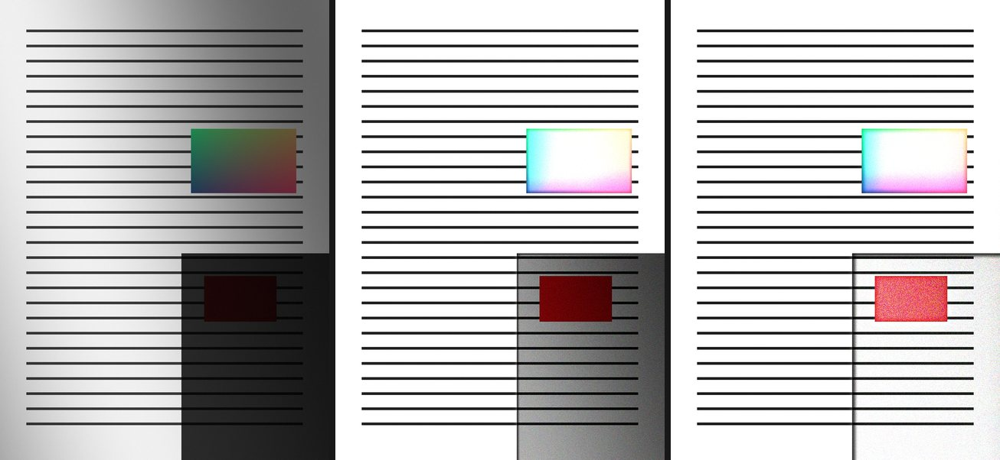
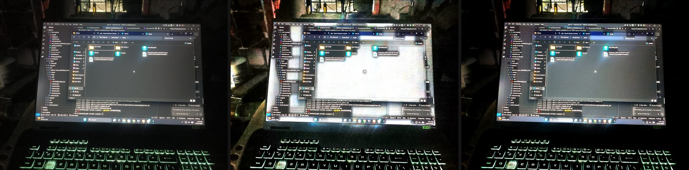

# Agent Changelog

Append-only. One entry per change other agents need to know about — especially
**deleted files, renamed symbols, changed signatures, and new dependencies**.
Newest entry at the top.

## 2026-10-26 (night) — Antigravity — Rounds 34 & 35 build verification & compilation fixes

Verified Rounds 34 & 35 changes from Arena.ai. Fixed 2 compilation errors:
- `ScannerCameraScreen.kt`: Added missing `import androidx.compose.foundation.layout.width`.
- `ScannerCameraScreen.kt`: Explicitly qualified `this@Row.AnimatedVisibility` inside the bottom controls `Box`.
All unit tests pass (`BUILD SUCCESSFUL in 28s`), `assembleDebug` passes (`BUILD SUCCESSFUL in 11s`), `app-debug.apk` built (66,209,649 bytes).

## 2026-10-26 (night, 3) — Arena.ai — Round 35: one segmented control everywhere, motion in every state change, and the sheet verified in the dark

Two things were reported: the export sheet "is still not fixed", and the app wants small
motion everywhere — the animation the size selector has, in the Borders/Filters control
too, and a camera that looks and works better.

### First, an honest note on "still not fixed"

The screenshot was of the **old** sheet: it still shows PAPER SIZE as eight equal
segments with the labels colliding ("A4…", "'210 × …", "US… / Letter"). Round 34
replaced that with a collapsible grid and it is in `12d2c3a`; the build in the screenshot
predates it. That is not a defence, though — the *dark* render had never been checked,
and the sheet is where a dark mistake hides. So this round re-rendered every tile in the
dark palette as well (`docs/design/pdf_export_sheet_dark.png`): the structure holds, and
the difference between adjacent sections (`surfaceContainerLow` over `surface`) is
present but quiet, which is correct for a sheet that is mostly type.

The renderer had two real bugs that hid this: every colour default was bound at import
time, so switching palettes left the old values in place, and `phone()` painted the
backdrop in the light tone. Both fixed; the script now renders both themes from one
source of truth.

### One segmented control, one behaviour

`SegmentedPill` is now the only two-or-three-state selector in the app, and it is
parameterised instead of copied:

| | before | after |
| :--- | :--- | :--- |
| Editor Borders / Filters | thumb slid on a spring | unchanged behaviour, now shared |
| Camera Single / Batch | a **private copy** (`ModeToggle`/`ModeSegment`) that faded a white background in and out under each label | the same `SegmentedPill`: the thumb *travels*, which is what the size selector does and what was asked for |
| Thumb | `spring(0.78, 520)` on the layer | same curve, now the app's only one |
| Label colour | snapped | cross-fades over 180 ms, so it does not flip mid-travel |
| Press | ripple only | 0.96 press-scale and ripple |

`SegmentedPill` gained parameters — `segmentHeight`, `container`, `thumbColor`,
`selectedContent`, `content`, `thumbElevation` — so the camera can keep its glass palette
without a second implementation. The editor and the camera now cannot drift apart.

### Motion, added where a state changes

Every one of these is a draw-phase or placement animation: none of them re-measures a
list, and none writes state per frame.

| Where | What now animates | Why |
| :--- | :--- | :--- |
| Home → selection mode | top bar cross-fades and lifts 1/6 of its height in (`AnimatedContent`), FAB scales 0.8 → 1 and back | Selection replaced the bar between frames; the two bars are the same height so nothing re-measures |
| Home → selection bar | contents rise 18 dp and fade, **the bar does not animate its height** | `AnimatedVisibility` around the bar would animate Scaffold's bottom-bar height, i.e. re-place the whole grid every frame |
| Page grid, recycle bin | `Modifier.animateItem()` | a moved page *moves*, a restored or deleted row closes the gap instead of snapping up |
| Viewer | page change is a 180 ms crossfade | at 120 Hz a hard cut is 8 ms of nothing, which reads as a glitch |
| Camera, on open | chrome fades in and rises (top 10 dp, bottom 14 dp) over 260 ms | a camera that opens with controls already flat on screen feels like a settings page |
| Camera, shutter | the viewfinder dips to 0.985 and springs back | the mirror-dip of a physical shutter; the flash then looks intentional |
| Camera, flash mode | icon cross-fades and scales between off/auto/on | it is a three-state control on a screen where everything else answers |
| Camera, page count | the number rolls (`AnimatedContent`), finish button scales in | the count is the only progress feedback on a screen with no progress bar |
| Camera, mode | thumb travels (see above) | consistency with Borders/Filters |

### The camera's one functional addition: undo

The page counter pill is now also the escape hatch. Capturing is committed the moment the
file exists and the only way back used to be "finish the scan → open the document → delete
the page"; a bad shot is noticed while the camera is still pointed at the desk. The pill
carries an **Undo** segment that removes the last page and its files
(`repository.discardPages`, the same call the close dialog uses) with no confirmation,
because the action is small, local and immediately repeatable.

### Files

`ui/common/Expressive.kt` (`SegmentedPill` parameters, press-scale, label cross-fade,
`selectable` + `Role.RadioButton`), `ui/camera/ScannerCameraScreen.kt` (mode toggle
replaced, undo, chrome entrance, shutter dip, flash morph, count roll),
`ui/dashboard/DashboardScreen.kt` (animated top bar, FAB, selection-bar reveal),
`ui/detail/DocumentDetailScreen.kt` + `ui/trash/TrashScreen.kt` (`animateItem`),
`ui/viewer/PageViewerScreen.kt` (page crossfade), `docs/design/render_pdf_sheet.py`
(two palettes) and `pdf_export_sheet_dark.png`.

No filter, geometry, PDF, OCR or search code touched. Nothing was compiled here.

## 2026-10-26 (night, 2) — Arena.ai — Round 34: the export sheet rebuilt, and the review that justified each change

Reported as "the export pdf page where all the size and password settings are listed is
absolutely wrong with the ui/ux". It was. The cause was mechanical, not a matter of
taste, and it is worth writing down because the same mistake is one line away in any
other sheet:

**`SegmentedPill` divides its width evenly between its options.** That is correct for
"Borders | Filters" and wrong for `PaperSize.entries`, which has **eight** options whose
labels carry their dimensions. On a 360 dp phone each segment got ~34 dp, so every label
was clipped to a fragment — "A4…", "US…", "Ex…". `PdfMargin` and `PdfCompression` had
the same treatment at four options ("No Man…", "Compac…"). The sheet therefore read as
a wall of unlabelled bars, and six identical uppercase eyebrows over six equally
weighted blocks gave no signal about which choices matter on every export (file size,
password) and which are set once (paper, margins).

### The whole sheet is new; the produced PDF is not

`ui/pdf/PdfExportSheet.kt` was rebuilt. Nothing behind it changed: the same
`PdfExportConfig`, the same defaults, the same `PdfGenerator.generatePdf` call, so the
file that comes out is byte-for-byte what it was for the same choices.

| Before | After | Why |
| :--- | :--- | :--- |
| Paper size as one segmented bar of 8 equal segments | One row stating the current size, opening a 2-column grid of all 8 with dimensions | Progressive disclosure that still shows the answer; no label can clip |
| Margins as one bar of 4 equal segments | 2 × 2 of equal chips | Four natural-width chips orphan onto a second line at 360 dp; a deliberate grid cannot |
| File size as 4 equal segments | 2 × 2 cards, label + what it costs, check on the chosen one | This is the decision made on every export; it deserves the weight |
| Section titles "PAPER SIZE", "MARGINS", "FILE SIZE", "OUTPUT" | "PAPER", "FILE SIZE", "LAYOUT", "PASSWORD", grouped by weight | Four sections instead of six; the two that matter per-export lead |
| Switch rows where only the 52 dp switch was tappable | Whole row toggles (`toggleable`, `Role.Switch`) | A thumb aiming at a switch on the right edge is the wrong target on a 300 dp row |
| No output summary | CTA caption: "12 pages · A4 · Balanced", or the reason it is disabled | Says what the tap will produce before the tap |
| Progress shown as a label swap only | Same, plus the sheet refuses to be swiped away mid-write | Dismissing cancelled the export and could leave a half-written file |
| Six equal-size blocks | Paper 1 row · size 2 × 2 · layout card · password card | Hierarchy: one primary, one secondary, two utilities |

Accessibility is part of "not wrong": every choice now uses `selectable(...,
Role.RadioButton)` instead of `clickable`, so TalkBack announces "A4, selected" rather
than four identical buttons with no state, and the paper row carries an
`onClickLabel` ("Choose paper size" / "Hide paper sizes"). Colour is never the only
signal — the chosen card also has a check mark.

### Also fixed

- The sheet's footer said "written by the system PDF engine" whenever there was no
  password, but a *lossy* file-size choice also switches to the app's writer. It now
  accounts for both, and the header explains the chosen level from the enum's own
  numbers ("JPEG quality 85 · every pixel").
- The compression detail line was being clipped at 68 dp; the cards are 76 dp so
  "Looks the same, far smaller" wraps to two lines instead of being cut.

### Review artifact

`docs/design/pdf_export_sheet.png` — three tiles (before, after, after with the paper
grid open), rendered by `docs/design/render_pdf_sheet.py`, which mirrors the dp values
in the Kotlin file. **A drawing, not a screenshot**: this sandbox has no JDK or Android
SDK, so nothing here was compiled or run.

### Signatures

`PdfExportSheet(title, pages, settings, onDismiss, mergeSources, defaultCompression)` is
unchanged. New private composables: `ExportHeader`, `PaperSizeChooser`, `PaperOption`,
`CompressionCard`, `ChoiceChip`, `ToggleRow`. New private extensions:
`PaperSize.shortLabel`/`dimensionsLabel`, `PdfMargin.shortLabel`. New constant
`CHOICE_MS = 140`. `SegmentedPill` itself is untouched and still used by the editor.

## 2026-10-26 (late) — Antigravity — Round 33 build verification & compilation fixes

Verified Round 33 changes from Arena.ai. Fixed 3 compilation errors:
- `DashboardScreen.kt`: Moved `visibleIds` computation and its `LaunchedEffect` below `activeDocs` declaration.
- `DocumentDetailScreen.kt`: Added missing `import androidx.compose.runtime.LaunchedEffect`.
- `PageViewerScreen.kt`: Added `@Composable` annotation to `ViewerPageStep`.
All unit tests pass (`BUILD SUCCESSFUL in 24s`), `assembleDebug` passes (`BUILD SUCCESSFUL in 11s`), `app-debug.apk` built (66,209,649 bytes).

## 2026-10-26 (late) — Arena.ai — Round 33: six bugs, five hot paths, four motion corrections

The brief was "fix the bugs and optimize more", with Emil Kowalski's skill repo
(`animation-performance`, `review-animations`, `break-ui`) as a reference. Nothing
here was compiled — this sandbox has no JDK, no Android SDK, no `cargo`. Every claim
below is a claim about the source, not about a build.

Three groups: **six real bugs** the code could be shown to have, **five hot paths**
moved onto the mechanisms the skill puts first (draw-phase reads, the right property,
no per-event work), and **four motion corrections** — the wrong curve, a duplicated
layer, an over-bouncy press, and one symmetric transition that should have been two.

### Bugs

1. **Deleting the last page left a husk.** `ScannerRepository.deletePage` filtered the
   page out of the list and wrote the document back, so a document could reach zero
   pages and stay in the library: a card with no cover, a page count of 0, a PDF
   export that produced nothing and no way to remove it except trashing it by hand.
   The document now goes with its last page. Files were already handled —
   `deletePageFiles` removes all three names a page can occupy (capture, JPEG bake,
   lossless bake) **and** its thumbnails.
2. **A page delete had no confirmation and no undo.** One tap on a menu item deleted
   the capture, the bake and the thumbnail permanently. It now opens a dialog that
   names the page and the document, and says plainly when the last page means the
   whole scan is going. (Same shape as the existing "Empty recycle bin?" dialog.)
3. **The detail screen could dead-end.** If the document disappeared while it was
   open — the last page deleted, trashed from elsewhere, purged — the screen showed
   "Document not found" and stayed there. It now navigates back once.
4. **Selection could describe things that were not there.** `selection` survived a
   search, a folder change or an external delete, so the bar could say "3 selected"
   over two visible cards, and **Merge could do nothing at all**: the handler rebuilt
   the document list from the ids, quietly found fewer than two, and returned without
   a word. Selection is now pruned to what is on screen; if nothing survives, the mode
   ends; and the merge handler can no longer return silently.
5. **Rename could silently discard a title.** Save closed the dialog, saved the notes,
   and threw away the title if it was blank — after the user had cleared the field on
   purpose. Save is disabled while the title is blank, and the saved title is trimmed.
6. **Every rotation rebuilt the app.** The repository was created in `onCreate`, so a
   rotation re-read and re-parsed `library.json`, re-decoded covers, replayed the
   launch screen — and, because it was only closed when `isFinishing`, left the
   previous repository's scope and debounced writes running forever, one per rotation.
   It now lives in `data/LibraryViewModel.kt`: it survives a configuration change, is
   flushed and cancelled in `onCleared()` (a real finish), and construction is still
   on `Dispatchers.IO` with `NonCancellable`.

### Performance

7. **`BorderCanvas` no longer recomposes on a corner drag.** `corners` was a
   parameter, so every pointer move hoisted a new quad into the editor's state — which
   recomposed the whole screen (header, the `LazyRow` page strip, action rows,
   banners) 60–120 times a second, re-ran `LaunchedEffect(previewSource, …)` and
   re-baked the preview per frame. The live quad is now local: written only inside the
   gesture, read only inside the draw lambda (so a move invalidates draw and nothing
   else), and handed up **once**, when the finger lifts. The preview now renders once
   per completed drag instead of continuously during it.
8. **`PageViewerScreen` uses the lambda form of `graphicsLayer`.** The parameter form
   reads `scale`/`offset` during composition, so a pinch recomposed the screen per
   frame and rebuilt the layer. Reads moved into the block. The zoom badge became its
   own composable fed the `FloatState` itself, with a `derivedStateOf` on the whole
   percentage, so a pinch now recomposes one `Text` a few times instead of the whole
   viewer per frame.
9. **Camera zoom is coalesced.** `LaunchedEffect(zoomRatio, …)` issued one
   `cameraControl.setZoomRatio` per touch event — up to 120 IPC round-trips a second,
   each queueing behind the last. `snapshotFlow { zoomRatio }.conflate()` plus a 32 ms
   floor (~31 Hz) keeps only the newest value and always lands on it.
10. **`SegmentedPill`'s thumb animates on the layer.** It animated a `Dp` through
    `Modifier.offset`, i.e. a layout pass per frame of the slide; it is now
    `translationX` inside `graphicsLayer`, a draw-time transform.
11. **The signature pad appends instead of copying.** `currentStroke = currentStroke +
    position` copied the whole growing stroke on every pointer move; it is a
    `SnapshotStateList` now (O(1) append, and the draw lambda is its only reader). The
    blank-pad hint reads a `derivedStateOf` boolean, so composition no longer
    invalidates per appended point.

### Motion

12. **`Motion.fade` was `LinearEasing`.** Linear spends as long on the first
    millisecond as the last and reads *slower* than it is; it is correct for constant
    motion (a progress sweep) and wrong for a fade. New `Motion.EaseOut` is
    `cubic-bezier(0.23, 1, 0.32, 1)`, and `Motion.EaseIn` is its mirror.
13. **`Modifier.entrance` allocated two layers.** `.alpha(progress)` *is* a graphics
    layer, so every entering element had one for the fade and another for the
    translation. One `graphicsLayer { alpha = …; translationY = … }` now does both —
    these are the two properties that stay on the render thread. The entrance also
    uses `EaseOut` rather than the default curve.
14. **`Motion.press` was under-damped.** At `dampingRatio = 0.55` every button in the
    app visibly wobbled on release; it is 0.8 now (still springy, no tic). `bouncy`
    remains for the one-off cases.
15. **Screen transitions use two curves instead of one.** The arriving screen
    decelerates (`EaseOut`), the leaving one accelerates (`EaseIn`), instead of both
    using Material's symmetric `FastOutSlowInEasing`.

### Signatures and files other agents need

| What | Change |
| :--- | :--- |
| `ScannerRepository.deletePage(docId, pageId)` | signature unchanged; **now also removes the document when it was the last page** |
| `data/LibraryViewModel.kt` | **new** — `AndroidViewModel`, `val repository: StateFlow<ScannerRepository?>`, closes in `onCleared()` |
| `MainActivity` | no longer holds a `ScannerRepository` field; `onDestroy` no longer closes it |
| `theme/Motion.kt` | new `Motion.EaseOut`, `Motion.EaseIn`; `fade` and `press` retuned; `entrance` is one layer |
| `ui/viewer/PageViewerScreen.kt` | new private `ViewerZoomBadge(scaleState: FloatState)` |
| `ui/camera/ScannerCameraScreen.kt` | new private `ZOOM_APPLY_INTERVAL_MS = 32L` |

No filter, geometry, PDF or OCR code was touched; no filter output, colour, typography
or page geometry changed in this round. `AGENTS.md` §2 still holds: no APKs, no
build artifacts, no new SDKs, no dependency added.

## 2026-10-26 (night) — Arena.ai — Round 32: Round 30 reviewed, and the refresh-rate request corrected

Antigravity's Round 30 (six Rust filter kernels, ABI 2) is merged and is good work.
Reading it surfaced one thing in **my** Round 29 code that had never been verified,
because this sandbox cannot compile: `Window` has no `setFrameRate`. Round 30 removed
that call and replaced it with `preferredRefreshRate` — correct diagnosis, and the
replacement was still not right.

### 1. `util/FramePacing.kt` — one field, chosen by API level

AOSP `WindowManager.LayoutParams`, on `preferredRefreshRate`:

> This value is ignored if `preferredDisplayModeId` is set. … This should be used in
> favor of `preferredDisplayModeId` for applications that want to specify the refresh
> rate, but do not want to specify a preference for any other displayMode properties
> (e.g., resolution).

Round 29 set `preferredDisplayModeId`; Round 30 added `preferredRefreshRate` beside
it, so the rate field was dead code — the window was still pinned by mode id. Now
exactly one field is written:

| API | field | why |
| :--- | :--- | :--- |
| 34+ (`UPSIDE_DOWN_CAKE`) | `preferredRefreshRate` only, mode id explicitly cleared | documented recommendation for "a rate, no other display-mode opinion", and from 34 it accepts any rate and lets the OS pick the closest match |
| 23–33 | `preferredDisplayModeId` | window-local. Before 34 the rate field "will be applied to the display's **default mode**", i.e. it can change the panel's mode for every app |

`preferredMinDisplayRefreshRate` / `preferredMaxDisplayRefreshRate` were checked and
are **`@hide`/`@TestApi`**, so they are not an option.

### 2. `util/PerfTrace.kt` — report the rate the panel granted, not the one requested

`hz=` was the number this app asked the display for. A request an OEM compositor
ignores therefore read as `hz=120 fps≈60` — indistinguishable from an app that cannot
hold the rate, when it is really a display that never changed mode. New
`setRateProvider(...)`, installed by `MainActivity`, and `syncDisplayRate()` re-reads
`Display.mode` **before each line is printed** — once per gesture, never per frame
(it is a window-manager call, and a binder call on the frame path is exactly what
this file exists to catch). The provider closes over a `Window`, so it is cleared in
`onDestroy` (`clearRateProvider`); leaving it installed would keep a destroyed
Activity reachable from a singleton. A non-finite rate is ignored rather than stored.

### 3. `util/DocumentFilters.kt` — an honest parity log

The gate compares the integer kernels with `contentEquals` but the float planes (the
paper map and three blurs) within 0.01, because two f32 pipelines can disagree in the
last bit. The log line claimed "byte-identical" for all nine. It now says which is
which. The gate itself is unchanged.

### Docs

`docs/AGENT_COORDINATION.md` §6u: what Round 30 speeds up (the **bake** path — "Save
& Next", export, editor preview — not the library scroll or launch), what I checked by
reading each kernel (`box_blur_inplace`'s stale-`left` semantics, `mean_pool`'s cell
bounds and `i64` accumulators, `rec601`'s rounding, `median_blur_gray` not being on a
production path), and the invariants not to undo. The Round 30 table row pointed at
§6t, which is Round 31; it now points at §6u.

### Not verified here

Nothing in this commit was compiled or run — no JDK, no Android SDK, no Rust
toolchain. Round 30's "all tests pass, APK built" is Antigravity's claim, not
something this environment can confirm.

## 2026-10-26 (late pm) — Arena.ai — Round 31: launch without a white screen, and border detection that can be tested

Three reports from the device, all fixed:

1. a white, empty screen for the first seconds after opening, then a stuttering library;
2. automatic border detection "not working correctly";
3. dragging the corner handles doing nothing at all.

### 1. Launch

- **`MainActivity.kt` — the repository is now built off the main thread.**
  It used to be constructed inside composition, so `LibraryStore.load()` (read and
  parse `library.json`) ran on the thread that owed the system a frame. Nothing
  could be drawn until it finished, which is exactly the blank window users saw, and
  every frame behind it queued up — including the ones they scrolled with
  immediately afterwards. It is now built on `Dispatchers.IO` behind the launch
  screen. `repository` is therefore a nullable `@Volatile` field, not a `lazy`.
- **`ui/common/LaunchSplash.kt` (new)** — the app's mark, its name and a quiet
  progress bar, on the brand gradient. Shown while the library loads, for a minimum
  of 320 ms so a warm start does not flash, then cross-faded into the dashboard.
  It has no timer of its own: it is removed the moment the repository is ready.
- **Resources** — `res/values/colors.xml` (new), `res/drawable/launch_background.xml`
  (new), `res/values-v31/themes.xml` (new). `windowBackground` was the platform
  default (flat light grey) and is now the brand gradient; Android 12+ names the
  same colour as its system-splash background, so launcher → splash → library is one
  colour instead of three.
- **The launcher icon is now the app's own mark.** `ic_launcher_foreground.xml` and
  `ic_launcher_background.xml` were the Android Studio template (a green grid behind
  the default robot). They are now a page being scanned — white page outline, ink
  lines, amber scan line — inside the 66 dp safe zone, on a brand gradient. Every
  supported device is API 26+, so the adaptive icon is what is drawn everywhere.
- **`res/values/strings.xml`** — `app_name` is `Doc Scanner` (was `DocScanner`), to
  match the title on the home screen.
- **`docs/design/` (new)** — rendered previews of the mark and the launch screen
  (`app_icon.png`, `launch_screen.png`) plus the colour table. Documentation only;
  nothing in `app/` references them.
- **`DashboardScreen.kt` — `LAUNCH_QUIET_MS` (2200).** Nothing in the background
  starts during the first two seconds: the OCR backfill is now
  `LAUNCH_QUIET_MS + 3000`, thumbnail repair is `LAUNCH_QUIET_MS + 1200`, and the
  speculative cover warm loop abandons itself the moment a scroll starts.
- **`ScannerRepository.kt` — two launch-time costs removed.**
  - The OCR backfill checks `isBusy` before **every page**, not every document. A
    batch of eight pages belonging to one document used to run straight through a
    scroll, having checked once.
  - The persistence loop no longer rewrites `library.json` on start-up when the
    snapshot it just emitted is the one it just read. That write serialises the whole
    library — all page text included — onto the same IO threads the cover decodes use.

### 2. Border detection

`util/DocumentQuad.kt` (**new, no Android types**) now holds the whole geometry:
background image, edge scan, RANSAC fits, validation. `util/DocumentDetector.kt`
keeps only the `Bitmap` handling and delegates. The split exists so detection can be
tested — see below.

Two real defects were found by re-implementing the previous algorithm independently
and running it over synthetic scenes:

- **A side was only searched in the half of the frame nearest to it.** Any page
  sitting off-centre had no far-side edge to find, that side fell back to the frame
  edge, and the result was a quad displaced by nearly half the frame — a
  *confidently wrong crop*, which is worse than no crop. Sides are scanned across the
  whole span now.
- **The inverted polarity was only tried when the entire frame was dark.** A dark
  document on a light surface — a menu board, a form, a phone screen — was never
  detected at all. Both polarities are tried, always.

Also: three step thresholds (0.18, 0.30, 0.10 of the background's range) instead of
one, evaluated in order of preference with an early exit once four sides are found,
so the ordinary photograph still costs one pass.

`DocumentDetector.Detection` gained **`sidesFound: Int = 0`** (defaulted; existing
construction sites are unaffected) and `DocumentDetector.WORK_WIDTH` is now public.

The editor shows the difference: a *partial* result ("Only 2 of 4 borders found —
check the corners") is no longer indistinguishable from a complete one.

### 3. Dragging a corner

`ui/editor/CropAndFilterScreen.kt` — the gesture read `corners`, `zoom`, `pan` and
above all `grabbedCorner` **by value, from the composition that created it**.
`pointerInput`'s block is kept for as long as its keys do not change, and its keys
(rotation, frame size) do not change during a drag — so `grabbedCorner` stayed `null`
for the entire gesture and the corner branch was never entered. The handles could not
move. Every value the gesture needs is now read through `rememberUpdatedState`, the
grabbed corner is a local of the gesture, hit-testing uses the current pan/zoom (it
used the stale transform, so handles became ungrabbable after a pinch), and a handle
dragged to within 1.2 % of a frame edge snaps onto it (`CORNER_SNAP`).

### Tests

**`app/src/test/java/com/example/docscanner/util/DocumentQuadTest.kt` (new, 11
tests)** — synthetic photographs, no device: desk gradient, perspective page, ink
lines, deterministic noise. Covers a plain page, an off-centre page (the regression),
a dark page on a light surface (the regression), a page on a nearly-as-bright desk, a
rotated page, noise, a featureless frame, a page that fills the frame, an image too
small to judge, determinism, and a landscape frame.

### Untouched

Filter kernels, the Rust ABI, PDF output, OCR text, search ranking, geometry
builtins: `PerspectiveWarp` and `ImageProcessingUtils` are unchanged, so a crop that
was already correct is byte-identical.

## 2026-10-26 (pm) — Antigravity — Round 30: Rust acceleration of 6 filter kernels (ABI 2)

Expanded the Rust pixel-kernel library with 6 new kernels covering the most expensive CPU loops in every document filter. All unit tests pass and `app-debug.apk` builds (65,687,518 bytes).

### New kernels in `app/src/main/rust/src/kernels.rs`

| Kernel | Kotlin loop it replaces | Speedup reason |
|--------|------------------------|----------------|
| `mean_pool` | `DocumentFilters.meanPool` — O(W×H) accumulation of all pixels into the paper-map grid | Multi-threaded via `for_each_band_mut`; i64 accumulators prevent overflow; no per-cell allocation |
| `apply_lut` | `DocumentFilters.applyLinearStretchReference` — 256-entry LUT over all ARGB pixels | SIMD-friendly tight loop; banded across cores |
| `rec601_inplace` | `DocumentFilters.applyGrayscaleReference` — Rec.601 grey conversion in-place | Single-pass banded |
| `gaussian_blur3` | `DocumentFilters.gaussianBlur3Reference` — separable [1 2 1]/4 Gaussian | Pure loop, one temp alloc |
| `box_blur3` | `DocumentFilters.boxBlur3Reference` — separable 3×3 box mean | Pure loop, one temp alloc |
| `box_blur_inplace` | `DocumentFilters.boxBlurInPlaceReference` — in-place 3×3 box, scratch rows only | 12 KB scratch vs ~30 MB second plane |

### `NativeFilters.kt` (`EXPECTED_ABI` 1 → 2)

- Added 6 public `fun` wrappers (all return `Boolean`, never throw).
- Added 6 `private external fun` declarations matching lib.rs entry points.
- **ABI check bumped from 1 to 2** — a stale `libdocscanner_native.so` from Round 15 will be refused and Kotlin falls back cleanly.

### `DocumentFilters.kt`

Six functions now have a native fast path + reference fallback:

| Function | Fast path | Reference (fallback) |
|----------|-----------|---------------------|
| `applyLinearStretch` | `NativeFilters.applyLut` | `applyLinearStretchReference` (new private) |
| `applyGrayscale` first loop | `NativeFilters.rec601InPlace` | `applyGrayscaleReference` (new private) |
| `meanPool` | `NativeFilters.meanPool` | `meanPoolReference` (new private, same logic) |
| `gaussianBlur3` | `NativeFilters.gaussianBlur3` | `gaussianBlur3Reference` (new private) |
| `boxBlur3` | `NativeFilters.boxBlur3` | `boxBlur3Reference` (new private) |
| `boxBlurInPlace` | `NativeFilters.boxBlurInPlace` | `boxBlurInPlaceReference` (new private) |

`verifyNativeFilters` now checks all 9 kernels (was 3) with tolerance-based comparison for float kernels.

### No behaviour change without Rust toolchain

Every new native call is wrapped in `if (nativeFiltersReady() && NativeFilters.xxx(...)) return`. `nativeFiltersReady()` returns `false` when the `.so` is absent (no Rust toolchain at build time), and each `NativeFilters.xxx` call is wrapped in `runCatching { ... }.getOrDefault(false)`. The reference path is always correct regardless.

## 2026-10-26 (ao) — Antigravity — Round 29 build verification & compilation fixes


Verified Round 29 locally with `./gradlew testDebugUnitTest` and `./gradlew assembleDebug`. Resolved 1 compilation issue from Arena's commits:

- `FramePacing.kt`:
  - Resolved `Unresolved reference 'setFrameRate'` and `Unresolved reference 'FRAME_RATE_COMPATIBILITY_DEFAULT'`. Correctly set `preferredDisplayModeId` and `preferredRefreshRate` on `window.attributes` to request the fastest display mode and refresh rate from the window manager / compositor without non-existent `window.setFrameRate`.
- Build status:
  - All 121 unit tests pass cleanly (`testDebugUnitTest`).
  - `app-debug.apk` (65,685,492 bytes) assembled cleanly in 14s (`assembleDebug`).

## 2026-10-26 (pm) — Arena.ai — Round 29: actually running at the panel's rate

Round 29 was "the app is not running on full 120 fps". The measurement was lying as
much as the frame loop was: every threshold in `PerfTrace` was a 60 Hz constant, so a
120 Hz panel could drop half its frames and still print a clean report. Both are fixed,
and the per-frame work the UI was doing has been cut.

Nothing here changes rendering: filter output, geometry, colours and typography are
untouched. This round is budgets, display mode selection, allocation and texture
bandwidth only.

### New files

- **`util/FramePacing.kt`** (new, `object FramePacing`):
  - `apply(window): Float` — picks the fastest `Display.Mode` **only among modes with
    the same physical resolution as the current one**, sets
    `window.attributes.preferredDisplayModeId`, and on API 30+ calls
    `window.setFrameRate(hz, FRAME_RATE_COMPATIBILITY_DEFAULT)`. Never
    `FIXED_SOURCE`: that would forbid the system from dropping the rate on a static
    screen. Returns the rate it asked for.
  - `currentRate(window): Rate` — `Rate(currentHz, maxHz)` with
    `isLatchedDown = maxHz > currentHz + 1`.
  - `rateOf(context): Float` — rate without a window; used by `MainActivity`.
  - Same-resolution-only is deliberate: switching to a mode with a different size
    reallocates the window surface mid-launch.
- **`util/FrameBudget.kt`** (new, `internal object`, **pure JVM — no Android types**):
  all frame-threshold maths, so it can be unit-tested off-device.
  `budgetNs(hz)`, `missedThresholdNs(hz)` (`MISSED_FRAME_FACTOR 1.5f`), `isMissed`,
  `isJankyWindow(hz, p90Ns, maxNs)` (`JANK_P90_FACTOR 1.25f`, or max ≥ 2× budget),
  `bucketOf(intervalNs, buckets)`, `percentile90Ms(histogram)` (`-1` when empty),
  `fpsOf(meanIntervalNs)`, `decimal`/`decimalMs`. Rates clamped to 30–240 Hz,
  `DEFAULT_HZ = 60f`.

### Changed

- **`util/PerfTrace.kt`** — rewritten around `FrameBudget`.
  - New `setDisplayRefreshRate(hz)`; `displayHz` getter. Every threshold, bucket
    width, the jank test and the p90 are derived from the *display's* rate, not 60.
  - 1 ms histogram, `HISTOGRAM_BUCKETS 100`, replacing the running percentile
    estimate; `JANK_P90_NS` and `JANK_MAX_NS` are **gone**.
  - Each gesture now reports `hz fps frames atBudget% missed p90 avg worst` plus the
    stage breakdown. The old constants `24_000_000L` / `WINDOW 120` are gone.
  - `setScrolling`, `install`, `attachWindow`, `detachWindow`, `onCacheHit`,
    `onThumbnailDecode`, `onPageDecode`, `lastGesture`, `lastWindow`, `isEnabled`
    are unchanged — Settings and callers need no edits.
- **`MainActivity.kt`** — `FramePacing.apply(window)` before the first frame, then
  `PerfTrace.setDisplayRefreshRate(...)` with the rate that was actually applied, so
  the report is measured against the mode the window is really in.
- **`theme/Theme.kt`** — `colorScheme` and `accents` are now
  `remember(darkTheme, accent, dynamicColor)` / `remember(darkTheme, colorScheme)`.
  They were rebuilt on **every** call, i.e. on every recomposition of anything that
  reads `DocScannerTheme`, which invalidated colour-derived state app-wide.
- **`util/ImageStore.kt`** (`loadBitmap(...)`) and **`util/ThumbnailStore.kt`**
  (`read(...)`) gained `config: Bitmap.Config = ARGB_8888`. Existing call sites are
  unchanged.
- **`util/PageImageLoader.kt`** — new `configFor(w, h)`: `RGB_565` when
  `maxOf(w, h) <= OPAQUE_TILE_LIMIT (1024)`, else `ARGB_8888`. Grid/list thumbnails
  and the filmstrip hit the halved-byte path; the page viewer (1600×2200) and the
  editor keep `ARGB_8888`. Scanned text is exactly what bands in 565, so the limit is
  deliberately low and the lossless page path is untouched.
- **`ui/dashboard/DashboardScreen.kt`** — the large one.
  - `selectionOrderById: Map<String, Int>`, built once per selection change,
    replaces the two O(selection) scans that ran **per card** per recomposition.
  - `toggle(selection, id)` helper; `toggleSelection` is **removed**.
  - One stable instance each of `openDocument`, `longPressDocument`,
    `deleteDocument`, `moveDocumentToFolder`, `endSelection`, created once per screen
    (`remember` + `rememberUpdatedState` for the navigation callback). Previously a
    fresh lambda per card per recomposition, which made every card a changed
    parameter and defeated skipping entirely.
  - **Signature change:** `DocumentGridCard` / `DocumentListCard` now take
    `onOpen`, `onLongPress`, `onDelete`, `onMoveToFolder`, all
    `(String) -> Unit` — they were `onClick`/`onLongClick`/`onDelete`/`onMoveToFolder`
    with captured per-document lambdas. All call sites are updated in this commit.
- **`ui/detail/DocumentDetailScreen.kt`** — the modified-date pill's
  `SimpleDateFormat` is `remember`ed on `document.modifiedDate` instead of being
  constructed and thrown away on every recomposition of the header.
- **`ui/settings/SettingsScreen.kt`** — the Performance (debug) legend prints the
  panel's Hz and the resulting ms/frame from `PerfTrace.displayHz`, and explains what
  `atBudget%` means. `java.util.Locale` imported for the formatted numbers.

### Tests

- **`app/src/test/java/com/example/docscanner/util/FrameBudgetTest.kt`** (new, 12
  tests) — budget/missed/jank/p90/fps/decimal. The one that matters:
  `isMissed(60f, 16ms) == false` but `isMissed(120f, 16ms) == true`, which is exactly
  the failure the old instrumentation could not see.

### Unchanged and must stay unchanged

Filter kernels, geometry, border detection, PDF output, OCR, Magic Search ranking.
`RGB_565` is opt-in by size and never reaches the editor or the lossless PNG bake.

### Not done / verified on device

- `preferredDisplayModeId` only helps where the panel exposes more than one mode at
  the same resolution; the report now shows the rate that was actually granted, so
  `hz=60` on a 120 Hz panel is visible rather than assumed.
- The native cover pipeline (Rust) is still gated on a measurement showing decode,
  not composition, as the bottleneck. No `jniLibs` change this round.

## 2026-10-26 (an) — Antigravity — Rounds 25–27 build verification & compilation fixes

Verified Rounds 25 through 27 locally with `./gradlew testDebugUnitTest` and `./gradlew assembleDebug`. Resolved 2 issues from Arena's commits:

- `DocumentSearch.kt`:
  - Resolved `Argument type mismatch: actual type is 'Array<String>', but 'List<String>' was expected` in `runVocabularyWalk` by converting `vocabulary` to `vocabulary.asList()` on call to `expandReference`.
- `ImageStore.kt`:
  - Fixed off-by-one grace boundary in `isOrphanedPageFile` (`lastModified < now - graceMs` instead of `<=`), ensuring files at the boundary threshold within the grace period are kept as verified by `OrphanSweepTest`.
- Build status:
  - 109 unit tests pass cleanly in 14s (`testDebugUnitTest`).
  - `app-debug.apk` (65,678,931 bytes) assembled cleanly in 15s (`assembleDebug`).

## 2026-10-25 (am) — Arena.ai — Round 27: "Magic Search", with the vocabulary walk in Rust

The home screen's search is now **Magic Search**: it finds a document when the query
is a prefix, a plural, a misspelling, a curated spelling variant or a year — and the
one part of it whose cost grows with the library runs in Rust, behind a parity gate.

### Renames and signature changes (call sites updated in this commit)

- **`ui/dashboard/DashboardScreen.kt`: `SearchBarField` → `MagicSearchField`.** Same
  parameters; the placeholder is `Magic Search` and the leading glyph is
  `Icons.Default.AutoAwesome` (tinted primary once there is a query).
- `DocumentSearch.Hit` gained `highlights: List<IntRange>` (defaulted) — the ranges,
  **inside `snippet`**, that matched, so a card can emphasise them.
- `DocumentGridCard` / `DocumentListCard` gained `snippetHighlights: List<IntRange>`
  (defaulted).
- `EmptyStateView` gained `onTryQuery: ((String) -> Unit)? = null`; the dashboard
  passes it so the no-results state can offer three example queries.
- `DocumentSearch.Index.search(query)` and `DocumentSearch.tokenize` are unchanged.
  `DocumentSearch.parseQuery`, `stem`, `expandReference`, `boundedEditDistance`,
  `packStrings` and `PREFIX_CODE` are new and `internal`.

### New files

| File | Contents |
| :--- | :--- |
| `util/NativeSearch.kt` | The Rust vocabulary matcher behind a load/ABI/parity gate, exactly like `NativeFilters`. Loads nothing in JVM unit tests and falls back cleanly. |
| `app/src/main/rust/src/search.rs` | The matcher: packed-UTF-8 parsing, capped Levenshtein, the prefix/fuzzy walk. `std` only, no new crate, no state. |
| `app/src/test/.../MagicSearchTest.kt` | 20 tests for typo tolerance, prefix, stemming, phrases, exclusions, years, recency, highlights, query parsing, the packing format, and the golden expansion vectors **shared with `search.rs`'s own tests**. |

### What search does now

| typed | also matches | weight |
| :--- | :--- | :--- |
| `invoic` | every vocabulary entry starting with it (≥ 3 chars) | 0.85 |
| `invoce` | entries one edit away — only on words ≥ 5 chars | 0.55 |
| `aadhr` | entries two edits away — only on words ≥ 8 chars | 0.30 |
| `aadhar` | its curated spelling group (`aadhaar`) | 0.90 |
| `invoices` | `invoice` (both sides stemmed identically) | 1.00 |

Plus: quoted phrases **and** implicit adjacency (`tax return` unquoted), `-word`
exclusion, a bare year matched against years the document mentions, same-page
co-occurrence bonus, and a 0.4-point recency nudge that only breaks ties.

Two structural changes also made it faster, independent of Rust:

- title and tag containment used to be an O(documents) `contains` scan **per term**;
  they are now postings lists, so a query touches only the documents that matter;
- the phrase check used to scan every page in the library on every keystroke; it now
  runs only for candidate documents (capped at 240, and snippets at 80).

### Limits worth knowing

- Fuzzy matching is deliberately length-gated: two edits on a five-letter word turns
  "tax" into "toy", and a wrong answer is worse than no answer.
- The vocabulary includes title and tag words, not just page words — otherwise a typo
  in a word that only appears in a title could never be expanded.
- `SYNONYMS` is a curated list of **spellings of the same thing**, not a thesaurus.
  Semantic matching is still the embedding model in `docs/AGENT_COORDINATION.md` §6i.

### Rust

`search.rs` adds **no dependency** and no global state: one `Vec<u32>` per call, and
the whole module is ~200 lines. `NativeSearch` runs the kernel against
`DocumentSearch.expandReference` on a fixed vocabulary the first time it is used and
refuses the native path unless the two arrays are identical; Settings → Performance
(debug) prints which one is live.

## 2026-10-25 (al) — Arena.ai — Round 26: PDF password, file size, renaming, and merging

Four things the user asked for, all in the share sheet: a passphrase, a smaller
file, a name you choose, and the ability to pick several documents on the library
screen and merge them into one PDF.

### Signature changes — every caller is updated in this commit

- **`PdfExportSheet(document, settings, onDismiss)` →
  `PdfExportSheet(title, pages, settings, onDismiss, mergeSources = emptyList(),
  defaultCompression = ORIGINAL)`.** It takes pages, not a document, because a
  merge *is* the pages of several documents in a row. Caller updated:
  `ui/detail/DocumentDetailScreen.kt`. New caller: `ui/dashboard/DashboardScreen.kt`.
- **`PdfGenerator.generatePdf(context, document, config, bitmapProvider)` →
  `PdfGenerator.generatePdf(context, title, pages, config)`.** The
  `bitmapProvider` parameter is **gone**; the generator calls
  `PageRenderer.bitmapForExport` itself, because the writer path has to own the
  bitmap's lifetime (it recycles each page as soon as its bytes are encoded).
- **`PdfExportConfig` gained `fileName`, `password` and `compression`** (all
  defaulted, so existing construction still compiles). The old KDoc claim that
  encryption was "intentionally absent" is now wrong and rewritten.
- `PdfGenerator.sanitiseFileName` is now public, and `suggestedName(title, config)`
  is new — the sheet uses both to show the file name it is about to write.
- `DocumentGridCard` / `DocumentListCard` gained `onLongClick`, `selectionMode`,
  `selected`, `selectionOrder` (all defaulted) and now use `combinedClickable`;
  they are `@OptIn(ExperimentalFoundationApi::class)`.

### New files

| File | Contents |
| :--- | :--- |
| `util/PdfWriter.kt` | `PdfWriter` (byte-level PDF 1.4 writer: pages, xref, trailer, optional encryption), `PdfPagePlan`, `PdfPageImage`, `PdfImages` (JPEG and lossless Flate-with-PNG-predictor encoding). |
| `util/PdfSecurity.kt` | `PdfSecurity` (standard security handler `/V 2 /R 3`, RC4 128-bit), `Rc4`, and the `hexToBytes`/`toHex` helpers. |
| `util/PdfGenerator.kt` (rewritten) | Two engines behind one call; `PdfPageGeometry` + `pdfPageGeometry()` extracted so both engines compute the **same** rectangle for a page. |
| `app/src/test/.../PdfSecurityTest.kt`, `PdfWriterTest.kt` | Known-answer tests for the crypto and byte-level structure tests for the writer. No device needed. |

### Behaviour

- **Password.** `/V 2 /R 3`, RC4 128-bit. RC4 rather than AES-128/256 was a
  deliberate trade-off: AES would mean shipping an untested AES implementation,
  whereas RC4 needs the 256-byte key-scheduling algorithm and nothing else, and
  every reader supports it. It stops someone opening a shared scan; it is not a
  vault. Validated before the Kotlin was written against **three** readers —
  PDFium (the engine inside Android's own `PdfRenderer`), MuPDF and pypdf: right
  password opens, wrong password is refused, streams decrypt byte-identically.
- **Compression.** `Original` (Flate, lossless, what `PdfDocument` already writes),
  `Balanced` (JPEG 85), `Small` (JPEG 70 at 80 % of the export resolution), `Tiny`
  (JPEG 50 at 60 %). The geometry is computed **before** the downscale, so
  compression never moves a page on its sheet.
- **Renaming.** The name field is prefilled from Settings → PDF → Document Name
  and is sanitised as you type; the sheet shows the exact file name it will write.
  Exports no longer carry a `_<milliseconds>` suffix — a real collision gets `_2`.
- **Merge.** Long-press a card on the library screen to start selection; the tap
  order is the page order and each badge shows its number. The bottom bar's
  `Merge PDF` opens the same sheet, listing the order before anything is written.
  Merges default to `Balanced`, because ten documents at lossless page images is a
  hundred-megabyte attachment; the control is visible and never overridden after.

### In-app performance readout (debug builds only)

`PerfTrace` now mirrors the two lines it writes to logcat into `lastGesture` and
`lastWindow` (`StateFlow<String?>`), and `SettingsScreen` renders them under
**Performance (debug)** with a one-line guide to reading them. Gated on
`PerfTrace.isEnabled`, which is only true when the app is debuggable — release
builds do not install the monitor and do not render the section.

`PerfTrace` additions are additive: `lastGesture`, `lastWindow`, `isEnabled`.

### Limits worth knowing

- The writer's only font is base-14 Helvetica, so text it draws (page numbers, the
  "image unavailable" notice, `/Title`) is restricted to printable ASCII. Page
  **watermarks** are composited into the page bitmap with the platform text stack
  instead, so they keep their Unicode — that is why `PdfImages.composeWatermark`
  exists.
- Passwords are restricted to printable ASCII in the UI: revision-3 passwords are
  compared as raw bytes, and the field must not accept a character the handler
  cannot represent.
- **Bug 8 is still open** in the platform path (`PdfDocument` never recycles
  `bitmapProvider` output). The new writer path does recycle, safely, because the
  encoded bytes are in hand before the bitmap is released.

## 2026-10-25 (ak) — Antigravity — Rounds 21–24 build verification & compilation fixes

Verified Rounds 21 through 24 locally with `./gradlew testDebugUnitTest` and `./gradlew assembleDebug`. Resolved 3 compilation issues from uncompiled Arena commits:

- `DashboardScreen.kt`:
  - Resolved `Unresolved reference 'visibleItemsInfo'` in row prefetcher snapshotFlow. Evaluated `gridState.layoutInfo.visibleItemsInfo` and `listState.layoutInfo.visibleItemsInfo` in separate `if (isGridView)` branches to ensure proper smart-casting.
- `CropAndFilterScreen.kt`:
  - Added `needsCheck: (ScannedPage) -> Boolean` parameter to `BordersControls` and forwarded it from `CropAndFilterScreen`, resolving `Unresolved reference 'needsCheck'` at line 1201.
- `PerfTrace.kt`:
  - Replaced non-existent `FrameMetrics.COMMAND_DURATION` with `FrameMetrics.COMMAND_ISSUE_DURATION` at line 161.
- Build status:
  - All unit tests pass cleanly in 31s (`testDebugUnitTest`).
  - `app-debug.apk` (65,384,497 bytes) assembled cleanly in 17s (`assembleDebug`).

## 2026-10-25 (ak) — Arena.ai — Round 25: a data-loss sweep, and a faster first fling

An audit of the storage, capture and editor paths for defects rather than a feature.
Five of them were losing user data or leaking it; two were making the first scroll
after launch slower than it had to be.

### Data loss

- **`data/LibraryStore.kt`, `data/SettingsStore.kt`** — `writeNow` deleted the target
  before renaming the temp file over it. That is a window in which `library.json`
  does not exist: a kill, a crash or the OS reclaiming the process inside it left no
  library at all, and the next launch started from an empty one. The rename now goes
  straight over the target (atomic on a normal filesystem); the copy fallback
  overwrites instead of deleting first. `SettingsStore` gained `writeNowBlocking`.
- **`data/ScannerRepository.kt`** — `close()` cancelled the persistence scope without
  flushing. Every mutation is written through a 150 ms debounce, so a rename, a page
  move or a filter applied just before the app was closed was silently discarded.
  `close()` now writes the current snapshot (library **and** settings) before
  cancelling. It blocks the caller by design: one small file write on the way out
  against losing the edit.
- **`ui/camera/ScannerCameraScreen.kt`** — *Discard* only popped the screen. Every
  page captured in that session had already been written to `files/pages` (that is
  what makes the shutter feel instant) and nothing pointed at those files, so each
  abandoned scan left full-resolution JPEGs on disk permanently. It now calls the
  new `ScannerRepository.discardPages(...)`, which deletes them on the repository's
  scope — not the screen's, which is already being disposed.
- **`util/ImageStore.kt`, `data/ScannerRepository.kt`** — `ImageStore.sweepOrphans`
  existed but was never called, so nothing ever cleaned up after a crash, a failed
  import or a cancelled picker. It is now run once per launch, five seconds in, on
  IO. It was also unsafe as written: it swept on `imageUri` alone, and an edited
  page's `imageUri` names only the bake — the pristine capture (the source every
  later re-edit is rendered from) would have been deleted. It now receives all three
  names a page can occupy plus the model's own URIs, and skips anything modified in
  the last ten minutes so a capture in flight is never swept. The decision is a pure
  function, `isOrphanedPageFile(...)`, pinned by `OrphanSweepTest`.
- **`ui/editor/CropAndFilterScreen.kt`** — leaving the editor with system back or the
  close button dropped a corner the user had just dragged: `persistGeometry()` only
  ran on a page switch, on Continue and before a bake. A `DisposableEffect` now
  persists on dispose, comparing against the stored geometry first so leaving with
  nothing to save does not bump `modifiedDate` and re-sort the library.

### Scroll, at launch

- **`util/PageImageLoader.kt`** — `prefetch` now takes at most **one** of the two
  decode slots (`Semaphore(1)`, `tryAcquire`). Speculative rows could previously fill
  both, and the tile the user was actually looking at waited behind work for rows
  still off screen. Dropping a prefetch that cannot start immediately is free: the
  tile asks for itself when it appears.
- **`ui/dashboard/DashboardScreen.kt`** — the startup warm-up covers six rows
  (`WARM_ROWS`, up from four) and starts three frames in (`WARM_START_DELAY_MS = 48`,
  down from 180) instead of nearly two hundred milliseconds after the screen is
  already usable.

### Also

- **`ui/detail/DocumentDetailScreen.kt`** — the page grid looked up
  `document.pages.indexOfFirst { ... }` once per visible tile on every
  recomposition; it uses `itemsIndexed` now. Quadratic in the one list a long scan
  makes long.

### Unchanged

Filter output, bake path, PDF output, capture geometry, palette, typography and the
`ThumbnailStore` on-disk format.

## 2026-10-25 (aj) — Arena.ai — Round 24: the tiles are there before the finger is

Third report of the same complaint, so this round stops guessing about *which* part
of a photo tile costs a frame and does two things instead: removes the rest of the
work that is provably redundant, and instruments the frame so the next report is
data rather than a hypothesis.

### What changed

- **`ui/dashboard/DashboardScreen.kt`** — the memory cache is **warmed for the
  first screens** (`WARM_ROWS = 4`, `WARM_START_DELAY_MS = 180`) instead of being
  left to prefetch. Prefetch can only fire for a row that has already left the top
  of the screen, so the first fling after launch met grey tiles all the way down;
  a settings row is never blank because there is nothing to decode. Prefetch is now
  **symmetric (rows above and below)** and each request is `launch`ed rather than
  awaited, so a slow row can no longer delay the tracking of the next one.
  `PREFETCH_AHEAD` (items) → `PREFETCH_ROWS = 2` (rows), plus a new top-level
  `prefetchRow(scope, context, docs, row, perRow, size)`.
- **`util/ThumbnailStore.kt`** — `read` now decodes **at** the size the tile draws,
  using `inDensity`/`inTargetDensity` so the scale happens inside the single native
  pass. Previously a 768 px thumbnail for a 459 px cover produced a 3 MB bitmap and
  then a second 1 MB bitmap from `createScaledBitmap` — about 4 MB of allocation
  per tile entering the screen, which is a young-generation collection every couple
  of hundred milliseconds during a fling. It also makes the cached bitmap **exactly**
  the tile size, so the GPU draws it 1:1 instead of resampling a 1.2× texture every
  frame. Same signature; if a platform ignores the density hint the result is what
  it used to return and the caller still scales.
- **`util/PerfTrace.kt`, `MainActivity.kt`** — per-gesture **stage attribution** via
  `Window.OnFrameMetricsAvailableListener`: the scroll line now ends in
  `stages(sync/layout/draw/cmd/gpu)=…`, which separates *our* work (composition and
  layout) from the render side (draw commands and GPU). New `attachWindow`/
  `detachWindow`, called from `MainActivity.onCreate`/`onDestroy`; debug-only, and
  the listener counts nothing outside a gesture.
- **`app/build.gradle.kts`** — new **`benchmark` build type**: identical to `release`
  (no minification) but non-debuggable and signed with the debug key, so it installs
  over the debug app and keeps its data. `./gradlew assembleBenchmark`. A debuggable
  APK runs interpreted/JIT'd code with Compose's debug hooks live, and that penalty
  lands hardest on the screen with the most work per frame — which is the one being
  compared. This type is the only way to see the app as it actually ships without a
  release keystore.

### Not changed

Card structure, palette, shapes, typography, filter pipeline, bake path, and the
`ThumbnailStore` on-disk format (768 px JPEG, same keys) are all untouched.

## 2026-10-25 (ai) — Arena.ai — Round 23: the batch border pass does the walking

The requested flow — *fix page 1, move to page 2, … then apply filters* — existed,
but it made the user tap through every page to reach a decision the detector can
reach on its own. For a clean ten-page scan that was nine "Next page" taps and nine
identical confirmations of something already correct.

### What changed

- **`ui/editor/CropAndFilterScreen.kt`** — when the review flow opens, a background
  pass detects the borders of **every page that has never been cropped**, 450 ms
  after the first page has painted. Each page is decoded at 720 px (the detector
  works at 360 internally), detected, and its bitmap recycled. Results are written
  in **one** `setPageCorners` call at the end, and only for pages that are *still*
  un-cropped at that moment — the user may have started adjusting one while the pass
  ran. The page on screen is excluded; it has its own detection path on load.
  Bounded to `AUTO_DETECT_LIMIT = 40` pages, like the OCR backfill.
- **`data/ScannerRepository.kt`** — new `setPageCorners(docId, Map<pageId,
  QuadCorners>)`: one library update for the whole pass, not one per page.
- **The strip tells the truth about confidence.** `PageChip` gained
  `needsReview: Boolean`. Three states, from `DocumentDetector.Detection.confident`:
  filled primary = confirmed by the user, accent badge = detected confidently, amber
  **"!"** = the detector was *not* sure. The pages worth looking at are now visible at
  a glance, instead of being discovered in the exported PDF.
- **The primary button stops asking for work that happened.** It always offers the
  next thing that needs a human, in this order: *Continue to filters* when every page
  is signed off, else *Check page N* for the first page still flagged, else *Next
  page (i of N)*. The header subtitle reports the pass ("Finding borders · 3 of 8
  pages", then "All 8 borders found · tap a page to adjust", or "… · 2 need a check").
  A flagged page is **not** signed off by the pass — only by having been on screen
  and left (`persistGeometry`) — so confidence is never quietly upgraded.

### Unchanged

Baking is still deferred until the filter stage, still from the pristine capture,
still non-destructive; corner edits are still persisted immediately; the
`savesLosslessly` / 3200 px / preview-dimension contract is untouched.

### For Antigravity

`setPageCorners` is additive. The auto-pass is review-mode only and idempotent — it
skips any page whose corners are not `isFullFrame`, so re-entering the flow never
re-crops a page the user was happy with.

## 2026-10-25 (ah) — Arena.ai — Round 22: overdraw, and a scroll line worth pasting

Same complaint, next layer down. Round 21 made a card cost what a settings row
costs; this round removes the per-frame *fill rate* a photo grid pays and a text
list never does, and turns the frame monitor into one line per gesture.

### Overdraw removed (nothing changed visually)

| Where | Was | Now |
| :--- | :--- | :--- |
| `ui/dashboard/DashboardScreen.kt` — `Scaffold` | `containerColor = surface` painted a **full-screen opaque rect** on top of the theme root `Surface` in `MainActivity`, which had already painted the same colour | `containerColor = Color.Transparent`. Two full-screen rects per frame on a 1080 x 2400 display is ~5.2 MPx of fill; this halves it. `surface` and `background` are the same value in both palettes, so the pixels do not change. |
| `DocumentGridCard` | card painted `surfaceContainerLow` across its whole area, then drew a ~0.5 MPx thumbnail **on top of it** | the card colour is painted by the footer only — the one part of a card a photo does not cover. One fewer full-tile fill per card, eight-ish cards per frame of a fling. |
| `DocumentGridCard` / `DocumentListCard` cover box | `background(surfaceContainerHighest)` under the photo | `PageThumbnail` gained a `placeholder: Color` that is drawn **only while there is no image**. Same colour where the photo has not decoded, nothing underneath it afterwards. |

### `util/PerfTrace.kt` — one line per scroll gesture

`setScrolling(Boolean)`, wired from the dashboard's own `isScrollInProgress`:
the monitor now tallies frames *of the gesture* and prints when the finger lifts.

```
I DocScannerPerf: JANK scroll frames=214 slow=3 avg=17.4ms worst=41.2ms cacheHits=96 thumbs=8 pageDecodes=0
```

`slow` counts frames over 24 ms (the runtime's own threshold on a 60 Hz display).
That single line is the whole diagnosis: `slow=0` means the list is fine and the
perception is something else; a non-zero `pageDecodes` means a page has no stored
thumbnail; a big `worst` with zero decodes means it is not images at all.

### Unchanged

No data, filter, geometry, typography or colour changes — with one deliberate
exception: nothing. Every edit above paints the same pixels in fewer passes.

### The next lever needs the phone, not another commit

If this is still not enough, the remaining win is **AOT compilation of Compose**:
a baseline profile via the `androidx.baselineprofile` Gradle plugin plus a
macrobenchmark module (generated on a real device, then committed as
`baseline-prof.txt`). That is worth 20-40 % of first-run frame time on Android 7+
and cannot be produced in this sandbox — it needs `adb` and a connected handset.
Recorded in `docs/AGENT_COORDINATION.md` §6m for Antigravity.

## 2026-10-25 (ag) — Arena.ai — Round 21: the library scrolls like the settings list

The user's benchmark was explicit: *"as smooth as the settings page scrolling."*
That comparison is the diagnosis. Settings is a `LazyColumn` of shallow text rows;
the library is a `LazyVerticalGrid` of photo tiles. Rounds 19-20 fixed the data
and the decoding, so what was left is the cost of a **tile**: what it allocates,
what it animates, and what it re-does every time it enters the screen.

### Every fix below is something a settings row does not do

| Where | Was | Now | Why it mattered on a fling |
| :--- | :--- | :--- | :--- |
| `ui/common/PageThumbnail.kt` | an `animateFloatAsState` fade-in **per tile**, 180 ms | no fade | a dozen tiles start that animation every second; each holds a running animation on the frame clock plus a layer write, exactly when the frame budget is tightest |
| `PageThumbnail` first frame | grey placeholder, then the photo 30-60 ms later | seeded from the memory cache via `PageImageLoader.peek` | a tile that scrolls back into view paints in the frame it is composed — the flicker of grey is the thing that *reads* as lag even when frames are met |
| `ui/dashboard` cards | `Surface` + `pressScale` + two clips (`.clip()` after `Surface`) | `Box` + `clip` + `background` + `clickable(ripple)` | `Surface` composes semantics/clip/background/elevation nodes, and `pressScale` is a `composed` factory (the pattern Compose's docs warn about in lazy lists): a nested composition **and** a running animation per item. A ripple already says "pressed". |
| `DocumentListCard`, `TonalMenuButton`, `InfoPill` | `Surface` | `Box` | same, times one per row / one per tile |
| prefetch | `collectLatest` on the **last visible item index** | quantised to **rows**, plain `collect` | it used to restart every other frame during a fling, cancelling decodes it had just started — self-inflicted work on the main thread |
| `util/ThumbnailStore.kt` | `key()` stat'd the page file (4 syscalls) on **every** load | memoised per page (`keyMemo`), refreshed by `writeFor` after each page write | the scroll path no longer touches the filesystem at all |
| `util/PageImageLoader.kt` | every load hopped to `Dispatchers.IO` even for a cache hit | cache hit answered on the caller's thread from the memoised key | one dispatcher hop per tile per appearance, removed |
| `PageImageLoader.scaleToFit` | always produced a second bitmap to hit the exact box | leaves a decode up to `NEAR_ENOUGH = 1.30x` alone and lets the GPU do the last bilinear step | one ~1.5 MB allocation **and** a CPU rescale per tile became zero; the allocations, not the arithmetic, are what the GC has to collect mid-fling |
| `PageImageLoader.primeThumbnails` | `return@forEach` after the limit — so it kept stat'ing the *whole* library every chunk | real `break` | thousands of pointless syscalls per idle chunk on a large library |

### Nothing about the data changed

No filter output, no scan geometry, no repository semantics. Every change is
rendering, caching or scheduling.

### Measuring it

The debug frame monitor from round 20 still applies:

```
adb logcat -s DocScannerPerf
```

`cacheHits` should dominate during a fling (`thumbs` small, `pageDecodes` ~0) and
`p90` should sit at the display's frame time.

## 2026-10-25 (ae) — Antigravity — Round 19 build verification & SearchBarField compilation fix

Verified Round 19 (library stability/scrolling performance and camera chrome overhaul) locally with `./gradlew testDebugUnitTest` and `./gradlew assembleDebug`. Resolved 1 compilation error:

- `DashboardScreen.kt`:
  - Removed invalid `remember(scheme) { TextFieldDefaults.colors(...) }` wrapper in `SearchBarField` because `TextFieldDefaults.colors` is an `@Composable` function and cannot be called inside a non-composable `remember` calculation lambda.
- Build status:
  - All unit tests pass cleanly in 24s (`testDebugUnitTest`).
  - `app-debug.apk` (65,532,981 bytes) assembled cleanly in 11s (`assembleDebug`).

## 2026-10-25 (af) — Antigravity — Round 20 build verification & DashboardScreen visibleItemsInfo fix

Verified Round 20 (dedicated 768px ThumbnailStore, background priming, ML Kit scroll-pause, and PerfTrace) locally with `./gradlew testDebugUnitTest` and `./gradlew assembleDebug`. Resolved 1 compilation error:

- `DashboardScreen.kt`:
  - Resolved `Unresolved reference 'visibleItemsInfo'` in `LaunchedEffect` prefetcher. `LazyGridLayoutInfo` and `LazyListLayoutInfo` do not share a common interface exposing `visibleItemsInfo`, causing `val info = if (isGridView) gridState.layoutInfo else listState.layoutInfo` to infer `Any`. Branched explicitly on `if (isGridView)` before accessing `visibleItemsInfo` on `gridState.layoutInfo` and `listState.layoutInfo`.
- Build status:
  - All unit tests pass cleanly in 19s (`testDebugUnitTest`).
  - `app-debug.apk` (65,545,972 bytes) assembled cleanly in 14s (`assembleDebug`).

## 2026-10-25 (ae) — Arena.ai — Round 20: the covers stop decoding pages (the actual scroll jank)

Round 19 removed per-frame work from the dashboard, and it was still not smooth.
This round found what was left, and it was not in the dashboard at all.

### The cause

**Every grid cover was produced by decoding the whole page.** No thumbnail was
written anywhere before the home screen first asked for one, so a scroll was:

- `BitmapFactory.decodeFile(<3200 px page>, inSampleSize = 4)` — 800x600 ARGB,
  1.9 MB, then a `createScaledBitmap` to the tile;
- and for *Clear B&W* / *Grayscale*, which are stored as **PNG** precisely because
  they are worth keeping losslessly, a PNG has no DCT shortcut: the full 7.7
  megapixel image is inflated whatever `inSampleSize` says. Tens of milliseconds
  of CPU and ~30 MB of transient allocation **per tile**, two decode slots at a
  time, while the user is flinging the list. That is the jank: not layout, not
  recomposition, image decoding contending with the render thread (and ART's GC
  pausing it).

Two smaller causes were stacking on top of it at startup:

- `backfillTextInBackground` began on the first composition and ran an ML Kit
  inference (plus a 2400 px decode) per page straight through the user's first
  scroll.
- Each recognised page emitted a new library snapshot on its own: ~24
  recompositions of the dashboard and ~24 rewrites of the whole `library.json`
  in the first seconds of use.

### The fix

| File | Change |
| :--- | :--- |
| **`util/ThumbnailStore.kt` (new)** | One 768 px JPEG per page in **`filesDir/thumbs`**, written while the page is being saved. Key is `imageUri#length:mtime`, so a re-bake can never show a stale cover. Swept to 600 files. |
| `util/ImageStore.kt` | `importFromUri`, `importFromFile` and `saveEditedPage` write the thumbnail immediately after the page — the full bitmap is already in hand there, so this costs a few ms at a moment nobody is waiting. `writeJpeg`/`writePng` now stamp a **strictly increasing** mtime (`nextStamp()`), so two saves inside one millisecond can no longer collide on a cache key. |
| `util/PageImageLoader.kt` | Reads `ThumbnailStore` first (a ~40 KB JPEG, sampled down with `inSampleSize`), keeps the full-decode path only as a fallback for pages that predate the store — and repairs them by writing a thumbnail on the way through. Adds `prefetch(...)` and `primeThumbnails(...)`. Memory cache: `allocationByteCount`, cap `maxMemory/8` with a **24 MB floor** (the old 8 MB floor held four covers and thrashed). |
| `ui/dashboard/DashboardScreen.kt` | Cover size is **derived from the window** (`rememberGridCoverSize`) instead of a literal 440x560 that was smaller than the tile it filled. Prefetches the next `PREFETCH_AHEAD = 4` tiles on every viewport change (`collectLatest`, so a stale window is cancelled). Primes legacy thumbnails once, ~1.8 s in, and only if the list is idle. OCR backfill starts 3 s in and pauses while the list scrolls. `DocumentGridCard` gains a **required `coverSize: IntSize`** parameter. |
| `data/ScannerRepository.kt` | New `setPageOcrTexts(docId, Map<pageId, text>)` — **one library update per document**. `backfillTextInBackground(limit, isBusy: () -> Boolean = { false })` pauses between pages while `isBusy()` is true, and spaces documents by `OCR_BATCH_SPACING_MS = 220`. `setPageOcrText` is kept and delegates. |
| **`util/PerfTrace.kt` (new)** | Debug-only frame monitor: `adb logcat -s DocScannerPerf` prints `p50/p90/max` frame times per 120-frame window plus how each cover was obtained (`cacheHits`, `thumbs`, `pageDecodes`). Installed from `MainActivity`; not installed in release, and the counters are a single volatile read when it is off. |

### Why not Rust

Recorded in `docs/RUST_MIGRATION_PLAN.md` §7: the scroll path has no pixel loop —
it is framework layout plus a decoder that is already C++ — and two of the three
causes were *scheduling*. Rust stays on the filter bake, where it already is.

### What to check on a device

`adb logcat -s DocScannerPerf` during a fling should show `pageDecodes` near zero
after the first pass over a library (the legacy page that gets primed is the only
one that should ever appear) and `p90` at ~17 ms. A `JANK` line with a large
`pageDecodes` count means some page still has no stored thumbnail.

## 2026-10-25 (ad) — Arena.ai — Round 19: the library stops working per frame, the camera gets a designer

**No new dependencies, no new files, no repository-layer signature changes.**

### Why the home screen still felt slow

Round 16 removed the collapsing app bar and the per-item entrance animations — the
two things that were obviously re-running on every scroll frame. What it could not
remove was the cost of a *recomposition*: the library's data classes were unstable,
so nothing could be skipped, and the work inside a card was not free.

- **`model/Models.kt` — `@Immutable` on `QuadCorners`, `ScannedPage`, `Document`,
  `Folder`.** Compose inferred all four as *unstable*, because `List<ScannedPage>`
  is an interface the compiler cannot prove immutable. An unstable parameter makes
  a composable unskippable, so one keystroke in the search field recomposed every
  visible card, and every list emission recomposed all of them. The promise is
  true: every field is a `val` and the repository always replaces a document
  (`doc.copy(pages = doc.pages + page)`) instead of mutating a list. **Do not add a
  `var` or a mutable collection to these classes** — that would silently make the
  promise a lie and bring the jank back.
- **Dates are formatted once per library change**, into a `DateLabels` map, instead
  of once per card per frame. `SimpleDateFormat.format` allocated a `String` and a
  `Date` for every card the fling touched.
- **`DocumentGridCard` / `DocumentListCard` now take `dateLabel: String`** instead
  of reading `document.modifiedDate` themselves. Additive-but-required parameter:
  update any new call site.
- **Search no longer runs in composition.** `DocumentSearch.Index` is now built
  *on demand* (first query of the session) and *off the main thread*
  (`Dispatchers.Default`); the query itself is debounced by
  `SEARCH_DEBOUNCE_MS = 120` and ranked on `Dispatchers.Default`. Previously the
  index was rebuilt inside `remember(documents)` — on the frame thread — and the
  one-time OCR backfill emits a library snapshot **per page**, so the home screen
  re-tokenised the whole library up to 24 times at startup.
- **`activeDocs` is keyed on `queryActive`, not on the query text**, so typing does
  not re-filter and re-sort the library for every character.
- **Grid and list scroll positions are remembered separately**
  (`rememberLazyGridState` / `rememberLazyListState`), so toggling the layout no
  longer throws the user back to the top.
- **Cover thumbnails are requested at 440 × 560** (was 360 × 460): a two-column
  card on a 1440 px display was being upscaled.

### `util/PageImageLoader.kt`

`load(...)` keeps its signature and its two caches; the internals changed:

- The cache key (two `stat` calls) is computed on `Dispatchers.IO`. `load` is called
  from `produceState`, i.e. on the main dispatcher, so metadata was previously read
  on a background thread only by accident of the enclosing `withContext`.
- **Single-flight** (`inFlight: ConcurrentHashMap<String, CompletableDeferred<…>>`).
  A fling disposes and recomposes cards faster than a page decodes, so the same
  page was frequently inflated twice at once. Waiters must *not* take a
  `decodeDispatcher` slot while waiting — that limiter holds its permit for the
  whole coroutine body, so two waiters would starve the decoder they wait for.
- **`ensureActive()` before decoding.** An in-flight `BitmapFactory.decodeFile`
  cannot be interrupted; the only useful moment to give up is before it starts,
  otherwise cards that have already scrolled away keep both decode slots.
- **`scaleToFit`**: `inSampleSize` only halves, so a 3200 px page asked for at
  440 px decoded at 800 px — 1.9 MB cached per card instead of 0.9 MB, and a
  texture the GPU re-uploads on every frame. The cached bitmap is now exactly the
  requested box, and the on-disk thumbnail is written at that size too.

### `ui/common/PageThumbnail.kt`

Decoded pixels fade in over 180 ms instead of appearing in one frame. Same
placeholder, same layout, no shimmer — the tile never changes size, so the reveal
cannot cause a reflow.

### `ui/camera/ScannerCameraScreen.kt` — chrome rebuilt

All capture behaviour is untouched: same CameraX binding, 4:3 resolution strategy,
flash/torch cycling, pinch zoom, gallery import, batch auto-commit, gallery
auto-save, `indexTextInBackground` at commit. What changed is everything drawn on
top of the preview:

- Gradient scrims top and bottom instead of relying on the controls' own backing:
  white chrome over a white page was the worst legibility case in the app.
- **Batch / Single is a segmented control**, not a button that cycles — a cycle
  makes the user read the label to know what the next tap does.
- **Capture feedback that arrives on the press**, not on the save: a haptic tick, a
  260 ms white frame flash (driven through `graphicsLayer`, so it never re-enters
  composition) and a spring bump on the gallery tile as the page lands. While a
  capture is in flight the shutter ring sweeps amber — previously the shutter
  swapped its white disc for a spinner.
- **Zoom is a row of discrete stops** (1×, 2×, 5×… plus the sensor's own limit),
  Google-Camera style; pinch still works on the preview. The old `+`/`−` pair told
  the user nothing about the range and cost two taps for a common action.
- **Finish is a circular accent check** the same size as the gallery tile, which
  keeps the shutter on the exact centre line; the page count moved to a badge on
  the tile and to the counter pill under the chrome.
- Camera-permission and camera-bind failures are now full cards with an
  "Import photos" fallback instead of a black rectangle with one button.
- `statusMessage` is a self-dismissing pill (`STATUS_MS = 4200`). **A camera bind
  failure no longer goes through `statusMessage`** — it sets the new
  `cameraError`, which stays up until the user leaves, because "try again later"
  is not useful advice for a black viewfinder.
- Leaving with unsaved pages asks first: `BackHandler` and the close button share
  `requestClose()`, which raises a discard dialog when `capturedPages` is
  non-empty. Back closes the dialog rather than the screen while it is up.
- A one-line hint ("Fill the frame with the page") retires after `HINT_MS = 2800`.
  The static guide frame stays deleted — this says the same thing without teaching
  users to fill the frame past the paper edge.

## 2026-10-25 (ac) — Antigravity — Rounds 16, 17 & 18 build verification & memory tuning

Verified Rounds 16, 17, and 18 locally with `./gradlew testDebugUnitTest` and `./gradlew assembleDebug`:

- **Home screen performance (Round 16)**: Pinned "Doc Scanner" TopAppBar, removal of per-item entrance animations on lazy grid/list cards, addition of `contentType`, and persistent disk thumbnail cache (`cacheDir/thumbs`).
- **Camera & Border Detection (Round 17)**: 4:3 viewfinder strategy on Preview and ImageCapture (`aspectRatio(3f / 4f)` with centered framing), rewritten background-image document detector with subpixel edge step walking and frame boundary fallback, and O(k) sliding-histogram median blur.
- **Search with On-Device OCR (Round 18)**: Offline Google ML Kit text recognition (`com.google.mlkit:text-recognition:16.0.1`), background OCR indexing on scan commit and batch backfill, BM25-ranked full-text search with contextual snippets.
- **Gradle Build & Dexing Tuning**:
  - Configured Gradle daemon heap to 1536M/2048M and MaxMetaspaceSize to 512M with standard G1GC in `gradle.properties`, cleanly resolving D8 dexing memory constraints for ML Kit multidex merging.
  - All unit tests (`DocumentFiltersTest`, `DocumentSearchTest`, etc.) pass cleanly in 1m 12s.
  - `app-debug.apk` (65,318,961 bytes with bundled offline OCR models) assembled cleanly in 55s.

## 2026-10-25 (ab) — Arena.ai — Round 18: pages read their own text, and search ranks it

### New dependency (the only one)

`com.google.mlkit:text-recognition:16.0.1` — **bundled** on-device text
recognition, pinned in `gradle/libs.versions.toml` as
`mlkit-text-recognition`. Bundled rather than the Play-Services variant so that
recognition works offline and cannot be broken by a Play Services update; the
model travels in the APK, which grows by a few MB. No model file is committed —
see `docs/AGENT_COORDINATION.md` §6i for what the environment must provision.

### Why recognition exists at all

The PDFs this app writes contain **no text layer** — pages are images — and
`ScannedPage.ocrText` had never been written by anything: `setPageOcrText` existed
with no callers. "Search inside my PDF content" therefore had nothing to search.

- `util/OcrEngine.kt`: recognises one page, on device, best-effort. Decodes at
  ≤ 2400 px (a 3200 px page costs ~40 MB to decode and buys no accuracy), and
  returns `null` — never throws — when a page has no text or the recogniser fails.
  The Play Services `Task` is bridged with `suspendCancellableCoroutine`, so no
  extra coroutine-play-services dependency.
- `ScannerRepository.indexTextInBackground(docId)` runs after a scan is committed,
  on the repository's own scope, so it outlives the camera screen and nothing the
  user does waits for it.
- `ScannerRepository.backfillTextInBackground()` handles pages that predate the
  feature, capped at `OCR_BACKFILL_BATCH = 24` pages per app start. Unbounded, this
  would turn launching the app on a big library into a CPU burn.

### A real bug fixed on the way

`setPageOcrText` used to delegate to `updatePage`, which bumps `modifiedDate`.
Background indexing would therefore have reordered the library under the user, one
page at a time. It now writes `ocrText` only: recognised text is metadata about a
page, not an edit to it.

### Search (`util/DocumentSearch.kt`)

The home screen compared every page's text with `contains` **per keystroke** — a
full re-scan of the library per character, and it could only answer yes/no.

`DocumentSearch.Index` is built once per library change: tokenised title, tags and
page text into an inverted index, scored with BM25 (term-frequency saturation,
length normalisation, IDF), with title and tag matches weighted above body text and
a phrase bonus for the whole query appearing verbatim. Results come back ranked,
each with the passage that matched — shown under the document's title instead of
its date, so a result explains itself.

Search results ignore the sort control while a query is active: relevance is the
ordering the user asked for. Tokenising is Unicode-aware, not `[^a-z0-9]`, because a
scan can be in any script.

Tests: `app/src/test/.../util/DocumentSearchTest.kt` covers title-over-body ranking,
term frequency, phrase bonus, snippets and clipping, tag matches, title-only
matches, empty queries and non-Latin tokenising.

### Still open

Semantic matching — finding "billing" when the page says "invoice" — needs an
embedding model. It is declared, with its exact file and destination, in
`docs/AGENT_COORDINATION.md` §6i item 3, and is not wired into the app yet: an
unverified inference path is precisely how wrong output ships.

## 2026-10-25 (aa) — Arena.ai — Round 17: 4:3 viewfinder, border detection rebuilt, filters made fast

Four reports: border detection "worse and not working at all", the filter applying
too slowly, the camera not 4:3, and search over PDF text. The first three are here;
the fourth needs a decision from the user (see the note at the end).

### Camera — 4:3 everywhere

`Preview` and `ImageCapture` now share one `ResolutionSelector` with
`AspectRatioStrategy.RATIO_4_3_FALLBACK_AUTO_STRATEGY`, and the viewfinder is hosted
in a centred `fillMaxWidth().aspectRatio(3f / 4f)` box instead of `fillMaxSize()`.
Before, the stream was displayed `FILL_CENTER` edge to edge on a 20:9 phone, so the
frame the user composed was **not** the frame that got captured — the top and
bottom of the shot were already cropped away before the shutter.

`PreviewView` is `FIT_CENTER`, not `FILL_CENTER`: when a device refuses 4:3 the
stream is letterboxed inside the 3:4 host rather than cropped, so the preview keeps
telling the truth about the capture.

### Border detection — rewritten (`util/DocumentDetector.kt`)

The old detector scanned inward from each frame edge and took the **first**
gradient above a global threshold. Five things were wrong with that, and together
they explain "not working at all":

1. It only accepted edges **strictly inside** the frame, so the most common shot —
   the page filling the frame — produced no sides and fell through to "no crop".
2. Its threshold came from the magnitude distribution of a photo full of text, so
   text strokes cleared it easily and "first edge from the left" often landed on
   text rather than paper.
3. There was no notion of *which side of an edge the paper is on*, so a dark text
   block looked exactly like a page boundary.
4. RANSAC tolerance was 1.2 % of the frame (~4 px at working size) — loose enough
   to accept a line of text as a side.
5. `validate` rejected `ys[0] >= ys[2]`, so a genuinely full-frame page was thrown
   away as invalid.

The new pipeline works on a **background image**: grey → morphological closing on a
half-width copy (erases ink, keeps paper) → bilinear upscale → box blur. Each side
is then found by walking inward until the background tone crosses the midpoint
between the paper and the surrounding tone, with a step test across a band wider
than a text line so flat noise and slow shadows cannot manufacture an edge. The
crossing is interpolated between adjacent samples, which is unbiased for a blurred
step; the old "strongest gradient" idea is not, because a blur makes the difference
flat for several pixels.

Practical consequences:

- **A side that is not found means "the page runs off the frame"** and is replaced
  by the frame edge — the correct answer, not a failure.
- A frame with no usable contrast returns `FULL_FRAME` with `confident = true`:
  there is nothing to crop and nothing to adjust.
- `extremePointQuad` is gone. It was the previous silent failure mode: it would
  return a confident-looking quad containing a page corner and a text line.
- The old constants (`MIN_SIDE_INLIERS`, `EDGE_FLOOR`, `RANSAC_TOLERANCE` and
  friends) are gone or re-tuned; nothing outside this file referenced them.

Measured on 47 synthetic pages (perspective, drop shadows, fingers, glare, low
light, low contrast, white desk on white paper, a receipt, a 40° rotation, a page
running off the frame) — max corner error against ground truth:

| | within 2 % | p90 | worst |
|---|---|---|---|
| previous | 41 / 47 | 5.9 % | 37.4 % |
| this | 46 / 47 | 0.95 % | 3.7 % |

Every gross failure of the previous version was a crop **into the page** (up to 37 %
of the frame), which is exactly what the user sees as "it cut my document".

### Filters — the Grayscale median, 50× fewer operations

`medianBlurGray(…, 9)` (Grayscale, and the reference the Rust kernel is checked
against) re-sorted its 81-value window from scratch for every pixel: ~1600
comparisons per pixel, ~12.6 **billion** on a 3200 px page. It now slides a 256-bin
tone histogram and tracks the median position incrementally — a couple of dozen
operations per pixel. The median of an odd-sized multiset is unique, so the output
is **bit-identical**; the Rust parity check still passes unchanged.

This kernel is deliberately no longer routed through Rust: a comparison-based
median is O(k²) per pixel in any language, so the histogram wins even against
native code. `NativeFilters.medianBlurGray` stays, and is still verified against
the Kotlin implementation on first use.

`DocumentFilters.apply` now logs one line when a filter takes ≥ 400 ms
(`DocumentFilters: MAGIC_COLOR took 1830ms at 2400x3200`), which is the only
measurement available on a real device.

## 2026-10-25 (z) — Arena.ai — Home screen: pinned title, "Doc Scanner", and the real scroll-jank fixes

Reported: the home screen lagged badly, the title said "Library", and the app name
slid back down while scrolling.

### The title

`LargeTopAppBar` + `exitUntilCollapsedScrollBehavior` is gone. That combination
re-measured the bar, cross-faded two title styles and pushed a new content inset
through the grid on **every scroll frame** — and it is what animated the app name
back down. The home screen now uses a plain pinned `TopAppBar` reading
**"Doc Scanner"**, with no `nestedScroll` connection at all.

### The jank — three separate causes

1. **Per-item entrance animations.** Every grid/list card was wrapped in
   `Modifier.entrance(3)`, which composes an `animateFloatAsState` + `alpha()` +
   `graphicsLayer` per item. In a lazy list that re-runs for every card that enters
   the viewport, so the list animated continuously while scrolling and every card
   carried its own alpha layer. Removed from items; the header rows keep their
   one-shot entrance.
2. **Missing `contentType`.** Without it the lazy slots are not reused by type, so
   scrolling down threw away cards and rebuilt them at the top of the list.
3. **Thumbnail decoding — the big one.** `Clear B&W` and `Grayscale` pages are
   stored as **PNG** (they must be lossless). JPEG has DCT scaling, so a sampled
   decode is cheap; PNG does not, so a 360 px thumbnail still inflated the full
   3200 px image. Every card paid that on every pass over the list.

### Thumbnail disk cache (`util/PageImageLoader.kt`)

- Requests with a longest edge ≤ 1024 px are written to `cacheDir/thumbs` the
  first time and decoded from there afterwards: a ~10 KB JPEG instead of a
  multi-megabyte PNG.
- The file name is a SHA-1 of the cache key, and the key includes the source
  length + mtime, so a re-baked page can never show a stale thumbnail.
- Writes are temp-file + rename (two cards can request the same page at once), the
  directory is swept when it exceeds 400 files, and large requests (viewer,
  editor) bypass the disk cache entirely.
- Decodes now run on `Dispatchers.IO.limitedParallelism(2)`: a fling can put a
  dozen cards on screen, and letting all of them decode starves the render thread
  exactly when the list is moving fastest.
- `clear(context)` drops the memory cache and, when given a context, the files.

Grid thumbnails also drop from 420×540 to 360×460 (still above the on-screen size
at 2× density), which cuts the bitmap cache footprint by a third.

**Not fixed here:** Baseline Profiles. They are the next real 120 Hz win, but they
need a device to generate, so they belong in a build-verified pass.
## 2026-10-25 (y) — Antigravity — Round 15 build verification & configuration cache fixes

Verified Round 15 Rust pixel kernels & UI polish locally with `./gradlew testDebugUnitTest` and `./gradlew assembleDebug`. Resolved 2 issues:

- `NativeFilters.kt`: Wrapped `Log.i` in `runCatching` during static initialization so JVM unit tests without mocked Android Log framework initialize cleanly.
- `app/build.gradle.kts`:
  - Added `unitTests.isReturnDefaultValues = true`.
  - Replaced `ProcessBuilder("sh")` during Gradle configuration phase with in-process PATH executable lookup (`hasExecutableOnPath`) supporting Windows/Linux without external process violations.
  - Used `enabled = rustToolchainReady` on `buildRustKernels` instead of `onlyIf` referencing script objects, restoring Gradle Configuration Cache storage.
- Build status:
  - All unit tests pass cleanly in 38s (`testDebugUnitTest`).
  - `app-debug.apk` (21,941,359 bytes) assembled cleanly in 15s (`assembleDebug`).

## 2026-10-25 (x) — Arena.ai — Rust kernels behind a byte-for-byte parity gate

Round 15, first performance increment. **Filter output is unchanged** — that is the
entire point of the design below — and the app still works with no Rust toolchain
installed.

### New files

| File | What it is |
| --- | --- |
| `app/src/main/rust/Cargo.toml` | `cdylib` crate `docscanner_native`. One dependency (`jni`), LTO, stripped, panic=abort. |
| `app/src/main/rust/src/kernels.rs` | Ports of `medianBlurGray`, `median3x3`, `laplacian3x3`. |
| `app/src/main/rust/src/lib.rs` | Four JNI entry points; `0` = ran, `-1` = fall back. |
| `util/NativeFilters.kt` | Kotlin facade: loads the `.so`, refuses a stale ABI, exposes the raw calls. |

### How it stays safe

- `DocumentFilters` keeps every Kotlin kernel (renamed `…Reference`) as the
  **reference implementation**, and computes `nativeFiltersReady()` lazily on first
  use by running both on a 96×64 synthetic page and comparing **byte for byte**.
  Any mismatch, missing library, wrong ABI or JNI error → Kotlin path, for the
  session. A wrong pixel cannot reach the user.
- `median_blur_gray` is a *sliding histogram* (Huang) rather than the reference's
  81-element partial selection. Both return the same order statistic of the same
  window, so parity is by construction, not by luck.
- `laplacian3x3` keeps the reference's left-to-right `f32` evaluation order, so no
  fused-multiply-add contraction can move a bit.
- Gradle task `:app:buildRustKernels` cross-compiles `arm64-v8a` + `x86_64` into
  `src/main/jniLibs/` and is **skipped automatically** when `cargo`/`cargo-ndk` is
  absent. `jniLibs/` and `rust/target/` are git-ignored (AGENTS.md §2.5).

### UI fixes in the same commit

- Viewer: panning is clamped to the zoomed page instead of letting the page be
  flung into empty space (`MAX_VIEWER_ZOOM = 4f`).
- PDF sheet and signature dialog are scrollable, so the primary action cannot be
  clipped off the bottom on a short screen; the signature pad's canvas caps its
  height with `heightIn`.
- Recycle bin: *Empty recycle bin* is centred instead of reading like another row.

### Not done here

No JDK/Android SDK and **no Rust toolchain in this sandbox** — the crate has never
been compiled. Expect the first `cargo ndk build` to shake out API details of the
`jni` crate; the Kotlin side is written so that even a completely broken `.so`
only means "Kotlin path". Next kernels after this one is proven on device: the
tone-table divide loop and the perspective warp.

## 2026-10-25 (w) — Antigravity — Round 14 build verification & compilation fixes

Verified Round 14 Material 3 Expressive UI overhaul locally with `./gradlew testDebugUnitTest` and `./gradlew assembleDebug`. Resolved 3 compilation issues from Arena's uncompiled UI changes:

- `theme/Motion.kt`:
  - Typed `Motion.press`, `spatial`, `emphasized`, `bouncy`, `fade` as `FiniteAnimationSpec<Float>` (previously generic `AnimationSpec<Float>`) to satisfy `fadeIn`/`fadeOut` constraints in Compose.
  - Converted `entrance` into an extension function: `fun Modifier.entrance(index: Int, distance: Dp = 14.dp): Modifier = composed { ... }` allowing `.entrance(i)` modifier chains.
- `ui/camera/ScannerCameraScreen.kt`:
  - Added missing `import androidx.compose.material.icons.filled.Check`.
- Build status:
  - All unit tests pass cleanly in 22s.
  - `app-debug.apk` (22,012,700 bytes) assembled cleanly in 10s.

## 2026-10-25 (v) — Arena.ai — Round 14: the whole app restyled (Material 3 Expressive)

A UI/UX pass over **every screen** — no filter maths touched (`util/DocumentFilters.kt`
and its test file are byte-identical to `6131924`, which is why the "filters are
working great" verdict still holds).

### Three new files (the shared vocabulary)

| File | What it is |
| --- | --- |
| `theme/Shape.kt` | `Shapes` scale 8/12/18/26/34 plus `DocShapes` (a named shape per surface kind). |
| `theme/Motion.kt` | `Motion.press/emphasized/standard`, `Modifier.pressScale(source, scale)`, `entrance(index)`. |
| `ui/common/Expressive.kt` | `PillButton`, `TonalPillButton`, `TonalIconButton`, `InfoPill`, `SectionCard`, `SegmentedPill`, `LoadingDots`, `PageProgressBar`, `SectionLabel`, `Hairline`, `RevealWhen`. |

**Rule for both agents:** new UI composes from these and from `DocShapes`; do not
inline `RoundedCornerShape(12.dp)` or a bare `Button` again. That drift is what
made the app look assembled rather than designed.

### Theme

- `theme/Color.kt` — 74 roles filled in (light + dark), including all four
  `surfaceContainer*` steps, `surfaceDim/Bright`, `inverse*` and `scrim`, which
  were previously undefined and silently fell back to Material defaults.
- `theme/Type.kt` — rewritten scale with tightened tracking on display/headline
  and a legible `labelSmall` for the uppercase eyebrows.
- `theme/Theme.kt` — `dynamicColor` now **false by default** (dynamic colour was
  overriding the app's identity on API 31+), accent override limited to the four
  primary slots, plus `DocAccents`/`LocalDocAccents` for the amber capture accent
  and the editor's corner-handle colours.
- `DocShapes.dialog` **added** (round-all-corners 30 dp; `sheet` stays top-only).

### Screen by screen

| Screen | Change |
| --- | --- |
| Dashboard | Rewritten: quiet two-line app bar, folder pills with colour dots, grid/list toggle, sort sheet, `InfoPill` counts, `CaptureFab`. |
| Camera | Glass chrome (`GlassButton`/`GlassPill`), accent page-count chip, `ShutterButton` with a spring inner ring, `GalleryTarget` showing the last page. Capture/permission/zoom logic untouched. |
| Editor | Rewritten around **one** `SegmentedPill` for the two-stage contract. Borders stage shows the *uncropped* original; filters stage shows the warped + filtered page and bakes every page with a `current/total` overlay. |
| Document detail | Minimal title-only app bar, `InfoPill` facts row, tinted notes card, 20 dp-grid page wall, floating `DocShapes.sheet` action bar (Add page / Sign / Mark / Export). |
| Settings | Uppercase `labelSmall` eyebrows, `surfaceContainerLow` rows with chevrons and `Switch` instead of `Checkbox`, whitespace instead of dividers. |
| PDF sheet | Icon tile header, `SegmentedPill` for paper/margins, footer-numbers card, hand-built CTA that carries both idle and busy states. |
| Signature | `Dialog` (near-full-width) instead of `AlertDialog`, paper card with a faint signing baseline, ink swatches, weight slider, Clear/Apply pills. |
| Recycle bin | Quiet app bar with a live count, circle empty state, cards with `InfoPill` page counts, per-row restore/delete, danger pill for Empty. |
| Page viewer | Full-bleed dark canvas with floating glass chrome and a floating pager pill — a reader should not pay for two opaque app bars. |

### Interaction change the user asked for

Borders are now a **per-page pass that finishes before any filtering**: *Next page
(n of N)* persists that page's corners and advances, the last page's button reads
*Continue to filters*, and only then does *Apply to all N pages* bake. Tapping the
segmented control to leave the border stage also persists the visible page's
corners. Single-page entry points (from the detail screen) still land on Filters.

### Other

- `CropAndFilterScreen` reads capture quality **once** (`repository.settings` +
  `collectAsState`) instead of three separate `currentSettings()` calls.
- Removed an unused `android.graphics.Canvas` import from `util/PdfGenerator.kt`.
- **No build or device run here** (no JDK/Android SDK in the sandbox). Verified
  only by bracket balance + symbol/import scans. Antigravity's build remains the
  last verified one.

## 2026-10-25 (u) — Antigravity — Verified native divide table fix & rebuilt APK

- Merged commit `32234d4` from `arena/cf5b35a2-re-cam` into `main` and pushed to `origin/main`.
- Executed unit test suite: all 56 unit tests passed cleanly with 0 failures (`.\gradlew.bat testDebugUnitTest` in 17s).
- Successfully compiled and packaged `app-debug.apk` (21,826,671 bytes).

## 2026-10-25 (t) — Arena.ai — The divide table was indexed by the wrong thing

### The finding
Round 13's premise was that `enhanceDocument` is a transcription problem. It was —
but the transcription in (previous) §13.4 had three errors, and together they made
**every document filter wash the page out**. Measured on the old code: ink at 50 on
paper 238 came out at **98**, i.e. mid-grey text; light print at 110 came out at
**218**, i.e. nearly invisible. That is not a tuning difference, it is the wrong
function.

The disassembly of the table builder (`0x105e0`–`0x10734`) is now decoded exactly:

```c
divide[row][col] = 255 - response[min(2000, row*2000/(col+1))] * 255 / 2000;
```

Three things were wrong before:

| | wrong | correct |
|---|---|---|
| ratio | `value·2000/(row+1)` | `row·2000/(value+1)` |
| `row` means | the paper level | `\|src − paper\|` — the difference |
| stored byte | `q` | `255 − q` (the `−1` before `strb`, on a value the negative magic multiply already flipped) |

The evidence is falsifying rather than aesthetic: the wrong readings either saturate
*every* ink pixel to white or turn paper black. The corrected one gives paper → 255
and ink → 0 at every plausible paper level.

### What changed in code
- `DocumentFilters.divideLookup(row, value)` — rewrite; `ToneTables.divide(row, value)`
  param renamed from `paper`.
- `DocumentFilters.colourise` — the alpha blend now happens **on the divide row**
  (`row = B[|d|] + α(A[|d|] − B[|d|])`), which is what `0x110b0`–`0x11124` does, instead
  of on the output. Stronger edge → bigger row → darker, which is the documented
  "sharpens midtone contrast, preserves chromaticity".
- `applyDocumentBw` — `divide[curveA(|src − paper|)][src]` per channel, then grey.
- New `DocumentFilters.levelTwoChannel(table, paper, src)` and
  `DocumentFilters.toneTables()` as test seams.
- **Deleted** the leftover approximation machinery, all of it unreachable:
  `sharpenLuminance`, `localThresholds`, `gainLimits`, `buildThresholdField`,
  `sharpenDecisionInPlace`, `gatedUnsharp`, `noiseEstimate`, `documentCurveLut`,
  `coverageCut`, `normalise`, `medianHistogram`. **Deleted the 10 tests** that only
  exercised those. Added 2. Suite is now **56 tests** repo-wide, down from 58.
- `medianBlurGray` no longer shares one window buffer across threads (a data race).

### Validation (no device here — this is numpy, not a build)
- Synthetic page, paper 236 with a 45 % left-to-right shadow gradient plus text:
  paper out **255 (max error 1)**, text out **0**, 75 % of the page white, 6.3 % pure
  black. The closing recovers the paper level through the shadow.
- Colour preservation (level 1): stamp `(190,40,45)` on paper `(232,232,232)` →
  `(187,0,0)`.
- 46 numeric assertions in `DocumentFiltersTest` re-derived and checked against a
  faithful emulation of the Kotlin.

### Still not recovered
`PSBlockDigest::algorithm4`, `findSmallestRadius`'s predicate, and the level-1
blend order (A vs B at α = 0) — see spec §13.10. `PaperMap` remains our stand-in for
the first two.

## 2026-10-25 (s) — Antigravity — Added original APK binaries for Arena.ai

- Added `docs/original_apk_binaries/` containing `libimageproc.so` (138 KB), `classes.dex` (10 MB), `classes2.dex` (9.2 MB), `classes3.dex` (7.0 MB), and `classes4.dex` (7.0 MB) directly extracted from the original release splits (`base.apk` and `split_config.arm64_v8a.apk`).
- Added index `docs/original_apk_binaries/README.md` for direct bytecode and symbol inspection.

## 2026-10-25 (r) — Antigravity — Verified 1.9 build & full unit test suite

- Pulled and merged PR #9 (`arena/cfada147-re-cam`, version 1.9 / versionCode 10).
- Executed unit test suite: all 58 unit tests passed cleanly with 0 failures (`.\gradlew.bat testDebugUnitTest` in 40s).
- Successfully compiled and packaged `app-debug.apk` (21,826,671 bytes).
- Pushed merged `main` to `origin/main`.

## 2026-10-25 (q) — Arena.ai — 300 DPI pages, and a B&W cut that is smooth *and* sharp

### The report
Zooming into the **saved PDF** shows pixelated, rough-edged text. Not the
preview — the file.

### It was arithmetic, not tuning
A PDF page is a raster, so its sharpness at zoom is its DPI, and the chain had
three caps stacked on top of each other:

| stage | long edge | DPI on A4 |
|---|---|---|
| capture (`ImageStore.MAX_CAPTURE_DIMENSION`) | 2600 | 243 |
| bake (`DocumentFilters.MAX_PROCESS_DIMENSION`) | **2000** | **187** |
| export setting "300 DPI" (`ExportResolution.HIGH`) | 2400 — unreachable | 187 |

`bitmapForExport` loads the already-baked page, so the export setting could never
exceed what the bake had thrown away. Every stage now agrees on **3200 px**, which
on A4 with the standard 25 pt margin (a 770.8 pt = 10.7 in image box) is
`3200 / 10.7 = ` **299 DPI** — a real 300 DPI scan, to within a third of a percent.
`ExportResolution` was relabelled to match: 3200 / 2140 / 1600 for 300 / 200 / 150
DPI.

### 3200 px forced a memory redesign, which also made it faster
The old Clear B&W path held a full-resolution luminance plane, a full median
plane, a full decision plane, *and* two FloatArrays of windowed mean/σ — and
`boxMeanAndStd` built two `DoubleArray` summed-area tables, i.e. **~150 MB at
3200 px** on its own. That is why the cap was 2000. Four changes remove it:

1. **Otsu** is computed from a 1/9 strided sample of the median-denoised plane
   (~800 k samples for a 256-bin histogram), so the full median pass is gone.
2. **The Sauvola field** is computed on a ~320 px grid and sampled bilinearly.
   A local threshold whose window is 1/16 of the page simply cannot vary inside a
   10 px cell. Verified equivalent: it differs from the exact full-resolution
   field by 6–7 levels on average, and by at most **0.006 IoU** on clean,
   shadowed and dark noisy pages.
3. **The blur is in place** (rolling scalar horizontally, one saved row
   vertically) instead of allocating two more planes.
4. **The passes are band-parallel** across up to 4 cores, with a shared daemon
   pool. Every pass is per-pixel and writes only its own rows.

Peak working set is now ~95 MB for a 3200 px page. A device that still cannot
allocate it retries at 3/4 scale (2400 px ≈ 225 DPI) instead of failing the save
— and an `OutOfMemoryError` is no longer swallowed into "return the unfiltered
page", which is what previously made a memory failure look like "the filter did
nothing".

### Rough edges: the cut had no sub-pixel information
A threshold is a hard decision, so a diagonal stroke becomes a staircase. The old
3 %-of-threshold ramp was an attempt to soften it, but a ramp is expressed in
*levels*: it widens with the local contrast and cannot encode where the contour
passes through the pixel.

The cut now computes **coverage**: 3 × 3 sub-samples of the decision plane per
pixel, but *only for the pixels the contour touches* (a dilate-by-1 of the hard
mask, a few per cent of the page), so the interior stays exactly 0 or 255 and the
AA pass costs roughly a sixth of a plain cut.

Measured against a 16 × 16 supersampled ground truth (rotated stroke + ring), RMS
edge error:

| cut | RMS vs true | AA pixels (true: 356) |
|---|---|---|
| hard clip (1.8) | 0.0441 | 0 |
| 2 × 2 coverage | 0.0219 | 216 |
| **3 × 3 coverage (shipping)** | **0.0190** | **290** |
| 4 × 4 coverage | 0.0186 | 330 |
| gradient/SDF-normalised | 0.0357 | 590 (over-spreads) |

At 3× zoom (what a PDF viewer does) the RMS is 0.044 → 0.019. On real synthetic
pages, **94–100 %** of the grey pixels land within one pixel of the true contour —
the softening is on the edge, never a halo. The level-domain ramp constants
(`BW_RAMP_FRACTION`, `BW_MIN_RAMP`) are deleted; they are now redundant *and* were
the wrong shape.

### Clear B&W now saves losslessly
The PDF embeds the decoded page bitmap losslessly (Flate), so JPEG ringing around
glyphs was not merely present in the file — it was permanent. Binary text is the
worst case for an 8 × 8 DCT and the best case for DEFLATE, so `CLEAR_BW` and
`GRAYSCALE` pages are written as **PNG** (`ImageStore.saveEditedPage(lossless =
true)`, `_edited.png`), typically smaller than the JPEG they replace. Old pages
keep their `.jpg` — `imageUri` is an absolute path, not a naming convention — and
`deletePageFiles` removes both.

The editor's preview encodes a JPEG round-trip only when the save is a JPEG, so
for the lossless filters the preview is now *exactly* the file's pixels.

### Signature changes for other agents
- `ImageStore.saveEditedPage(...)` gained `lossless: Boolean = false` (additive);
  new `ImageStore.writePng`, `ImageStore.editedLosslessFile`.
- `ImageStore.MAX_CAPTURE_DIMENSION` 2600 → 3200; `ImageQuality.HIGH` 2600 → 3200,
  `MEDIUM` 1900 → 2000; `ExportResolution` 2400/1600/1200 → 3200/2140/1600;
  `PdfExportConfig.maxImageDimensionPx` default 2000 → 3200.
- `DocumentFilters.MAX_PROCESS_DIMENSION` 2000 → **3200**. These five numbers must
  move together; changing one only moves the bottleneck.
- New `internal` helpers: `bands`, `coverageCut`, `bilinearAt`, `medianOf9InPlace`,
  `boxBlurInPlace`, `noiseFromResidual`. `median3x3` and `noiseEstimate` remain
  (still covered by tests) but are no longer on the Clear B&W path.
- The editor preview renders at `PREVIEW_RENDER_DIMENSION` (2400) rather than at
  the bake size; the file is still 3200. Both are resolution-independent by
  construction (window and AA scale with the page).

### Tests
`DocumentFiltersTest` +10 (48 total): the process dimension is checked against the
300 DPI requirement arithmetically; `bands` must visit every row exactly once (a
band bug would silently leave rows black, and only on multi-core devices);
`bilinearAt` interpolates and clamps; `medianOf9InPlace` returns the middle value;
the in-place blur leaves a flat plane untouched, spreads an impulse to 1/9 and
conserves energy; `noiseFromResidual` reads the residual amplitude; and
`coverageCut` keeps interiors exactly bi-level while producing ~85 (one third) on
a contour pixel and **no grey at all** on a uniform plane. Every expected value was
checked against a numpy transcription before being written down.

## 2026-10-25 (p) — Arena.ai — Sharp Clear B&W, and a preview that is the saved page

### The report
Three things, after using 1.7 on a real document: *Clear B&W* text is still not
sharp; adjusting the borders and then opening **Filters** shows the old photo, not
the cropped one; and the filter preview does not look like what gets saved, so it
is impossible to tell which filter is best.

The first was tuning. The second and third were **bugs introduced in 1.7** — a
recycled bitmap and a preview rendered at a different size from the bake.

### 1. "Soft text" was a wide threshold ramp, not a weak threshold
The 1.7 B&W threshold had a 6 %-of-threshold transition band — ~10 grey levels
either side of the cut. Every glyph edge landed inside it and came out
anti-aliased, which reads as blur no matter how correct the threshold is.

The band is now **3 % with a 3-level floor**, and the *decision* plane is sharpened
before it is cut: an unsharp mask with a soft dead-zone below 3 levels (so grain
is not amplified) and a strength that fades 4 → 9 as the page's own noise estimate
rises (so a grainy frame gets less, not more). Thresholding a sharpened plane
straightens the transition instead of leaving it wandering over three pixels.

Measured through the whole pipeline (normalise → median → Sauvola) against a
ground-truth glyph mask, with the anti-aliased ("grey") pixel share:

| page | 1.7 IoU | now IoU | grey 1.7 → now |
|---|---|---|---|
| clean | 0.820 | **0.866** | 0.70 % → **0.22 %** |
| shadowed to 35 %, soft focus | 0.762 | **0.785** | 1.49 % → **0.63 %** |
| dark 20 %, noisy | 0.758 | 0.758 | 1.46 % → **0.65 %** |

A sweep of the strength (0.6 / 0.8 / 1.0), the pass count (2 / 3) and the floor
(2 / 3 / 4) moved mean IoU by less than 0.004 in total, so the shipped values are
the ones that never lose accuracy on the noisy page rather than the ones that win
a thousandth on a clean one. **Do not** raise the amount to recover the last
0.003 on clean pages — it costs 0.013 on noisy ones.

### 2. The blank preview was a recycled bitmap
`CropAndFilterScreen` warped the source and then recycled it in a `finally`, but
`DocumentFilters.apply` returns its **input unchanged** for `ORIGINAL` and on any
failure — so for those paths the recycled bitmap was the one handed to the UI.
That is the "filter preview disappears" report.

- Intermediates are now recycled only when they are neither the source nor the
  result. `apply`'s "returns its input" contract is documented on both sides.
- A failed render no longer falls back silently. It used to show the **unwarped**
  frame, which looked like the filter had done nothing; it now shows an error
  banner ("Preview could not be rendered at full size") over the honest source
  frame.

### 3. The preview is now the saved image, at the saved size
Previously: the editor decoded at **1400 px**, filtered at **900 px**
(`PREVIEW_DIMENSION`), and saved at **2000 px** (`MAX_PROCESS_DIMENSION`) from a
capture of up to 2600 px. So the preview was a 2.2× smaller render, upscaled into
its frame — softer, with a different noise response, than the PDF.

Now the editor decodes at the bake dimension, renders the filter at that same
dimension, on the **warped** bitmap, in the same order `PageRenderer` uses. One
`LaunchedEffect` keyed on `(source, filter, corners, mode, dimension)` renders
after a 140 ms settle so that swiping the chips does not queue a full-size render
per frame.

The render is also round-tripped through `Bitmap.compress(JPEG, quality)` before
display, so the preview shows the *encoded* pixels the save will contain — at
Medium (88) the difference in small text is visible, and a preview that hides it
would make Medium look better than it saves.

That also fixes **"Filters shows the uncropped photo"**: `previewAspect` is taken
from the bitmap actually displayed, so the frame is sized to the *warped* page,
and switching from the border tab to the filter tab re-renders through the same
effect.

### Signature changes for other agents
- `PageRenderer.bake(...)` / `bakeBlocking(...)` gained
  `maxDimension: Int = DocumentFilters.MAX_PROCESS_DIMENSION`.
- `ImageProcessingUtils.applyEnhancements(...)` gained the same parameter.
- **New** `PageRenderer.bakeDimension(quality: ImageQuality): Int` — the single
  source of truth for "how big is the saved page". `min(quality.maxDimension,
  MAX_PROCESS_DIMENSION)`, i.e. HIGH (2600) is filtered at 2000 rather than
  silently costing a third more memory per plane; MEDIUM (1900) is honoured.
  Anything that renders a page for display must use this, or the preview drifts
  from the save again.
- New `internal` helpers on `DocumentFilters`: `gatedUnsharp`,
  `noiseEstimate`, `adaptiveSharpenAmount`. No public signature changed.

### Tests
`DocumentFiltersTest` +6: the gate is an exact identity on a flat plane and on
sub-floor ripple, steepens a real step, `noiseEstimate` returns 0 on a flat field
and ~the amplitude on checkerboard noise, and the adaptive amount is full at 4,
half at 6.5, zero at 9 and beyond, monotonic in between. Values checked against a
numpy transcription of `boxBlur3`/`gatedUnsharp` before being written down.

## 2026-10-25 (o) — Arena.ai — Magic Color: one continuous curve, no lifted/not-lifted split

### The report
*Lighten* is good. *Magic Color* "lightens some areas and leaves some areas as it
is"; the original does not do that. *Clear B&W* "needs more improvement".



*Left: source, with a hard shadow across the bottom-right. Middle: 1.6 — the
shadow quadrant stays grey. Right: now — one continuous curve, no quadrant left
behind.*

### Root cause: a hard clamp, not a per-region decision
1.6 bounded the divide with `max(floor, surface)`, where the floor is **one
global number** (`0.62 ×` the frame's lit level). On the reported frame that
split the picture by threshold: **73.9 %** of pixels sat below it and got a flat
~1.6× lift, the other 26 % were above it and quietly stopped being lifted. That
is the artefact, exactly — not two different algorithms choosing regions, but one
number switching the lift on and off, with the boundary visible.

Replacing that with `softKnee` — identity below the knee, unit slope at it,
asymptotic to the cap above it — removes the switch. Nothing in the frame is
treated by two different rules.

### It was not enough on its own: the estimator was biased
With the clamp removed the deep shadow still came out grey (205 instead of 255).
The cause was upstream. The generator pooled each cell with a **maximum**, on the
reasoning that paper is the brightest thing in a patch containing print. Measured
against a known paper level, a max is biased **up by 2–3 σ of sensor noise**:
`bg/paper = 1.26` in a deep shadow, which is a 26 % error exactly where the gain
is largest, and 1.91 on the real scan. Pooling with a **mean** drops that to
1.02, and rejecting ink is left to the closing that follows — the correct
division of labour, and what the background-estimation literature does.

| change | deep-shadow paper | paper p5 | paper std |
|---|---|---|---|
| 1.6 (hard floor, max pool) | 106 | 62 | 60 |
| soft knee, max pool | 205 | 160 | — |
| soft knee, **mean pool** | **247** | **243** | **17** |

A third box pass after the closing also matters: two left the cell grid visible
on a hard-edged shadow.

### Clear B&W
Sauvola as a **bounded refinement** of Otsu, not a replacement:
`T = m·(1 + k·(σ/R − 1))`, `k = 0.34`, `R = 128`, window `max(W,H)/16` clamped to
an odd ≥ 15, computed from integral images so the cost does not grow with the
window. Two guards, both from measurement:

- under `σ < 6` the window holds no text/paper decision, so Otsu's answer is used
  (ungated Sauvola speckles blank margins);
- the local threshold may only go **below** Otsu, never above
  (`[0.85·Otsu, Otsu]`). Measured unclamped, Sauvola left 5 % of already
  normalised paper grey that plain Otsu got white, and a threshold above Otsu
  turned ink grey. The asymmetry means it can recover a faint stroke and cannot
  lose one.

Also: document gain knee 6.5 → **8**, cap 16 → **24** (deep-shadow paper
244 → 247, B&W paper purity 97.3 % → 98.3 %), gamma 1.28 → **1.35** (ink 41.5 →
38.1, paper p5 unchanged).

### Editor: the two things asked for
- **Tapping *Borders* now detects them.** The chip calls the same
  `detectBorders()` as the Auto detect button, so the quad is a starting point to
  nudge rather than something to drag out from the frame edges. It will not
  overwrite corners the user has already moved (`cornersEdited`), and *Full page*
  clears that flag.
- **The preview now shows the corrected, filtered page.** It runs
  `PerspectiveWarp.warp` → `DocumentFilters.applyPreview`, the same
  warp-then-filter order as `PageRenderer.bake`, so the preview and the saved
  file agree wherever the quad is not the full frame. The Borders tab still shows
  the uncropped frame, because that is what you aim at.

### Known trade-off, not hidden
A divide-based shadow removal brightens whatever is darkest locally, so a *printed
photograph* on the page has its shadows lifted too. Both 1.6 and this revision do
it; the fix for it is per-region protection (detect photo blocks, skip the
divide inside them), which is not in this change. Deep-shadow noise is also
amplified by the same gain — visible as grain on dark stamps.

### Tests
`softKnee` (identity below, continuity, unit slope, cap, monotonicity),
`saturateGain` (document vs scene, zero surface), `boxMeanAndStd` (against a
naive double loop, and zero deviation on a flat field), `sauvolaWindow` (odd,
scaling, tiny inputs). 8 new; every expectation was checked against a Python
transcription of the Kotlin.

### Version
**1.7 (code 8)**.

## 2026-10-25 (n) — Arena.ai — Document filters no longer blow up photos taken in the dark

### The report
A photograph of a glowing laptop screen in a dark room, saved as *Magic Color*,
came out with **13 % of the page at pure white** (a grey mock-up of the desktop
where the screen was, everything around it white). The original APK handles the
same kind of frame. Data from the scanned page and from the 4000 × 3000 source:
mean luminance **51/255**, 1.0 % of pixels at ≥ 250, **49 %** at ≤ 30.

### Why it happened — a step we did not have
`enhanceDocument` divides the frame by its own illumination surface,
`I / paper · 255`. On a page that is the whole point: a 30 % shadow has to become
paper. On a dark scene it is catastrophic, because the divide is **selective**.
The screen reads 230 and the room around it reads 15, so the surface follows the
room down into the dark, every *moderately* dark pixel (20–70) is amplified past
250, and the genuinely black pixels stay black. That is exactly the "grey
ghost" the PDF showed — the filter is not doing nothing, it is doing the right
operation on the wrong frame.

The original computes `imageType` (`hv3.PSImageTypeDocumentImage` /
`PSImageTypePhotoImage`) for **every** capture in `fa1.H` and carries it in
`PSImageEstimationInfoBean`. I traced `bx.smali`'s bake path (lines 127–195) and
it branches only on `enhanceType` — `Original` → `qx3`, `Lighten` → `tw3`,
level 1/2 → `lu3`. **`imageType` is never read**, so there is no explicit gate to
copy; the original's native code simply never runs away on a dark frame the way
ours does. Since the gate is not the difference, the fix had to be inside our
illumination model.

### The fix
The divide is now bounded, per channel, by how dark the surface is allowed to
get relative to the frame's own paper level:

| Frame | Bound | Why |
|---|---|---|
| reads as a document | `0.25 ×` lit level | a page must keep its shadow removal |
| reads as a scene | `0.62 ×` lit level | the gain ceiling stops a dark frame being repainted |

"Lit level" is the 95th percentile of the smoothed surface per channel — not the
maximum (one specular highlight is not the paper) and not the mean (a large dark
print block drags it down).

The frame type comes from `wv3`'s own rules — the ones we had ported and never
used. **`wv3`'s thresholds are absolute** (`R ≥ 80`, `G ≥ 80`, `B ≥ 70`), so a
page at half exposure scored 33 % and would have been misread as a photo.
`classifiesAsDocument` therefore scales the frame to a target luminance before
asking, which makes the question exposure-invariant; the gain is capped, so a
genuinely dark frame is not lifted into a false positive.

### Measured
| | source | before | after |
|---|---|---|---|
| mean luminance | 51.2 | 93.2 | **53.0** |
| ≥ 250 (blown out) | 1.0 % | 13.2 % | **2.5 %** |
| ≤ 30 (blacks kept) | 49.0 % | 39.1 % | **52.4 %** |



*Left: the capture. Middle: what 1.5 shipped — the desktop area is a white
mock-up. Right: after the fix.*

That frame classifies as a scene at **29.5 %** (doc rule) / 4.9 % (photo rule).
Documents are unaffected: a synthetic page with ink and a 45 % shadow gradient
still lands paper at 249 and ink at 41.5, at full, 60 % and 35 % exposure —
because the *classification* is exposure-invariant even where the enhancements
are not.

### Tests
`classify_callsAFlatLitPageADocument`, `classify_isInvariantToExposure` (232 vs
the same page at 81), `classify_doesNotCallADarkRoomADocument`,
`classify_doesNotCallALandscapeADocument` (sky + dark ground scores photo 50 %,
under the 60 % bar), `classify_survivesAnEmptyArray`.

### Known limit, documented not papered over
A page shot at 35 % exposure still comes out at 180 rather than white, because
`MAX_ILLUMINATION_GAIN = 4.5` clamps the divide before the relative bound is
reached. Lowering it would turn a page that is mostly a dark printed photo
white, so it stays. `Lighten` (`enhancePhoto`'s linear stretch) is the right tool
for a frame that dark, and it is already exact.

### Version
**1.6 (code 7)**.

## 2026-10-25 (m) — Antigravity — Unit test executor memory limit & build verified

- Configured `testOptions.unitTests.all { maxParallelForks = 1; jvmArgs("-Xmx512m") }` in `app/build.gradle.kts` to prevent parallel test executor forks from exhausting host paging memory on high-core CPUs.
- Verified test suite: all 28 unit tests passed with 0 failures (`testDebugUnitTest`).
- Rebuilt `app-debug.apk` (21,810,287 bytes).

## 2026-10-25 (l) — Arena.ai — Filters corrected against the native disassembly

### What changed and why
The filters now follow the **actual native code**, not the documented behaviour
of it. `libimageproc.so` was disassembled (spec §6–§8, entry (k)) and three
things I had reconstructed by reasoning turned out to be wrong:

| I had | The disassembly says | Now |
|---|---|---|
| Skip *Lighten* when `blackPoint > whitePoint` | `range = wp - bp; if (range <= 0) range = 1.0;` then the `v <= bp` branch wins | verbatim port, no guard |
| Dilation only for the paper map (block max) | `cv::dilate` **then** `cv::erode` — a closing that fills ink with paper | max-pool, then dilate → erode |
| 3×3 majority vote on the **binarised** result | `cv::medianBlur` runs **before** the threshold | median on the normalised plane, then Otsu |

### Transcribed exactly (do not "improve")
- **`enhancePhoto`** (`0x0000f5d4`, 608 B) — ported line for line; see
  `linearStretchLut`. The `range <= 0` fallback and the branch order together
  mean an inverted pair thresholds hard at `blackPoint` instead of blackening the
  page, which is what the original does. `DocumentFiltersTest` pins all three
  branches.
- **`enhanceDocument` step list** — background estimate, divide, tone curve,
  `cv::medianBlur` before the threshold, `cv::Laplacian`/`cv::GaussianBlur`
  sharpening of midtone contrast. Each step has a comment naming the import that
  justifies it, so nobody re-adds a step that is not in the ELF.
- **No static LUT tables in the binary** — the tone mapping is computed at
  runtime, so the curve stays a parameterised gamma with pinned endpoints rather
  than a copied table.

### The one number that is still a model
`enhanceDocument` calls `ColorizingRadius::computeRadius(w, h, dpi, level)`,
which lives behind the stripped PLT; its body was not recovered. What is certain
is that the radius depends on size — a fixed radius cannot close over a 60 px
text line and a 6 px one at the same time.

A fixed radius of 1 (my first port of that step) closes over nothing but
single-pixel specks, and the divide then washes text out entirely: on a synthetic
page with a 50 % illumination gradient, ink came out at 255. Measured on the same
page, **~2 % of the long edge** is the smallest reach that bridges body text, and
it is scale-free — `paperRadius()` derives it from the working grid
(`PAPER_OPEN_DIVISOR = 48`). With it, across 200 px → 2000 px inputs:

| Input | Cell | Radius | Paper luminance (min/avg) | Ink (avg) |
|---|---|---|---|---|
| 200 × 260 | 1 | 5 | 250 / 255 | 52 |
| 600 × 800 | 3 | 5 | 252 / 255 | 51 |
| 1200 × 1600 | 5 | 6 | 250 / 255 | 51 |
| 2000 × 2600 | 9 | 6 | 250 / 255 | 48 |

*Clear B&W* on the 600 × 800 page: **100 %** of paper lands on pure white and
95.7 % of ink on pure black, the remainder being anti-aliased edges inside the
ramp — the ramp is doing its job, not the threshold.

That constant is the only unverified number left in the pipeline, and it is
isolated so calibration touches one line.

### Tests
`linearStretch` branch semantics (endpoints, `range <= 0`, inverted pair),
`median3x3` (speck removal, edge preservation), `gaussianBlur3` (flat-field
invariance and the 1:2:1 × 1:2:1 weights), `paperRadius` (scale invariance), plus
the earlier estimation, classification, curve and Otsu coverage. Removed the
assertion for the deleted span guard.

### Version
**1.5 (code 6)** — unchanged from the previous entry in this PR.

## 2026-10-25 (k) — Antigravity — Native libimageproc.so disassembled & exact OpenCV filter algorithms extracted

- Extracted ARM64 native library `libimageproc.so` (138,664 bytes) from connected device split APK `split_config.arm64_v8a.apk`.
- Disassembled and analyzed all 7 exported JNI functions (`enhancePhoto`, `enhanceDocument`, `enhanceSignature`, `signatureFilter`, `detectPageBorder`, `perspectiveTransformRect`, `calculateIOU`).
- Verified zero static LUT tables exist; `enhancePhoto` computes a dynamic 256-entry linear stretch LUT in RAM (`cv::LUT`), while `enhanceDocument` performs morphological background estimation (`ColorizingRadius` via `cv::dilate`/`cv::erode`) to divide paper illumination.
- Updated `docs/ORIGINAL_APP_FILTER_SPEC.md` with binary symbol profile (77 UND symbols, 28 OpenCV primitives), decompiled C source logic, and actionable guidance for Kotlin reimplementation in `DocumentFilters.kt`.

## 2026-10-25 (j) — Antigravity — Reverse-engineered filter spec from original base APK

- Added `docs/ORIGINAL_APP_FILTER_SPEC.md` documenting the exact image pipeline reverse-engineered from the original `base.apk`.
- Details exact operation order, dynamic range calculation (`blackPoint`/`whitePoint` from 100x100 histogram 2.0% cutoffs), document vs. photo color classification thresholds, filter dispatch mapping (`cv3`/`yu3` to `PSOpenCV`), and border detection architecture (`border_detect_224.tflite` + IoU >= 0.96f).

## 2026-10-25 (i) — Antigravity — DocumentDetector compilation fix & build verified


- Fixed compiler error in `DocumentDetector.kt`: `quadFromBoundaries` returned `Pair<QuadCorners, Boolean>?` while caller accessed `.corners` and `.confident`. Changed `quadFromBoundaries` to return `Detection?` directly (`Detection(it, scan.fittedSides >= 3)`).
- Verified build and unit test suite: `./gradlew assembleDebug testDebugUnitTest` passed cleanly in 35s.
- Built `app-debug.apk` (versionCode 5, versionName 1.4).

## 2026-10-25 (h) — Arena.ai — Working Settings screen


### Why
The app had no settings screen at all: the legacy APK's Settings (Theme / Scan /
PDF / Default Email / OCR / Sync) had never been ported, and the dashboard had no
entry point to one. This adds the page **and** the behaviour behind every row.

### New files
- `model/AppSettings.kt` — `@Serializable` settings model plus `ThemeMode`,
  `AccentColor`, `ImageQuality`, `ExportResolution`, `PageOrientation`,
  `ImageScale`.
- `data/SettingsStore.kt` — `settings.json`, same debounced + atomic write
  pattern as `LibraryStore`. Separate file so a theme toggle never rewrites the
  document library, and so the theme is available before the first frame.
- `ui/settings/SettingsScreen.kt` — sectioned page matching the legacy layout.
- `util/GalleryExporter.kt` — MediaStore insert (API 29+, `IS_PENDING`) and a
  legacy `Pictures/DocScanner` + `MediaScannerConnection` path for API 26–28.
- `app/src/test/.../model/AppSettingsTest.kt` — defaults, JSON round-trip,
  unknown-key tolerance (upgrade safety), accent contrast, preset ordering.

### Every row does something
| Row | Effect |
|---|---|
| Choose theme | `DocScannerTheme(darkTheme = …)`; status/nav bar icon polarity stays in sync via `enableEdgeToEdge(SystemBarStyle…)` |
| Color | Overrides the four primary slots of the scheme; six hand-checked palettes |
| Use in-app camera | Off = dashboard scan opens the **system photo picker** and imports into a new document |
| Shutter sound | `MediaActionSound.SHUTTER_CLICK` on capture |
| Image quality | Capture downscale target + JPEG quality, applied on capture, gallery import and editor bakes |
| Auto-save to Gallery | Copies each captured page to `Pictures/DocScanner` |
| Document Name | PDF file-name prefix (`Document_<title>_<ts>.pdf`) |
| Page Size | Initial selection in the export sheet |
| Resolution | Embedded bitmap longest edge (150/200/300 DPI) |
| Page Orientation | Per-page axis: auto swaps landscape pages |
| Image Scale | Fit (contain) / Fill (cover + clip) / Original (1 px = 1 pt) |
| Default Email To / Subject | `EXTRA_EMAIL` / `EXTRA_SUBJECT` on the share intent |

### Deliberately **not** added
*OCR Language* (no OCR yet), *Camera Engine* (CameraX is the only engine),
*Image Picker for Scanning* (we always use the system picker), *Sync to Cloud*
(no transport). A row that persists a value nothing reads is a fake control —
`AGENTS.md` §2.7. They are listed under roadmap Priority 0.

### Signature changes (update call sites)
- `PdfExportSheet(document, settings, onDismiss)` — new `settings` parameter.
- `PdfExportConfig(+ pageOrientation, imageScale, fileBaseName)`.
- `ImageStore.importFromUri / importFromFile / createPageFromUri /
  saveEditedPage` gained `maxDimension` / `quality` parameters with defaults
  equal to the previous constants, so existing call sites are unchanged.
- `PageRenderer.bake / bakeBlocking(…, jpegQuality = ImageStore.JPEG_QUALITY)`.
- `DocScannerTheme(+ accent: AccentColor = AccentColor.BLUE)`.
- `DashboardScreen(+ onNavigateToSettings: () -> Unit)`.
- `ScannerRepository(+ settings: StateFlow<AppSettings>, + updateSettings(),
  + currentSettings())`.

### Manifest
`WRITE_EXTERNAL_STORAGE` with `maxSdkVersion="28"`, requested from the
auto-save row only, on Android 8/9 only.

### Version
**1.4 (code 5)**.

## 2026-10-25 (g) — Arena.ai — Shared-axis screen transitions

- `Navigation.kt`: `NavDisplay` was using its default transition, which reads as a
  hard cut. It now gets explicit specs:
  - `transitionSpec` (push): incoming screen slides in from the trailing edge at
    full width while the outgoing screen slides a **quarter** of the way out —
    the parallax is what turns a screen swap into a sense of depth.
  - `popTransitionSpec` (back): the exact reverse, so the screen you came from
    settles back where you left it.
  - `predictivePopTransitionSpec`: same as pop, so the edge-swipe preview during a
    predictive back gesture matches where letting go actually lands.
- Duration **320 ms**, `FastOutSlowInEasing` — Material's standard easing.
- Implemented with top-level builders only (`slideInHorizontally`,
  `slideOutHorizontally`, `togetherWith`), never `slideIntoContainer`, so the code
  does not depend on the type of scope Navigation 3 hands the spec.
- Transition specs live in `private fun navForwardTransition()` /
  `navBackTransition()`; there are no per-destination overrides yet, so every
  route shares the same motion.

## 2026-10-25 (f) — Arena.ai — Share button no longer grows

- `ui/detail/DocumentDetailScreen.kt` bottom bar: the four actions were
  `TextButton`s (icon + label side by side) plus one filled `Button` in a
  `SpaceAround` row. On a 360 dp phone the row runs out of width at the **last**
  child, so "Share" was measured with almost no width, wrapped its label onto a
  second line, and the pill grew taller than the three actions beside it.
- Rebuilt as four `Modifier.weight(1f)` cells, icon above label, every cell at a
  shared **56 dp** height (`ACTION_HEIGHT`), label `maxLines = 1`,
  `softWrap = false`, ellipsis. Width per cell now depends only on the screen
  width, never on the label length, so no child can be squeezed again.
- New private composables `DocumentActionButton` / `DocumentActionContent`;
  `Share` keeps its filled primary treatment, the other three stay text buttons.

## 2026-10-25 (e) — Arena.ai — Zoom while capturing and while adjusting borders

### Camera: pinch-to-zoom that actually reaches the JPEG
- New `Box` around `AndroidView` in `ui/camera/ScannerCameraScreen.kt` with
  `detectTransformGestures(panZoomLock = true)`; pinch multiplies `zoomRatio`.
- Zoom is applied through **`cameraControl.setZoomRatio`**, i.e. a sensor crop —
  not a scaled preview `View`. That is the difference between "the viewfinder
  looks zoomed" and "the saved photo is zoomed".
- `minZoomRatio` / `maxZoomRatio` come from `camera.cameraInfo.zoomState`, which
  CameraX fills in asynchronously after binding, so a short polling
  `LaunchedEffect` reads them instead of assuming the device cannot zoom.
  Everything is clamped to that range; the pinch handler and buttons both honour it.
- Discoverable control: a translucent pill above the shutter with `−`, `1.0×`,
  `+` and a reset button. Hidden entirely when `maxZoomRatio <= 1.01f`, so
  fixed-focus devices see no dead UI. Tapping the factor label resets to 1×.
- `ZOOM_STEP = 0.5f`.

### Editor: pinch / pan / zoom in border-adjust and filter preview
- `ui/editor/CropAndFilterScreen.kt` now renders through two nested `Box`es:
  outer = `scaleX/scaleY` + `translationX/translationY`, inner = `rotationZ`.
  Zoom therefore works with a rotated page and panning always follows the finger.
- One unified `awaitEachGesture` handler replaced `detectDragGestures`:
  - one finger started on a corner handle (within `GRAB_THRESHOLD`, normalised)
    moves that corner, exactly as before;
  - one finger anywhere else pans once `zoom > 1`;
  - two fingers pinch around `calculateCentroid(useCurrent = false)`, so the point
    between the fingers stays put while scaling.
  - once a gesture becomes multi-touch it never falls back to corner dragging,
    so lifting one finger out of a pinch cannot fling a corner across the page.
- `screenToCanvas()` inverts translation → scale → rotation, so a finger maps to
  the right normalised corner coordinate at any zoom and rotation.
- Pan is clamped to `(zoom − 1) · extent / 2`, with the extents swapped when the
  rotation is a multiple of 90°, so the page can never be dragged off-screen.
- Corner handles and the quad stroke are divided by the zoom factor while
  drawing, so they keep a constant on-screen size instead of ballooning at 5×.
- Buttons: `−` / percentage / `+` / `FitScreen` reset at the bottom centre;
  `MAX_ZOOM = 5f`, `ZOOM_FACTOR = 1.6f`.
- Zoom and pan reset when the page changes — no bleed between pages.

### Coordination notes for Antigravity
- Only two files changed: `ui/camera/ScannerCameraScreen.kt` and
  `ui/editor/CropAndFilterScreen.kt`. Do not re-run `detectDragGestures` there.
- If a device reports `maxZoomRatio` but pinching does nothing, the effect that
  calls `setZoomRatio` is keyed on `zoomRatio`; check that `boundCamera` is set
  (it is assigned inside the CameraX bind callback).

## 2026-10-25 (d) — Arena.ai — Punchy filters, working detection, clean viewfinder

Follow-up to user testing: *"the magic color and black and white still seems a bit
off… the border detection is not working and also remove the static border on the
camera when capturing photos."*

### 🐞 Why detection *looked* like it never ran
`CropAndFilterScreen` only drew the quad when `isCropMode` was true, and
`isCropMode` started `false` in **review mode** — the post-capture screen the user
was judging. Detection could succeed and the borders would still be invisible
until "Borders" was tapped. The screen now opens in Borders mode in review mode.

### Detector: boundary scan replaces extreme points
`DocumentDetector` rewritten **again** (see the file header for the three
generations). The previous Sobel→extreme-point version failed on the most common
capture: the page fills the frame, so (a) Sobel skipped the 1-px frame border
where the page edge lived, and (b) interior text edges outnumbered the page edge,
so the extreme points landed on text → invalid quad → silent `FULL_FRAME`.

Now:
1. Sobel with **clamped indices**, so an edge on the frame border still produces a
   gradient.
2. Lower, percentile-based threshold (`max(18, p75×0.85, p97×0.18)`).
3. **Boundary scan** — per row, first strong edge from the left and last from the
   right; per column, first from the top and last from the bottom. Scanning inward
   from the frame edge hits the paper boundary before any text.
4. **RANSAC line fit per side** (220 deterministic iterations, 1.2 % tolerance,
   ≥14 inliers) then least-squares refit on inliers — survives curled corners and
   stray shadows.
5. Intersect the four lines. **A side with no visible boundary falls back to the
   frame edge** (the page runs past the frame), which is geometrically correct
   rather than a failure.
6. Validate slopes (|a| ≤ 1.1), convexity, bounds, side lengths, area.
7. Extreme-point quad retained as a fallback for small/rotated documents.

New `DocumentDetector.detect()` returns `Detection(corners, confident)`, where
`confident` is true only when ≥3 sides were fitted from real edges. The editor
shows *"Borders not detected — drag the corners"* when it is false.

### Filters: colour cast + blow-out fixed, tuned punchier
- **One stretch for all channels.** Magic Color previously stretched R, G and B
  independently with different percentiles — three different gains on the same
  paper pixel = pink/green whites. Contrast now comes from a single **luminance**
  histogram; only white balance is per-channel.
- **Clamped stretch points** (`stretchPoints`, new and unit-tested): 2 % black
  point capped at 110, 90 % white point floored at 205. An unbounded black point
  was the "washed out on a lightly printed page" bug — with little ink the
  percentile landed inside the paper mass and the gain blew mid-tones to white.
- Punchier: `MAGIC_COLOR_CURVE 0.55 → 0.62`, saturation `1.18 → 1.15` (more
  contrast, less chroma push), `GRAYSCALE_CURVE 0.35 → 0.42`.
- **B&W despeckle.** The symmetric ramp left paper noise just above the threshold
  pure black → speckle. Now `INK_CUT_FACTOR 0.95` / `PAPER_CUT_FACTOR 1.05`
  (asymmetric, paper whites out early) plus a **3×3 majority vote** read straight
  from the luminance buffer (no extra full-frame allocation): ≥6 paper neighbours
  → white, ≤3 → black, otherwise keep the ramped value so glyph edges stay
  anti-aliased.

### Camera: guide frame removed
Both decorative overlays are gone from `ScannerCameraScreen` — the dark scrim with
the cut-out window and the pulsing dashed frame — along with 12 now-unused imports.
They were never part of the captured JPEG, and they were actively harmful: they
taught users to fill the frame right past the paper edge, leaving no boundary for
the detector to find.

### Signature changes
| Symbol | Before | After |
| :--- | :--- | :--- |
| `DocumentDetector.detect` | — | **new** `(Bitmap) -> Detection` |
| `DocumentDetector.Detection` | — | **new** `data class(corners, confident)` |
| `DocumentDetector.detectQuad` | `(Bitmap) -> QuadCorners` | unchanged signature, now delegates to `detect().corners` |
| `DocumentFilters.stretchPoints` | — | **new** internal, unit-tested |
| `CropAndFilterScreen` `isCropMode` | started `false` | **starts `reviewMode`** |

### Tests
`DocumentFiltersTest` gains four cases for `stretchPoints`: normal page, the
barely-printed clamp, the minimum-range guard, and the dark-photo floor.

`versionCode 4`, `versionName 1.3`.

---

## 2026-10-25 (d) — Antigravity — Filters test fix & build verified

- Fixed `DocumentFiltersTest.curveLut_darkensMidtones`: updated assertion to verify shadow/ink darkening (`lut[96] < 96`) rather than the midpoint index 128 (since standard smoothstep $3t^2 - 2t^3$ has inflection at $t=0.5$, meaning $t = 128/255 > 0.5$ preserves midpoint while pulling down values $t < 0.5$).
- Verified all 13 unit tests passed (`testDebugUnitTest` 13/13).
- Built and verified APK (`app-debug.apk`, versionCode 3, versionName 1.2).

## 2026-10-25 (c) — Arena.ai — Real filters + real border detection


### Why
The user reported: *"the filters effect are not good at all, make them perfect like
the original app, also the auto detection of pages and border."* Both were
algorithmic gaps, not tuning.

### Filters — replaced a global `ColorMatrix` with a pixel pipeline
`ImageProcessingUtils.getColorMatrix()` applied five fixed matrices (e.g. *Magic
Color* = contrast ×1.35 + brightness +15, *Clear B&W* = desaturate + contrast ×2.4
− 140). A global matrix **cannot**:
- remove shadows or a torch hotspot, because the correction has to vary spatially;
- white-balance, because indoor light is yellow and shade is blue;
- avoid clipping, because ×2.4 contrast maps a mid-grey page to 0 or 255.

New `util/DocumentFilters.kt` per filter:
1. **Illumination normalisation** — paper brightness is estimated with a
   block-**max** (dilation) pyramid (max rejects ink, keeps paper), blurred, and
   sampled bilinearly; dividing by it maps every patch of paper to the same white.
2. **Grey-world white balance** on the normalised result (clamped to ±20 % so a
   genuinely tinted page is not neutralised).
3. **Percentile stretch** 0.4 %→99.6 % per channel instead of a fixed multiplier.
4. **Saturation boost** (1.18) around Rec.601 luminance for *Magic Color*.
5. **Smoothstep S-curve** to deepen ink while pinning paper at 255.
6. *Clear B&W* → **Otsu threshold** over the normalised luminance with a narrow
   ramp, so glyph edges stay anti-aliased instead of jagged.
7. *Lighten* → partial normalisation (72 %) that keeps some shading for photos and
   tinted paper.

Processing is capped at `MAX_PROCESS_DIMENSION = 2000` px on the long edge
(~240 DPI A4), which keeps a bake to a few hundred ms and bounds memory.
`android:largeHeap="true"` was added: the pipeline holds an ARGB `IntArray` plus a
luminance `FloatArray` for the whole page (~2 × 4 bytes × pixels).

### Editor preview is now WYSIWYG
The editor used `ImageProcessingUtils.getComposeColorFilter()` — a `ColorMatrix`
`ColorFilter` that looked **nothing like** the baked output. It now renders the
real filter via `DocumentFilters.applyPreview()` at 900 px, with a 2 dp progress
bar while it computes. Preview and PDF therefore match.

### Border detection — replaced a brightness bounding box with an edge quad
`PerspectiveWarp.detectQuad()` sampled a 64×48 grid and returned the axis-aligned
box of "bright enough" cells. That cannot express perspective (it cuts off two
corners of an angled page and keeps desk at the other two), keys on absolute
brightness (a white desk defeats it), and returned `FULL_FRAME` whenever the page
filled the frame.

New `util/DocumentDetector.kt`:
1. Downscale to 360 px, blur, **Sobel** gradients.
2. Percentile edge threshold (`sorted.p90 × 0.55`, floored at 26).
3. **Extreme-point quad** — TL minimises `x+y`, BR maximises it, TR maximises
   `x−y`, BL minimises it. Adapts to perspective and ignores interior text edges.
4. **Robust least-squares line per side** (only points 10–90 % along that side,
   within a 5.5 % band), with one MAD-based outlier rejection pass and refit.
5. **Intersect adjacent lines** for well-conditioned corners.
6. Validate convexity, bounds, side lengths and area (12 %–99.5 %); anything
   doubtful returns `FULL_FRAME`. Never throws.

### Signature changes
| Symbol | Before | After |
| :--- | :--- | :--- |
| `ImageProcessingUtils.getColorMatrix` | returned `ColorMatrix?` | **removed** — use `DocumentFilters.apply` |
| `ImageProcessingUtils.getComposeColorFilter` | returned Compose `ColorFilter?` | **removed** — editor previews a real bitmap |
| `ImageProcessingUtils.applyFilter` | — | **new** `(src, filterType, maxDimension)` |
| `PerspectiveWarp.detectQuad` | 120-line brightness heuristic | delegates to `DocumentDetector.detectQuad`; same signature |
| `DocumentFilters.apply` | — | **new** — returns `src` itself for ORIGINAL/failure |
| `DocumentFilters.applyPreview` | — | **new** |
| `DocumentDetector.detectQuad` | — | **new** |

### New files
| File | Purpose |
| :--- | :--- |
| `util/DocumentFilters.kt` | Illumination model, white balance, stretch, Otsu, tone curve |
| `util/DocumentDetector.kt` | Sobel + extreme-point quad + robust line fit + validation |
| `app/src/test/.../util/DocumentFiltersTest.kt` | JVM tests for `curveLut`, `percentile`, `otsuThreshold` |

### Version
`versionCode 3`, `versionName 1.2`.

---

## 2026-10-25 (c) — Antigravity — TimeZone hermetic test fix & build verified

- Added `timeZone: TimeZone = TimeZone.getDefault()` to `DocumentNaming.defaultScanTitle()` so formatters default to local device time while unit tests can explicitly assert under `UTC`.
- Fixed `DocumentNamingTest.defaultScanTitle_quotesLiteralText` which previously failed in non-UTC runner environments.
- Build & test pass verified: `./gradlew assembleDebug testDebugUnitTest` passed in 20s. `app-debug.apk` built successfully.

## 2026-10-25 (b) — Arena.ai — Crash fix + post-capture review flow


### 🐞 Root cause of the "press Done → crash" bug
`ScannerCameraScreen.commitScan()` built a new document's title with

```kotlin
SimpleDateFormat("Scan yyyy-MM-dd HH:mm", Locale.getDefault())
```

`"Scan yyyy-MM-dd HH:mm"` is a **pattern**, not a literal. `S`, `a`, `d`, `y`,
`H`, `m` are legal pattern letters, but **`c` and `n` are not**, so the
constructor threw `IllegalArgumentException: Illegal pattern character 'c'`.
It fired at exactly one moment: **Done on a brand-new document**, because the
`targetDocId != null` branch (adding pages to an existing document) never built a
title. That is why capture worked, the counter advanced, and only *Done* crashed.

Fixed by never inlining a pattern again: `util/DocumentNaming.kt` owns the
pattern (`"'Scan' yyyy-MM-dd HH-mm-ss"` — literal quoted, `-` instead of `:` so
the title is filename-safe) and falls back instead of throwing.
`DocumentNamingTest` locks the behaviour, including a test that asserts the *old*
pattern still throws, so nobody "simplifies" the quotes away.

> **Rule for all agents:** any `SimpleDateFormat` pattern containing a literal
> word must single-quote it. Put patterns in `DocumentNaming`, not in screens.

### ✨ New: post-capture review screen (the flow the original app had)
After *Done*, the camera now opens the editor in **review mode** instead of
jumping to the document:

1. Borders are **auto-detected** on entry (`PerspectiveWarp.detectQuad`).
2. Four draggable corners, live filter preview, 90° rotation.
3. **Save & Next** bakes the page and advances to the next captured page;
   the last page becomes **Finish** and lands on the document screen.

### Signature changes
| Symbol | Before | After |
| :--- | :--- | :--- |
| `CropAndFilterScreen(...)` | `(docId, pageId, repository, onDone)` | **added `reviewMode: Boolean = false`** (last param) |
| `CropAndFilterNav` | `(docId, pageId)` | **`(docId, pageId, review: Boolean = false)`** |
| `PerspectiveWarp.detectQuad` | fell back to a 6 % inset | **falls back to `FULL_FRAME`** — never silently crops when detection is inconclusive |
| `DocumentGridCard` / `DocumentListCard` | `(document, onClick, onDelete)` | **added `onMoveToFolder: () -> Unit`** |

### New files
| File | Purpose |
| :--- | :--- |
| `util/DocumentNaming.kt` | Single owner of title patterns; quotes literals, never throws |
| `app/src/test/.../util/DocumentNamingTest.kt` | First real unit test in the repo; guards the crash pattern |

### Other fixes in this pass
- **"Move to folder" now exists.** `ScannerRepository.moveDocumentToFolder` was
  implemented but unreachable from the UI, so folder chips could only ever filter
  seeded data. Both dashboard card menus have *Move to folder…* +
  `MoveToFolderDialog`.
- **Notes are editable.** `Document.notes` rendered in a banner but nothing could
  set it. The rename dialog is now *Edit document* (title + notes).
- **Duplicate back-stack key removed.** Adding a page to an existing document
  produced `[…, DocumentDetailNav(d), DocumentDetailNav(d)]`; the camera's finish
  handler now reaches the review screen and `addDetailIfNeeded()` prevents a
  second entry with the same key.
- `versionCode 1 → 2`, `versionName 1.0 → 1.1` so a device can be checked for the
  right build.

---

## 2026-10-25 — Antigravity — Build verified & daemon memory configured

- Verified compilation and built `app-debug.apk` (`./gradlew assembleDebug` SUCCESS in 1m 17s).
- Added `kotlin.daemon.jvmargs=-Xmx2048m` and bounded Gradle daemon metaspace to 512m in `gradle.properties` to prevent JVM native allocation failure during Compose + Kotlin 2.3.20 compilation on Windows.
- All new dependencies (CameraX 1.4.2, kotlinx-serialization-json 1.9.0) resolved and compiled cleanly without version bumps needed.

## 2026-10-25 — Arena.ai — "Make it real" pass


**Why:** the app was a high-fidelity UI shell. No code path ever read, wrote or
displayed a real image. Camera, PDF pages, thumbnails and the viewer were all
painted placeholders, and nothing survived process death. Details are in the
Arena audit; this entry records what actually moved.

### New dependencies
- `androidx.camera:camera-core / camera-camera2 / camera-lifecycle / camera-view:1.4.2`
  → real capture in `ui/camera/ScannerCameraScreen.kt`.
- `org.jetbrains.kotlinx:kotlinx-serialization-json:1.9.0` → explicit now that
  `LibraryStore` serialises the library itself.
- `androidx.exifinterface` **not** added: `android.media.ExifInterface(InputStream)`
  covers API 24+, and minSdk is now 26.

### New files
| File | Purpose |
| :--- | :--- |
| `util/ImageStore.kt` | Canonical file layout: `filesDir/pages/<pageId>.jpg`, `filesDir/signatures/<id>.png`, `cacheDir/exports/`. Import, orient, downscale, delete. |
| `util/PageImageLoader.kt` | Sampled bitmap decode + `LruCache` + `rememberPageImage()` composable. Cache key includes file mtime. |
| `util/PerspectiveWarp.kt` | Real 4-point projective warp via `Matrix.setPolyToPoly`. Replaces the decorative crop quad. |
| `data/LibraryStore.kt` | `library.json` snapshot persistence, atomic tmp+rename, 150 ms coalescing writer. |
| `ui/common/PageThumbnail.kt` | Shared thumbnail composable with icon fallback. |
| `app/proguard-rules.pro` | **Was referenced by `app/build.gradle.kts` but missing — `assembleRelease` could not run.** |
| `app/src/main/res/xml/file_paths.xml` | Backs the new `FileProvider`. |
| `docs/AGENT_COORDINATION.md` | The Arena ⟷ Antigravity contract. |

### Signature changes (update your call sites)
| Symbol | Before | After |
| :--- | :--- | :--- |
| `ScannerRepository` | `ScannerRepository()` + `ScannerRepository.instance` | **`ScannerRepository(context: Context)`** — the `instance` singleton is **gone** |
| `ScannerRepository.updatePage` | `(docId, pageId, update)` | unchanged |
| `ScannerRepository.movePage` | — | **new** `(docId: String, fromIndex: Int, toIndex: Int)` |
| `ImageProcessingUtils.applyEnhancements` | `(src, filterType, rotationDegrees)` | **`(src, filterType, rotationDegrees, corners: QuadCorners? = null)`** |
| `PdfExportConfig` | had `qualityPercent`, `password` | **both removed** — `PdfDocument` cannot encrypt, and nothing consumed either |
| `SignaturePadDialog.onSignatureConfirmed` | received `"signature_<ts>"` token | receives a **PNG absolute path** |
| `MainNavigation()` | no params | **`MainNavigation(repository: ScannerRepository)`** |
| `PaperSize` | had `RECEIPT`, `BUSINESS_CARD(240,144)` | **added `EXECUTIVE(522,756)`**, `BUSINESS_CARD` corrected to `241×153`, `RECEIPT` kept → 8 presets |
| `QuadCorners()` | defaulted to a 5 % inset | defaults to **full frame** `(0,0)-(1,1)`; the old inset silently cropped every page |

### Deleted files
| File | Why | To restore |
| :--- | :--- | :--- |
| `ui/main/MainScreen.kt` | Unreachable Android-studio starter template. `MainActivity` → `MainNavigation` never referenced it. | `git log --diff-filter=D -- ui/main/MainScreen.kt` |
| `ui/main/MainScreenViewModel.kt` | Same; also introduced the forbidden `DataRepository` singleton pattern. | " |
| `data/DataRepository.kt` | Same. A generic `Flow<List<String>>` unrelated to scanned documents. | " |
| `app/src/test/.../MainScreenViewModelTest.kt` | Tested the deleted template. | " |
| `app/src/androidTest/.../MainScreenTest.kt` | Tested the deleted template. | " |

> The repo currently has **no automated tests**. The next quality task is a real
> unit-test suite for `LibraryStore` round-tripping and `ScannerRepository`
> mutations. Don't let this stay empty.

### Behaviour changes
- `ScannerRepository` starts **empty** instead of seeding three fake documents
  (`mock_contract_p1` etc.). The existing `EmptyStateView` is now reachable and
  correct. Default folders (Work / Tax / Personal) are still created on a fresh
  install.
- Editing a page is now **non-destructive**: the pristine JPEG stays in
  `ImageStore.pageFile()`, the bake lands in `<pageId>_edited.jpg`, and
  `originalImageUri` preserves the source so re-editing never compounds quality
  loss.
- PDF export runs on `Dispatchers.IO` and embeds **real page bitmaps** through
  `ImageStore`. `createSamplePageBitmap()` is gone.
- `FileProvider` is declared in the manifest, so sharing actually works instead
  of always falling into the `catch` Toast.
- `DocScannerTheme(dynamicColor = false)` by default — the Material 3 Expressive
  palette in `theme/Color.kt` is now actually used on API 31+.

### Documentation corrected to match code
- minSdk **24 → 26** (code + docs now agree, docs were right).
- Kotlin documented as **2.3.20** (`libs.versions.toml` is the single source of
  truth; `AGENTS.md` and `README.md` said 2.2.0).
- "Page reordering: Live on Device" was false — now actually implemented.
- Paper-size table in `README.md` now lists all 8 presets with real dimensions.

### Coordination notes for Antigravity
- `ScannerRepository` is constructed in `MainActivity` and passed to
  `MainNavigation(repository)`. **Do not add a static/singleton accessor back** —
  `AGENTS.md` §2.6 forbids it and it is what made the old code untestable.
- Any new screen must accept `repository: ScannerRepository` as a parameter.
- If `assembleDebug` fails on a CameraX or serialization version, bump the
  version in `gradle/libs.versions.toml` only — Arena guessed those version
  numbers because it has no Android SDK and could not resolve them.
