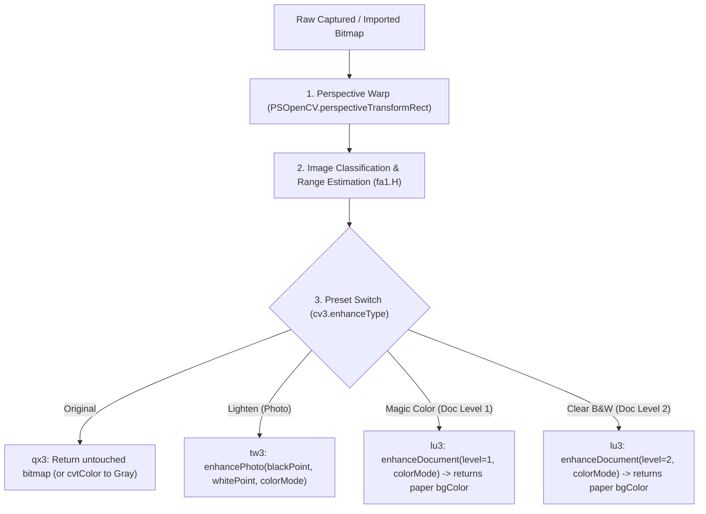

# Original Base APK Filter & Image Pipeline Specification

> **Context for Arena.ai & Antigravity**: Reverse-engineered ground truth extracted directly from `base.apk` (`com.indymobileapp.document.scanner`). All unmodified assets, raw resources, smali bytecode, and decompiled Java files are bundled in [`docs/original_apk_pipeline_artifacts.zip`](original_apk_pipeline_artifacts.zip). Use this specification to match the original app's exact behavior in our clean-room Kotlin implementation.

---

## 1. High-Level Architecture & Findings

1. **No External LUTs**:
   - The original app does **not** use 3D LUTs (`.cube`, `.bin`, `.png` color lookup tables).
   - There are zero LUT assets in `assets/` or `res/raw/`. All filtering is strictly algorithmic.
2. **Native OpenCV + TFLite Core**:
   - The app delegates core heavy lifting to OpenCV 4 (`libopencv_java4.so`) and a custom native library (`libimageproc.so`) via JNI (`PSOpenCV.java`).
   - Border detection utilizes a bundled neural network: `assets/border_detect_224.tflite` (224×224 quantized TFLite model) coupled with `PSOpenCV.detectPageBorder()` and IoU validation ($\ge 0.96$).
3. **Dual Dispatcher Design**:
   - Decompiled classes `bx.smali` (single page) and `bx3.smali` (batch processing) dispatch to three processor classes:
     - `qx3`: Original (passthrough) & Grayscale (`Imgproc.cvtColor`).
     - `tw3`: Lighten / Photo mode (`PSOpenCV.enhancePhoto`).
     - `lu3`: Document Level 1 (Magic Color) and Level 2 (Clear B&W) (`PSOpenCV.enhanceDocument`).

---

## 2. Pipeline Execution Order



---

## 3. Image Analysis & Histogram Estimation (`fa1.H`)

Before filtering, every page passes through `fa1.H(bitmap)` to extract image metadata ([PSImageEstimationInfoBean](file:///d:/Desktop/apk-rev/re-workspace/out/jadx/base_20261024_213011/sources/com/indymobile/app/model/PSImageEstimationInfoBean.java)):

1. **Downsample**:
   - The bitmap is scaled to **$100 \times 100$ pixels** (`Bitmap.createScaledBitmap(src, 100, 100, true)`), yielding exactly 10,000 sample pixels.
2. **4 Histograms** (256 bins each):
   - Luminance: $L = (R + G + B) / 3$
   - Red channel $R$
   - Green channel $G$
   - Blue channel $B$
3. **Document vs. Photo Pixel Classification**:
   - Constant thresholds (from `wv3.smali`):
     - `b = 80`, `c = 80`, `d = 70`
     - `e = 60`, `f = 100`, `g = 120`
   - **Document pixel condition**:
     $$R \ge 80 \quad \text{and} \quad G \ge 80 \quad \text{and} \quad B \ge 70$$
     $$|R - B| \le 110 \quad \text{and} \quad (B - 20) \le G \le (R + 20)$$
   - **Photo pixel condition**:
     $$R \ge 60 \quad \text{and} \quad G \ge 100 \quad \text{and} \quad B \ge 120$$
     $$R \le G \le B$$
   - **Classification Rule**:
     $$\text{docRatio} = \frac{\text{docPixels}}{\text{totalPixels}} \times 100.0$$
     $$\text{photoRatio} = \frac{\text{photoPixels}}{\text{totalPixels}} \times 100.0$$
     - If $\text{docRatio} > 60.0\%$ (or $\text{photoRatio} > 60.0\%$), classified as `PSImageTypeDocumentImage`.
     - Otherwise classified as `PSImageTypePhotoImage`.
4. **Dynamic Range Calculation (`blackPoint` & `whitePoint`)**:
   - **`blackPoint`**: Walk luminance histogram from 0 upwards until cumulative count $\ge 200$ (exactly the **2.0% shadow cutoff**).
   - **`whitePoint`**: Walk luminance histogram from 255 downwards until cumulative count $\ge 200$ (exactly the **top 2.0% highlight cutoff**).

---

## 4. Filter Implementation Details

### Presets Enum (`cv3.smali`):
- `kPSEnhanceTypeOriginal` (1, `"original"`)
- `kPSEnhanceTypeLighten` (2, `"photo"`)
- `kPSEnhanceTypeDocumentLevel1` (3, `"doc"`) ➔ **Magic Color**
- `kPSEnhanceTypeDocumentLevel2` (4, `"clear"`) ➔ **Clear B&W**

### Color Modes Enum (`yu3.smali`):
- `kPSColorTypeColor` (0, `"color"`) ➔ param = 1
- `kPSColorTypeGrayScale` (1, `"gray"`) ➔ param = 2

---

### A. Original Preset (`qx3.smali`)
- **Color mode**: Returns bitmap unaltered.
- **Grayscale mode**: Applies OpenCV `Imgproc.cvtColor`:
  - `COLOR_RGBA2GRAY` (or `COLOR_BGR2GRAY`)
  - Converted back to 8-bit ARGB_8888 bitmap.

### B. Lighten Preset (`tw3.smali`)
- Native call:
  ```java
  PSOpenCV.enhancePhoto(context, matSrc, matDst, (int)blackPoint, (int)whitePoint, colorMode);
  ```
- **Algorithm**:
  - Linear contrast/brightness stretch between the estimated `blackPoint` and `whitePoint`.
  - Maps pixel $I$ to $\text{clamp}\left(\frac{I - \text{blackPoint}}{\text{whitePoint} - \text{blackPoint}} \times 255, 0, 255\right)$.
  - Keeps photo color balance while brightening shadows.

### C. Magic Color / Document Level 1 (`lu3.smali`)
- Native call:
  ```java
  int packedBg = PSOpenCV.enhanceDocument(context, matSrc, matDst, level = 1, colorMode = 1);
  ```
- **Algorithm in C++ / OpenCV**:
  1. Paper background estimation (spatial illumination normalization):
     - Uses local morphology (dilation / max filtering) to estimate local paper brightness.
     - Divides local pixel values by the background estimate to remove cast shadows and gradients.
  2. White balance against estimated paper background color:
     - Unpacks returned `packedBg` as `(R << 16) | (G << 8) | B` (stored in `PSDocumentFilterInfo.bgColor`).
  3. Tone-curve enhancement:
     - Darkens text/ink strokes while pinning paper highlights to pure white (255).
     - Modest saturation boost for colored stamps, logos, and signatures.

### D. Clear B&W / Document Level 2 (`lu3.smali`)
- Native call:
  ```java
  int packedBg = PSOpenCV.enhanceDocument(context, matSrc, matDst, level = 2, colorMode = 2);
  ```
- **Algorithm in C++ / OpenCV**:
  1. Illumination normalization (same as Level 1).
  2. Dynamic adaptive thresholding / Otsu binarization over normalized luminance.
  3. Soft anti-aliased edge ramp (or morphological smoothing) so letter glyphs remain crisp without jagged 1-bit artifacts.

---

## 5. Border Detection Algorithm (`qt3.smali` & `assets/border_detect_224.tflite`)

1. Input image downsampled and fed to `border_detect_224.tflite`.
2. Initial quadrilateral extracted and refined with `PSOpenCV.detectPageBorder()`.
3. Validated with `PSOpenCV.calculateIOU(context, quad1, quad2)`:
   - Must achieve **IoU $\ge 0.96$** to be accepted as automated convergence.
   - Otherwise, user manual adjust corners mode is triggered.
