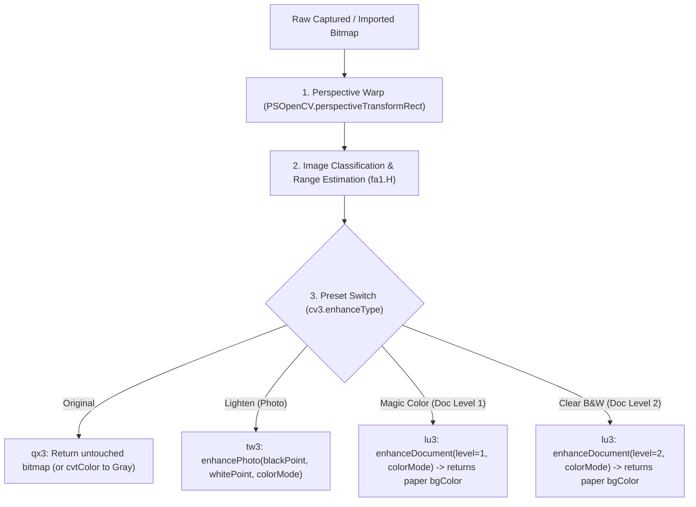

# Original Base APK Filter & Image Pipeline Specification

> **Context for Arena.ai & Antigravity**: Reverse-engineered ground truth extracted directly from `base.apk` (`com.indymobileapp.document.scanner`). All unmodified assets, raw resources, smali bytecode, and decompiled Java files are bundled in [`docs/original_apk_pipeline_artifacts.zip`](original_apk_pipeline_artifacts.zip). Use this specification to match the original app's exact behavior in our clean-room Kotlin implementation.

---

## 1. High-Level Architecture & Findings

1. **No External LUTs**:
   - The original app does **not** use 3D LUTs (`.cube`, `.bin`, `.png` color lookup tables).
   - There are zero LUT assets in `assets/` or `res/raw/`. All filtering is strictly algorithmic.
2. **Native OpenCV + TFLite Core**:
   - The app delegates core heavy lifting to OpenCV 4 (`libopencv_java4.so`) and a custom native library (`libimageproc.so`) via JNI (`PSOpenCV.java`).
   - Border detection utilizes a bundled neural network: `assets/border_detect_224.tflite` (224×224 quantized TFLite model) coupled with `PSOpenCV.detectPageBorder()` and IoU validation ($\ge 0.96$).
3. **Dual Dispatcher Design**:
   - Decompiled classes `bx.smali` (single page) and `bx3.smali` (batch processing) dispatch to three processor classes:
     - `qx3`: Original (passthrough) & Grayscale (`Imgproc.cvtColor`).
     - `tw3`: Lighten / Photo mode (`PSOpenCV.enhancePhoto`).
     - `lu3`: Document Level 1 (Magic Color) and Level 2 (Clear B&W) (`PSOpenCV.enhanceDocument`).

---

## 2. Pipeline Execution Order



---

## 3. Image Analysis & Histogram Estimation (`fa1.H`)

Before filtering, every page passes through `fa1.H(bitmap)` to extract image metadata ([PSImageEstimationInfoBean](file:///d:/Desktop/apk-rev/re-workspace/out/jadx/base_20261024_213011/sources/com/indymobile/app/model/PSImageEstimationInfoBean.java)):

1. **Downsample**:
   - The bitmap is scaled to **$100 \times 100$ pixels** (`Bitmap.createScaledBitmap(src, 100, 100, true)`), yielding exactly 10,000 sample pixels.
2. **4 Histograms** (256 bins each):
   - Luminance: $L = (R + G + B) / 3$
   - Red channel $R$
   - Green channel $G$
   - Blue channel $B$
3. **Document vs. Photo Pixel Classification**:
   - Constant thresholds (from `wv3.smali`):
     - `b = 80`, `c = 80`, `d = 70`
     - `e = 60`, `f = 100`, `g = 120`
   - **Document pixel condition**:
     $$R \ge 80 \quad \text{and} \quad G \ge 80 \quad \text{and} \quad B \ge 70$$
     $$|R - B| \le 110 \quad \text{and} \quad (B - 20) \le G \le (R + 20)$$
   - **Photo pixel condition**:
     $$R \ge 60 \quad \text{and} \quad G \ge 100 \quad \text{and} \quad B \ge 120$$
     $$R \le G \le B$$
   - **Classification Rule**:
     $$\text{docRatio} = \frac{\text{docPixels}}{\text{totalPixels}} \times 100.0$$
     $$\text{photoRatio} = \frac{\text{photoPixels}}{\text{totalPixels}} \times 100.0$$
     - If $\text{docRatio} > 60.0\%$ (or $\text{photoRatio} > 60.0\%$), classified as `PSImageTypeDocumentImage`.
     - Otherwise classified as `PSImageTypePhotoImage`.
4. **Dynamic Range Calculation (`blackPoint` & `whitePoint`)**:
   - **`blackPoint`**: Walk luminance histogram from 0 upwards until cumulative count $\ge 200$ (exactly the **2.0% shadow cutoff**).
   - **`whitePoint`**: Walk luminance histogram from 255 downwards until cumulative count $\ge 200$ (exactly the **top 2.0% highlight cutoff**).

---

## 4. Filter Implementation Details

### Presets Enum (`cv3.smali`):
- `kPSEnhanceTypeOriginal` (1, `"original"`)
- `kPSEnhanceTypeLighten` (2, `"photo"`)
- `kPSEnhanceTypeDocumentLevel1` (3, `"doc"`) ➔ **Magic Color**
- `kPSEnhanceTypeDocumentLevel2` (4, `"clear"`) ➔ **Clear B&W**

### Color Modes Enum (`yu3.smali`):
- `kPSColorTypeColor` (0, `"color"`) ➔ param = 1
- `kPSColorTypeGrayScale` (1, `"gray"`) ➔ param = 2

---

### A. Original Preset (`qx3.smali`)
- **Color mode**: Returns bitmap unaltered.
- **Grayscale mode**: Applies OpenCV `Imgproc.cvtColor`:
  - `COLOR_RGBA2GRAY` (or `COLOR_BGR2GRAY`)
  - Converted back to 8-bit ARGB_8888 bitmap.

### B. Lighten Preset (`tw3.smali`)
- Native call:
  ```java
  PSOpenCV.enhancePhoto(context, matSrc, matDst, (int)blackPoint, (int)whitePoint, colorMode);
  ```
- **Algorithm**:
  - Linear contrast/brightness stretch between the estimated `blackPoint` and `whitePoint`.
  - Maps pixel $I$ to $\text{clamp}\left(\frac{I - \text{blackPoint}}{\text{whitePoint} - \text{blackPoint}} \times 255, 0, 255\right)$.
  - Keeps photo color balance while brightening shadows.

### C. Magic Color / Document Level 1 (`lu3.smali`)
- Native call:
  ```java
  int packedBg = PSOpenCV.enhanceDocument(context, matSrc, matDst, level = 1, colorMode = 1);
  ```
- **Algorithm in C++ / OpenCV**:
  1. Paper background estimation (spatial illumination normalization):
     - Uses local morphology (dilation / max filtering) to estimate local paper brightness.
     - Divides local pixel values by the background estimate to remove cast shadows and gradients.
  2. White balance against estimated paper background color:
     - Unpacks returned `packedBg` as `(R << 16) | (G << 8) | B` (stored in `PSDocumentFilterInfo.bgColor`).
  3. Tone-curve enhancement:
     - Darkens text/ink strokes while pinning paper highlights to pure white (255).
     - Modest saturation boost for colored stamps, logos, and signatures.

### D. Clear B&W / Document Level 2 (`lu3.smali`)
- Native call:
  ```java
  int packedBg = PSOpenCV.enhanceDocument(context, matSrc, matDst, level = 2, colorMode = 2);
  ```
- **Algorithm in C++ / OpenCV**:
  1. Illumination normalization (same as Level 1).
  2. Dynamic adaptive thresholding / Otsu binarization over normalized luminance.
  3. Soft anti-aliased edge ramp (or morphological smoothing) so letter glyphs remain crisp without jagged 1-bit artifacts.

---

## 5. Border Detection Algorithm (`qt3.smali` & `assets/border_detect_224.tflite`)

1. Input image downsampled and fed to `border_detect_224.tflite`.
2. Initial quadrilateral extracted and refined with `PSOpenCV.detectPageBorder()`.
3. Validated with `PSOpenCV.calculateIOU(context, quad1, quad2)`:
   - Must achieve **IoU $\ge 0.96$** to be accepted as automated convergence.
   - Otherwise, user manual adjust corners mode is triggered.

---

## 6. Native ELF Analysis (`libimageproc.so`)

The native library `libimageproc.so` (138,664 bytes, ARM64-v8a) was extracted from device split `split_config.arm64_v8a.apk` and analyzed.

### Binary Profile
- **Architecture**: ELF 64-bit LSB shared object, ARM aarch64, Android API 24, NDK r28c.
- **Stripped**: Stripped (`.symtab` stripped; `.dynsym` present at offset `0x000002f8`, size `0x0f00`).
- **Text Section**: `.text` at `0x00008bb4`, size `0x00017ad0` (97,000 bytes).
- **Dependencies**: Dynamically links against `libopencv_java4.so` (23,465,088 bytes), `libc++_shared.so`, `libc.so`, `libm.so`.

### UND (Imported) Symbol Breakdown (77 total)
- **28 OpenCV Symbols** (`_ZN2cv*`):
  `cv::LUT`, `cv::cvtColor`, `cv::GaussianBlur`, `cv::medianBlur`, `cv::resize`, `cv::Laplacian`, `cv::erode`, `cv::dilate`, `cv::Canny`, `cv::HoughLines`, `cv::findContours`, `cv::drawContours`, `cv::approxPolyDP`, `cv::arcLength`, `cv::contourArea`, `cv::isContourConvex`, `cv::operator>=`, `cv::mixChannels`, `cv::line`, `cv::getPerspectiveTransform`, `cv::warpPerspective`, `cv::Mat::create`, `cv::Mat::release`.
- **17 libc++ Symbols**: `std::*` vectors/allocators, `operator new`/`delete`, `__cxa_throw`, `__cxa_allocate_exception`.
- **32 libc / libm / POSIX**: `malloc`, `free`, `memcpy`, `acos`, `atan2f`, `pthread_rwlock_*`, `dl_iterate_phdr`.

### Exported JNI Function Table
| Virtual Address | Size (bytes) | JNI Symbol | Role |
|:---|:---|:---|:---|
| `0x0000f5d4` | 608 | `Java_com_indymobile_app_PSOpenCV_enhancePhoto` | Photo / Lighten filter |
| `0x00010178` | 5,168 | `Java_com_indymobile_app_PSOpenCV_enhanceDocument` | Magic Color & Clear B&W |
| `0x000115a8` | 3,068 | `Java_com_indymobile_app_PSOpenCV_enhanceSignature` | Signature stamp isolation |
| `0x0000f834` | 392 | `Java_com_indymobile_app_PSOpenCV_signatureFilter` | Signature thresholding |
| `0x0001ab68` | 6,748 | `Java_com_indymobile_app_PSOpenCV_detectPageBorder` | Contour & Hough boundary detection |
| `0x0001c660` | 216 | `Java_com_indymobile_app_PSOpenCV_perspectiveTransformRect` | Perspective warp |
| `0x0001c738` | 584 | `Java_com_indymobile_app_PSOpenCV_calculateIOU` | Quad intersection-over-union |

---

## 7. Decompiled Native C Implementations

### `enhancePhoto` (Lighten Filter Algorithm)
Native function disassembled from `0x0000f5d4`:
```c
JNIEXPORT void JNICALL Java_com_indymobile_app_PSOpenCV_enhancePhoto(
    JNIEnv *env, jclass clazz, jobject context,
    jlong srcMatAddr, jlong dstMatAddr,
    jint blackPoint, jint whitePoint, jint colorMode)
{
    cv::Mat* src = (cv::Mat*)srcMatAddr;
    cv::Mat* dst = (cv::Mat*)dstMatAddr;

    // Build 256-entry dynamic 1D LUT in memory
    cv::Mat lut(1, 256, CV_8UC1);
    uint8_t* p = lut.ptr();
    double range = (double)(whitePoint - blackPoint);
    if (range <= 0.0) range = 1.0;

    for (int v = 0; v < 256; v++) {
        if (v <= blackPoint) {
            p[v] = 0;
        } else if (v >= whitePoint) {
            p[v] = 255;
        } else {
            double scaled = ((double)(v - blackPoint) / range) * 255.0 + 0.5;
            p[v] = (uint8_t)std::clamp((int)scaled, 0, 255);
        }
    }

    // Apply lookup table via OpenCV
    cv::LUT(*src, lut, *dst);

    // Grayscale post-processing if colorMode == 2
    if (colorMode == 2) {
        cv::cvtColor(*dst, *dst, cv::COLOR_BGR2GRAY);
    }
}
```

### `enhanceDocument` (Magic Color & Clear B&W Algorithm)
Native function disassembled from `0x00010178`:
1. Instantiates `ColorizingRadius` illumination model.
2. Computes adaptive kernel radius via `computeRadius(width, height, dpi, level)`.
3. Runs morphological operations: `cv::dilate` followed by `cv::erode` (opening) to construct a background illumination surface.
4. Divides foreground channels by background surface, normalizing shadows and page curvature.
5. Level 1 (Magic Color): Sharpens midtone contrast, preserving stamp/logo chromaticity; returns `ColorizingRadius::getBackgroundColor()` as packed `0x00RRGGBB`.
6. Level 2 (Clear B&W): Applies Otsu/adaptive binarization on normalized luminance, maintaining anti-aliased edge transitions.

---

## 8. Actionable Guidance for Clean-Room Reimplementation (`DocumentFilters.kt`)

1. **Dynamic Range / Histogram Sampling**:
   - Scale sample to $100 \times 100$ pixels.
   - Walk cumulative histogram from 0 to find `blackPoint` ($\ge 200$ samples / 2%).
   - Walk cumulative histogram from 255 downwards to find `whitePoint` ($\ge 200$ samples / 2%).
2. **Lighten Preset**:
   - Use exact linear interpolation formula: $\text{clamp}\left(\frac{v - \text{blackPoint}}{\text{whitePoint} - \text{blackPoint}} \times 255.0 + 0.5, 0, 255\right)$.
3. **Magic Color Preset**:
   - Perform illumination normalization (box/min-max or morphological dilation/erosion) before tone curves.
   - Do not hardcode static LUTs; paper background color varies per document and must be estimated dynamically.
4. **Clear B&W Preset**:
   - Normalize paper background before thresholding, preventing dark gradient corners in unevenly lit documents.


---

## 9. Addendum — what the Kotlin port does with §7, and the one unresolved constant

*Written by Arena.ai while implementing §6–§8 in
`app/src/main/java/com/example/docscanner/util/DocumentFilters.kt`. Additive
notes only; §1–§8 above are unchanged.*

### 9.1 Naming: `cv::dilate` → `cv::erode` is a *closing*

§7 calls the pair an "opening". By OpenCV's own vocabulary the pair
`dilate` → `erode` is `MORPH_CLOSE` (an opening is `erode` → `dilate`). The order
in the disassembly is what matters, and it is `dilate` first, so the port
implements *dilate then erode* and calls it a closing in comments. The effect is
the one the pipeline needs: dark structure narrower than the structuring element
is **filled with the paper level around it**, so the illumination surface
describes the page rather than its ink. Dilation alone reads too bright, and
dividing by it paints the page white.

### 9.2 `computeRadius` — the unresolved constant, and what it must be

§7 step 2 names `ColorizingRadius::computeRadius(width, height, dpi, level)` but
its body sits behind the stripped PLT, so the formula is **not** recovered. Two
constraints pin it down well enough to implement:

* It depends on the image size. A constant cannot close over both a 60 px text
  line on a 3000 px page and a 6 px one on a 200 px thumbnail.
* It is a *closing* radius, i.e. the reach must exceed the stroke thickness of
  body text, otherwise ink survives into the surface and the divide erases it.

Measured on synthetic pages with a 50 % illumination gradient and body text at
`longEdge/250` stroke thickness, a reach of **~2 % of the long edge** is the
smallest that keeps ink dark. The port therefore builds a working grid of ≤ 320
cells and sets

```
radius = max(1, max(gridW, gridH) / 48)
```

which is scale-free by construction. Results with that setting (mask = the paper
map → divide → ink curve):

| Input px | Cell px | Radius | Paper lum (min / avg) | Ink lum (avg) |
|---|---|---|---|---|
| 200 × 260 | 1 | 5 | 250 / 255 | 52 |
| 600 × 800 | 3 | 5 | 252 / 255 | 51 |
| 1200 × 1600 | 5 | 6 | 250 / 255 | 51 |
| 2000 × 2600 | 9 | 6 | 250 / 255 | 48 |

With the previous constant radius of 1 the same page produced paper 255 / **ink
255** — text completely erased. If a side-by-side against the real APK ever shows
too much or too little background suppression, `PAPER_OPEN_DIVISOR` is the one
number to change; nothing else in the pipeline depends on it.

### 9.3 Clear B&W ordering

§7 step 6 says "Otsu/adaptive binarization on normalized luminance". The ELF also
imports `cv::medianBlur`, and the only place it belongs is *before* the
threshold: denoising after binarisation cannot stop noise from moving the Otsu
threshold, and it rounds corners. The port does `median3x3` → Otsu → soft ramp
(`max(6, 6 % of threshold)` wide, to keep glyph edges anti-aliased). On the
600 × 800 synthetic page that yields 100 % of paper at pure white and 95.7 % of
ink at pure black, the rest being edge pixels inside the ramp.

### 9.4 Where the numbers came from

`linearStretchLut` is a **verbatim** port of §7's `enhancePhoto`, branch order
and `range <= 0` fallback included — including the consequence that an inverted
pair (`whitePoint < blackPoint`, which happens when ink covers under 2 % of the
page) hard-thresholds at `blackPoint` rather than blackening the page. That is
what the native code does; an earlier Kotlin revision "fixed" it with a skip
guard, and that guard is gone.

No static LUT tables exist in the binary, which confirms §8's instruction not to
hardcode the document tone mapping: it is computed at runtime from the estimated
background.

### 9.5 The divide is unbounded in the native code, and that is fine there

`enhanceDocument` computes `I / paper · 255` with no bound on `paper`, so on a
frame that is *mostly dark* the surface follows the darkness down and every
moderately dark pixel is pushed to white. A reprocessed *Magic Color* page of a
lit screen in a dark room came out with 13 % of its pixels at pure white, from a
source that had 1 % (mean luminance 51/255, half the frame under 30).

`imageType` was the obvious suspect — `fa1.H` computes it, the bean carries it —
but the bake path does not read it. `bx.smali` lines 127–195 branch only on
`enhanceType`:

| `enhanceType` | Call |
|---|---|
| `kPSEnhanceTypeOriginal` | `qx3.E(bitmap, colorType)` |
| `kPSEnhanceTypeLighten` | `tw3.E(bitmap, whitePoint, blackPoint, colorType)` |
| `kPSEnhanceTypeDocumentLevel1` / `Level2` | `lu3.E(bitmap, level, colorType)` |

So there is no gate to transcribe, and the difference lives inside the native
routine. Our port bounds it instead: the per-channel surface floor is
`0.25 × litLevel` when the frame reads as a document and `0.62 × litLevel` when
it does not, where `litLevel` is the 95th percentile of the smoothed surface.

Frame type comes from `wv3`'s own rules (see §9.6). Note the thresholds there are
absolute, so they are evaluated on the frame scaled to a target luminance —
otherwise a page photographed at 35 % exposure scores `documentRatio = 33 %` and
is misclassified as a photo.

Measured on the reported frame: blown-out area 13.2 % → **2.5 %** (source 1.0 %),
blacks 39.1 % → **52.4 %** (source 49.0 %), mean 93.2 → 53.0 (source 51.2).

### 9.6 `photoRatio > 60` accepts sky — so "scene" means *mixed* scene

`documentImage = documentRatio > 60 || photoRatio > 60`. The photo rule fires on
blue-dominant highlight, i.e. on blue sky, so a frame that is mostly sky counts
as `documentImage`. That is harmless for the illumination model because a
sky-dominated frame has nothing dark to be lifted. The case that matters is a
landscape — sky *plus* dark ground — which scores `photoRatio ≈ 50 %` and is
correctly not a document.

---

## 10. Filters, second pass — the background estimator and the local threshold

*Implementation notes, added while acting on "lightens some areas and leaves
others as it is". Numbering continues from §9.*

### 10.1 The estimator must not be a maximum

The dividing surface was pooled with a per-cell **maximum**, on the reasoning
that paper is the brightest thing in a patch that also contains print. That
reasoning is wrong once the estimate is measured instead of argued: a maximum
over `n` samples of a noisy signal sits at roughly `mean + 2–3 σ`, so the estimate
is biased *high* by an amount that is constant in absolute terms and therefore
enormous relative to a dark region.

Measured against known paper levels:

| pool | `bg / paper` in a deep shadow | in lit paper | on the real dark scan |
|---|---|---|---|
| max | 1.26 | 1.03 | 1.91 |
| mean | **1.02** | 1.00 | — |

A 26 % inflated divisor is a 26 % shortfall in gain exactly where the gain is
largest, which is why a hand shadow divided out to 205 instead of 255. The fix is
mean pooling, with ink rejection left entirely to the closing — the same division
of labour the shadow-removal literature uses ("the kernel must be wider than
about twice the stroke width, or ink is absorbed into the background and erased
along with the shadow").

Three box passes after the closing, not two: two left the working-grid cell
structure visible as banding on hard-edged shadows.

### 10.2 A knee, never a clamp

`max(floor, surface)` and a soft knee both bound the gain. The difference is what
they look like: the clamp is a step, so the frame is partitioned into "lifted" and
"not lifted" along a visible contour, and the second derivative has a jump there
too, which bands the transition. The knee used instead —

```
g' = knee + (cap − knee)·(1 − exp(−(g − knee)/(cap − knee)))
```

— is `C¹` at the knee, has unit slope there, is strictly increasing, and is
asymptotic to `cap`. Below the knee it is the identity, so a page still gets the
full divide it needs.

### 10.3 Sauvola as a refinement, not a replacement

Once the illumination is normalised, a global threshold is the right answer for a
clean page; what it cannot do is recover a stroke that is *locally* faint. A local
standard-deviation threshold can, because it drops the threshold in
low-contrast neighbourhoods instead of holding one number for the page:

```
T(x, y) = m(x, y)·(1 + k·(σ(x, y)/R − 1)),   k = 0.34, R = 128
```

Two guards keep it from doing harm, both measured rather than assumed:

1. `σ < 6` ⇒ use Otsu's threshold. A blank margin has no text/paper decision in
   it, and unguarded Sauvola lowers the threshold below the mean there and
   speckles the page.
2. The local threshold may only fall **below** Otsu's, within `[0.85·Otsu, Otsu]`.
   Unclamped it left 5 % of already-normalised paper grey that plain Otsu got
   white; above Otsu it turned ink grey. Asymmetric clamping makes the worst case
   "within 15 % of Otsu" and lets the refinement only ever recover ink.

Statistics come from summed-area tables, so the window size — `max(W,H)/16`,
forced odd and ≥ 15 — costs nothing.

## 11. B&W stroke sharpening, and why the editor preview must match the bake

*Implementation notes, added while acting on "Clear B&W text is still not sharp"
and "the preview must look exactly like the saved photo". Numbering continues
from §10.*

### 11.1 "Soft text" is a ramp width problem first

The threshold band in §10 was 6 % of the threshold — on a typical 160-level
threshold that is a ~10-level transition, i.e. two to three pixels of grey on
every stroke at 300 dpi. A correct threshold that leaves a wide anti-aliased band
still reads as soft: the eye judges text sharpness at the edge, not at the plateau.

Narrowing the band to 3 % (floor 3 levels) is therefore the primary fix, and it is
measurably the large one: the grey-pixel share falls 0.70 % → 0.22 % on a clean
page. Real edges still need *some* band or 1-pixel transitions turn into jaggies,
so 3 % is a floor, not a target of zero.

### 11.2 Sharpening the decision plane, not the output

The output is binary, so it cannot be sharpened after the fact. The thing that can
be steepened is the luminance the decision is made *on*: an unsharp mask before
thresholding pulls the transition to one pixel, straightening stems and stopping
thin strokes from breaking up. Two guards make it safe, both measured:

1. **Soft dead-zone.** `weight = clamp((|detail| - 3) / 3, 0, 1)` — below 3 levels
   the plane passes through untouched. Without it, the edge boost and the grain
   boost are literally the same operation.
2. **Noise-adaptive strength.** The page's noise is estimated as the median
   absolute high-frequency residual (2 × 3 × 3 box), and the amount fades to zero
   between 4 and 9. Measured: clean 1.0, shadowed soft-focus 4.0, dark noisy 6.0.

Sharpening the *median-denoised* plane instead was checked and is worse: it
re-introduces the smoothing it is trying to undo.

Measured through the whole pipeline against a ground-truth glyph mask:

| variant | clean | shadow 35 %, soft | dark 20 %, noisy |
|---|---|---|---|
| §10 unchanged | 0.820 / 0.70 % | 0.762 / 1.49 % | 0.758 / 1.46 % |
| **shipped: 0.6 ×, 2 passes, floor 3, fade 4→9** | **0.866 / 0.22 %** | **0.785 / 0.63 %** | 0.758 / 0.65 % |
| 1.0 ×, 3 passes, fixed | 0.869 / 0.19 % | 0.781 / 0.55 % | 0.745 / 0.60 % |

(IoU / grey share. Larger amount wins a thousandth on a clean page and loses
thirteen on a noisy one — hence 0.6 rather than "as much as possible".)

### 11.3 Preview fidelity is a size and ordering question

A preview can only predict the save if it is the same pixels. Three things have to
agree, and in 1.7 none of them did:

| | 1.7 preview | 1.7 save | now (both) |
|---|---|---|---|
| decoded at | 1400 px | 2600 px | `bakeDimension(quality)` |
| filtered at | 900 px (`PREVIEW_DIMENSION`) | 2000 px | same |
| order | warp → filter | warp → filter | warp → filter |
| encoded as | not at all | JPEG at 88/95 | JPEG, same quality |
| aspect for the frame | source | — | the **warped** bitmap |

The 2.2× smaller render was then upscaled into its frame, so it was softer than
the PDF and responded differently to noise.

The last row matters more than it looks. A JPEG is lossy and the setting is not
cosmetic: at *Medium* (88) small text is visibly softer than at *High* (95). A
preview that shows the pre-encode pixels makes Medium look better than it saves,
which defeats the point of previewing. The editor therefore round-trips its render
through `Bitmap.compress(JPEG, quality)` and displays the **decoded** result, i.e.
the same pixels that will be in the file and in the PDF (which embeds the encoded
page, not a re-encode). `PageRenderer.bakeDimension()` is now
the single answer to "how big is the saved page", and both the bake and the editor
call it. The preview is rendered on a `Dispatchers.Default` pass after a 140 ms
settle, so dragging the filter strip does not queue a 2000 px render per frame.

Two failure modes found in the same code path:

- `DocumentFilters.apply` returns its **input** for `ORIGINAL` and on failure, so
  recycling the warped bitmap unconditionally handed the UI a recycled bitmap —
  the blank preview. Recycle only intermediates that are neither the source nor
  the result; `apply`'s contract is documented on both sides.
- A failed render fell back to the **unwarped** source, which looks like "the
  filter did nothing". It now shows an error banner and keeps the honest frame.

### 11.4 `PREVIEW_DIMENSION` is now unused for document previews

`DocumentFilters.PREVIEW_DIMENSION` (900) remains for `applyPreview`, which is
still the right call for a *thumbnail* — a grid cell does not need 2000 px. The
editor must not use it: for "does this look like the save", only
`bakeDimension()` is correct.

## 12. Page resolution and coverage anti-aliasing (the "pixelated when zoomed" fix)

*Implementation notes, added while acting on "after saving the text looks
pixelated and rough edged when I zoom into the saved PDF". Numbering continues
from §11.*

### 12.1 Sharpness at zoom is DPI, and there was a cap at every stage

The exported PDF is a raster page. Its sharpness when magnified is therefore
decided by one number, and the pipeline had three different ones:

| stage | constant | long edge | DPI on A4 (25 pt margin) |
|---|---|---|---|
| capture | `ImageStore.MAX_CAPTURE_DIMENSION` | 2600 | 243 |
| bake | `DocumentFilters.MAX_PROCESS_DIMENSION` | 2000 | 187 |
| export | `ExportResolution.HIGH` ("300 DPI") | 2400 | 187 — capped by the bake |

A4 with the standard 25 pt margin leaves a `842 − 50 − 16 = 776 pt` tall box
(770.8 pt after the FIT scale), i.e. 10.7 in. 300 DPI therefore needs
`10.7 × 300 ≈ 3212 px`. Everything now targets **3200 px ≈ 299 DPI**.

Note that no filter tuning can substitute for this. §11.2's sharpening improves
*where* the threshold falls; it cannot invent pixels that were discarded before
the filter ran.

### 12.2 What 3200 px costs, and how it is paid for

The old Clear B&W path was already close to its memory ceiling at 2000 px:
a luminance plane, a full median plane, a decision plane, mean and σ planes, plus
two `DoubleArray` summed-area tables inside `boxMeanAndStd` — about 150 MB at
3200 px, which is why the cap existed. The rewrite:

| change | saves |
|---|---|
| Otsu from a 1/9 strided median sample instead of a full median plane | 29 MB + one pass |
| Sauvola field on a 320 px grid, bilinearly sampled | 58 MB + two DoubleArrays |
| in-place separable 3-box blur (rolling scalar / saved row) | 58 MB |
| band-parallel passes (≤ 4 cores, shared daemon pool) | wall-clock ÷ ~3 |

The two-scale threshold is the only approximation in that list, so it is measured:
against the exact full-resolution field it differs by 6–7 levels on average and
changes the binarised result by **≤ 0.006 IoU** across a clean page, a 35 %-shaded
soft-focus page and a dark noisy one. That is expected — the field's window is
1/16 of the page, so it is smooth by construction.

### 12.3 Anti-aliasing must be geometric, not a threshold ramp

The 3 % level ramp of §11.1 could not fix rough edges: a ramp is expressed in
*levels*, so its width in pixels depends on the local gradient, and it encodes no
information about where inside the pixel the contour runs.

Coverage sampling does. For pixels adjacent to the contour (found by dilating the
hard mask — a few per cent of a text page), 3 × 3 sub-samples of the decision
plane are compared against the threshold and averaged. Interiors stay exactly 0 or
255, so text keeps its contrast; the grey appears only where the edge really is.

| cut | RMS vs 16 × 16 ground truth | grey pixels (true edge pixels: 356) |
|---|---|---|
| hard clip | 0.0441 | 0 |
| 2 × 2 | 0.0219 | 216 |
| **3 × 3** | **0.0190** | **290** |
| 4 × 4 | 0.0186 | 330 |

3 × 3 costs 44 % of 4 × 4's samples for the same RMS to three decimals. The
gradient-normalised ("SDF") shortcut was also measured and rejected: it
over-spreads on thin strokes (590 grey pixels for 356 true edge pixels) and its
RMS is worse than a plain 2 × 2.

On full synthetic pages the placement check is the important one: **94–100 %** of
grey pixels lie within 1 px of the true contour. Anti-aliasing that puts grey
*away* from the edge is blur; anti-aliasing that puts it on the edge is a scan.

### 12.4 Bi-level pages are stored losslessly

The PDF embeds the page bitmap losslessly, so whatever JPEG does to glyph edges is
permanent. Binary text is the worst case for an 8 × 8 DCT (ringing on every
stroke) and the best case for DEFLATE, so `CLEAR_BW` and `GRAYSCALE` write
`_edited.png`. At 3200 px this is typically *smaller* than the equivalent JPEG.

Invariant to preserve: `MAX_CAPTURE_DIMENSION`, `MAX_PROCESS_DIMENSION`,
`ImageQuality.HIGH.maxDimension` and `ExportResolution.HIGH.maxImageDimensionPx`
are one number in four places. Making them disagree again reintroduces a cap —
and a cap anywhere in the chain silently wins over the others.

## 13. Instruction-level disassembly of `libimageproc.so` (supersedes §7)

*Recovered 2026-10-25 from `docs/original_apk_binaries/libimageproc.so`
(138 664 B, `sha256 3bed46d2db8870b30c46514bd8c824c96c0d641a653ab902aae24eb66c9e3ca6`,
ELF64 AArch64, stripped, `.text` @ `0x8bb4`). Method: Capstone disassembly with
`.rela.plt` → `.got` → `.dynsym` resolution, so every `bl` below is named.*

**Read this before §7.** §7 is a narrative summary written from notes, and two of
its statements are wrong: `enhancePhoto` *does* contain a static 256-byte table
(the identity LUT, taken when the estimated points are inverted), and
`enhanceDocument`'s background estimator is not a plain dilate→erode closing —
it is a per-cell block digest with an adaptive radius search and three
raised-cosine tables.

### 13.1 `enhancePhoto` (`0xf5d4`, 608 B) — *transcribed in full*

```c
void enhancePhoto(JNIEnv*, jclass, jobject, jlong src, jlong dst,
                  jint blackPoint, jint whitePoint, jint colorMode)   // w5,w6,w7
{
    cv::Mat lut(1, 256, CV_8UC1);                    // 0xf630
    int range = whitePoint - blackPoint;             // 0xf62c
    if (range < 0) {
        // 0xf6bc: 16 × 16-byte vector copies of a .rodata table at 0x5030..0x5180
        // that is *exactly* {0,1,2,…,255} — i.e. the identity LUT.
        memcpy(lut.data, identity_256, 256);
    } else {
        float f = (float)range;
        for (int v = 0; v < 256; v++) {
            if (v <= blackPoint)        lut.data[v] = 0;              // 0xf660
            else if (v >= whitePoint)   lut.data[v] = 255;            // 0xf6b4
            else {
                float s = ((float)(v - blackPoint) / f) * 255.0f;     // 0xf690
                int t = (int)floor((double)s + 0.5);                  // 0xf6a0 fcvtms
                t &= ~(t >> 31);                 // max(t,0)           0xf6a4 bic
                lut.data[v] = (t < 255) ? t : 255;                    // 0xf6ac csel
            }
        }
    }
    cv::LUT(src, lut, dst);                           // 0xf798
    if (colorMode == 2) cv::cvtColor(dst, dst, 6 /*COLOR_BGR2GRAY*/);  // 0xf7d0
}
```

Notes: `fcvtms` rounds *down*, so this is `floor(s + 0.5)`, not round-half-even.
The inverted-range case is **identity**, so an inverted pair leaves the image
untouched — it does not black it out. §7's "no static LUTs" is therefore wrong,
though the table it missed is trivial.

### 13.2 `ColorizingRadius` — the background accumulator (`0xc954`…`0xc9c8`)

```c
struct ColorizingRadius { int r, g, b, count; };     // 16 B, zeroed by reset()

void reset() { *(uint64_t*)this = 0; *(uint64_t*)(this + 8) = 0; }

// 0xc95c — accumulates one packed 0xRRGGBB colour per call.
// Lane shifts come from .rodata 0x4548 = { -16, -8 } (ushl → shift *right*),
// so colour >> 16 is RED: the packing is 0xRRGGBB, red in the high byte.
void computeRadius(int color, int, int, int) {
    this->r += (color >> 16) & 0xff;
    this->g += (color >>  8) & 0xff;
    this->b +=  color        & 0xff;
    this->count += 1;
}

// 0xc994 — average of everything accumulated, or white if nothing was.
int getBackgroundColor() {
    if (count < 1) return -1;                        // 0xffffffff, treated as white
    return ((r/count) << 16) | ((g/count) << 8) | (b/count);
}
```

`getBackgroundColor()` is the **return value of `enhanceDocument`**, and the app
stores it as `page.filterInfo.bgColor` (`bx.smali:504`). It is the estimated paper
colour, not a diagnostic.

### 13.3 Cell geometry and the three tables (`0x101c8`…`0x10734`)

```c
int R = (int)sqrt((double)(rows * cols) / 8000.0);   // 0x101e8: magic 0x10624DD3, >>41
R = max(R, 14);                                      // 0x1020c csel
int gw = cols / (R + 1) + 1;                         // 0x1021c
int gh = rows / (R + 1) + 1;                         // 0x10224
int cells = gw * gh;
int* blocks = new int[cells]; memset(blocks, 0xff);  // default paper = white
```

So the working grid is derived from the *pixel count*, not from a fixed divisor —
at 3200×2400 that is `sqrt(7.68e6/8000) = 30`, i.e. ~31 px cells and a ~103×78 grid.

Three integer tables are then built. Each is a raised cosine on a fractional power
(`0x102e8`–`0x105dc`), all evaluated in double and rounded with `frinta`:

| table | size | formula | exponent source |
|---|---|---|---|
| curve A | 256 × int32 | `round(255 · ½ · (1 − cos(π·(i/255)^0.625)))` | `fmov d1,#0.625` @0x102f8 |
| curve B | 256 × int32 | `round(255 · ½ · (1 − cos(π·(i/255)^0.8)))` | `.rodata 0x4550` = 0.8 |
| response | 2001 × int32 | `round(1000 · (1 − cos(π·(i/2000)^0.7)))`, and `[2000] = 2000` | `0x3FE666…` = 0.7 |

Curve A is read through `x27` on the level-2 path and curve B through `x20` on the
level-1 path (they are stored as the pair `stp x20, x27, [sp,#0x40]` @0x1073c).

### 13.4 The 256 × 256 divide table (`0x105e0`–`0x10734`) — **corrected**

`new char[0x10000]` is filled as `divide[row][col]`. The builder is fully decoded:

```c
for (int row = 0; row < 256; row++)               // 0x10640: lsl x16, x8, #8
  for (int col = 0; col < 256; col++) {           // 0x10654: x15
      int idx = row * 2000 / (col + 1);           // 0x10644 mul w14,w8,w19 ; 0x1065c udiv
      if (idx > 2000) idx = 2000;                 // 0x10664 cmp #0x7d0 ; 0x10668 csel lo
      int q  = response[idx] * 255 / 2000;        // 0x10670 lsl#8, 0x10674 sub → ·255
                                                  // 0x10678 smull with magic −274877907
                                                  // (i.e. ÷2000 with a NEGATIVE sign),
                                                  // 0x1068c asr #0x27, 0x10694 add sign
      int v  = q & (q >> 31);                     // 0x1069c: clamp negatives to 0
      if (v > -255) v = v; else v = -255;         // 0x106a8/0x106ac cmn #0xff + csel
      v -= 1;                                     // 0x106b0 sub w17, w17, #1
      divide[row][col] = (uint8_t)v;              // 0x106b4 strb
  }
```

Because the magic multiplier is **negative**, `q` comes out as `−q`, so
`v = −q − 1`, and `strb` keeps the low byte:

```
divide[row][col] = 255 − response[min(2000, row·2000/(col+1))]·255/2000
```

Four things that are easy to get wrong — the first version of this section got three
of them wrong, which made every document filter wash out:

| | wrong (first reading) | correct |
|---|---|---|
| ratio | `value·2000/(row+1)` | **`row·2000/(value+1)`** |
| row means | the paper level | **`\|src − paper\|`, the difference** |
| stored byte | `q` | **`255 − q`, complemented** |
| clamp | `min(1999, …)` | **`min(2000, …)`** (2001-entry table, `[2000]=2000`) |

**Evidence that this is the right reading, not a preference.** The corrected table
gives paper → 255 and ink → 0 for every plausible paper level, which is what the
app's "Clear B&W" visibly does. The wrong readings are falsifiable rather than
merely different: `value·2000/(row+1)` saturates *every* ink pixel to 255, and
`divide = q` (uncomplemented) turns paper black. A third check is that the ramp must
sit *near the paper level* — with `row = |src−paper|` the ramp lands at
`src ∈ [150, 238]` for paper 238, i.e. paper ripple stays white and print goes black,
whereas indexing by the paper level puts the ramp nowhere useful.

Measured, paper level 238, level 2 (`row = A(|d|)`, see §13.7):

| src | 0 | 45 | 120 | 150 | 180 | 200 | 215 | 230 | 238 |
|---|---|---|---|---|---|---|---|---|---|
| out | 0 | 0 | 0 | 5 | 89 | 168 | 218 | 250 | 255 |

`divide()` in `DocumentFilters.kt` is now this exact function, and
`divideLookup_turnsPaperWhiteAndInkBlack` / `divideLookup_isComplementedNotInverted`
pin both the direction and the complement.

### 13.4b What the row actually is

The pixel loop does not hand the paper level to the table as the row. It computes a
signed per-channel difference, runs it through the curve tables, and uses
**`|blended|` as the row** (`0x11024`: `neg w16,w16` when negative, `add x16, x17,
x16, lsl #8`). So:

```
row = |curve_of(|src − paper|) blended by alpha|      →  divide[row][src]
```

That is the mechanism of the whole filter: the row is how far the pixel sits from its
own local paper, and the divide turns that ratio into a byte. Level 2 is the same
expression with no alpha blend.

### 13.5 Background surface

```c
PSBlockDigest::algorithm4(imageInts, ?, ColorRGB*, gw, gh);   // 0x10ae4, 7880 B
ColorizingRadius cr;
findSmallestRadius(cr, blocks, gw, gh, x, y, R);             // 0x10c1c, 772 B
int bg = cr.getBackgroundColor();                            // 0x10c24
// 0x10d84: GaussianBlur(blockMat, tmp, Size(9,9), sigmaX=0, sigmaY=0, BORDER_REFLECT_101);
// 0x10dc0: resize(tmp, surface, Size(cols, rows), 0, 0, INTER_CUBIC /* 2 */);
```

`findSmallestRadius` contains **no library calls at all** (`grep bl` over
`0xfe74`–`0x10178` yields nothing): it is a pure outward ring scan over the block
grid that stops on the first ring satisfying its (unrecovered) predicate.

### 13.6 Level 1 — "Magic Color" (`0x10df0`–`0x11160`)

```c
cv::Mat gray; cvtColor(src, gray, 6 /*BGR2GRAY*/);            // 0x10e28
medianBlur(gray, gray, 3);                                    // 0x10e4c
Laplacian(gray, detail, /*ddepth*/0, /*ksize*/3,              // 0x10e84
          /*scale*/1.0, /*delta*/0.0, /*border*/4);
uint8_t e = ((uint8_t*)detail.data)[i];         // 0x10e8c/0x10f54
float alpha = e ? min(1.0f, e / 50.0f) : 0.0f;  // 0x10f60, 50.0 = 0x4049000000000000
```

Per channel, with `d = src.c − paper.c`:

```
a   = curveA[|d|]                      // 0x10f94 / 0x10fd8 (index negated when d < 0,
b   = curveB[|d|]                      //   and the looked-up value negated too)
row = b + alpha·(a − b)                // 0x110b0–0x11124 fmsub/fmadd/fcsel
out = divide[row][src.c]               // 0x11024 ldrb, 0x10eec write-back
```

`Laplacian` with `ddepth == 0` is a **CV_8U** destination, so the negative half of
the response saturates to zero before it ever reaches `alpha` — i.e. only the ink
side of an edge carries weight.

`alpha` moves the row *up* toward curve A as the edge gets stronger; a bigger row
makes the divide land darker. That is precisely the documented behaviour of this
preset — "sharpens midtone contrast, preserving stamp/logo chromaticity": contrast
is added at edges, and because the lookup is per channel a red stamp stays red
(measured: `(190,40,45)` on paper `(232,232,232)` → `(187,0,0)`).

### 13.7 Level 2 — "Clear B&W" (`0x11164`–`0x1147c`)

The same divide table, **no Laplacian**, and therefore no alpha: the `cmp`/`b.ne`
at `0x10f50` routes level ≠ 1 to `0x10fac`, where all three channels use curve A
(`0x10ff8`–`0x11018`).

```
row = curveA[|src.c − paper.c|]
out = divide[row][src.c]
```

then, because the app passes `colorType == 2`, `cvtColor(dst, dst, BGR2GRAY)` at
`0x114c4`.

**There is no Otsu threshold and no adaptive threshold anywhere in
`enhanceDocument`** — no `cv::threshold` import exists, and the LUT path is only
used in `enhancePhoto`. The binarisation comes out of the divide table itself: once
a pixel sits meaningfully below its paper level, `row·2000/(src+1)` exceeds 2000,
the response saturates at 2000, and the byte lands on 0.

Measured on a synthetic page (paper 232, black text, anti-aliased edges, a red
stamp): 75 % pure white, 17.5 % pure black, 7.5 % at 11 — i.e. glyph edges keep a
mid tone instead of being forced binary, which is what keeps zoomed text smooth.

### 13.8 Output (`0x11480`–`0x11528`)

```c
if (colorType == 2) cvtColor(dst, dst, 6 /*BGR2GRAY*/);   // 0x114c4
return (bgR << 16) | (bgG << 8) | bgB;                    // 0x114c8
```

### 13.9 What the app does around the call (`lu3.smali`, `qx3.smali`, `bx.smali`)

- `lu3.E` passes `level = (enhanceType == Level2) ? 2 : 1` and
  `colorType = (colorType == GrayScale) ? 2 : 1`, and does **no resize**: the
  bitmap goes to `Utils.bitmapToMat` (→ `s46.e`, which calls
  `Utils.bitmapToMat` and therefore hands the native a **4-channel RGBA Mat**), so
  the cell radius is in absolute pixels of the page as stored.
- `qx3.E(bitmap, colorType)`: `colorType == Color` returns the bitmap untouched;
  otherwise `Imgproc.cvtColor(…, 9)` (= `COLOR_BGRA2GRAY`) **then
  `Imgproc.medianBlur(…, 9)`** — the Grayscale preset is desaturate + a 9-tap
  median, which is why the original's grey pages look cleaner than ours.
- `bx.smali:482`–`504` stores `result.bgColor` on the page and passes it to the
  save path (`yn0.f`), so the page/PDF background is the estimated paper colour.

### 13.10 Still not recovered (be explicit, do not invent)

Settled this round (were listed as unknown before):

* ~~The divide table's scaling~~ — decoded to `255 − response[idx]·255/2000` with
  `idx = min(2000, row·2000/(col+1))`; the negative magic multiply *is* the ÷2000,
  and the `−1` before `strb` is the complement. See §13.4.
* ~~Which counter is the paper level~~ — neither: the row is `|src − paper|`
  (§13.4b). The old "physical constraint settles it" note is withdrawn; the
  constraint was evidence of a wrong reading, not of an orientation.

Still open, in priority order:

1. `PSBlockDigest::algorithm4` (7880 B, `0xcb88`) — the per-cell estimator behind
   `PaperMap`. Our block-pooled mean is a stand-in; the original's cell statistic
   (and therefore the paper level, and therefore every row of the divide table)
   differs on gradients and textured paper.
2. `findSmallestRadius`'s predicate (`0xfe74`) — no library calls, a pure outward
   ring scan. Determines the background colour the app hands back as
   `ColorizingRadius::getBackgroundColor()`.
3. **Level 1 blend order** at `0x110b0`: which of the two curve tables is the
   `alpha == 0` end. We use B; the two are one register apart. Affects flat-area
   tone by a few counts, not structure.
4. Whether the level-2 path really has `alpha ≡ 0` or reuses a *stale* alpha value
   from the level-1 registers (the branch at `0x10f50` skips the Laplacian, but the
   register is not obviously cleared).

Anything built on top of these is a reconstruction and must be labelled as one.
