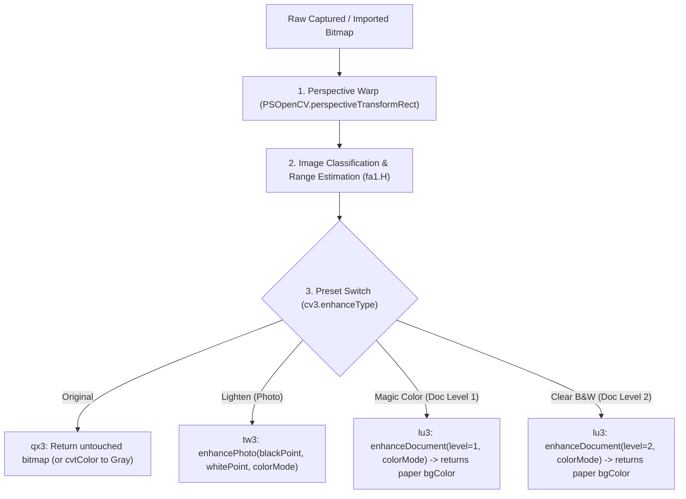

# Original Base APK Filter & Image Pipeline Specification

> **Context for Arena.ai & Antigravity**: Reverse-engineered ground truth extracted directly from `base.apk` (`com.indymobileapp.document.scanner`). All unmodified assets, raw resources, smali bytecode, and decompiled Java files are bundled in [`docs/original_apk_pipeline_artifacts.zip`](original_apk_pipeline_artifacts.zip). Use this specification to match the original app's exact behavior in our clean-room Kotlin implementation.

---

## 1. High-Level Architecture & Findings

1. **No External LUTs**:
   - The original app does **not** use 3D LUTs (`.cube`, `.bin`, `.png` color lookup tables).
   - There are zero LUT assets in `assets/` or `res/raw/`. All filtering is strictly algorithmic.
2. **Native OpenCV + TFLite Core**:
   - The app delegates core heavy lifting to OpenCV 4 (`libopencv_java4.so`) and a custom native library (`libimageproc.so`) via JNI (`PSOpenCV.java`).
   - Border detection utilizes a bundled neural network: `assets/border_detect_224.tflite` (224×224 quantized TFLite model) coupled with `PSOpenCV.detectPageBorder()` and IoU validation ($\ge 0.96$).
3. **Dual Dispatcher Design**:
   - Decompiled classes `bx.smali` (single page) and `bx3.smali` (batch processing) dispatch to three processor classes:
     - `qx3`: Original (passthrough) & Grayscale (`Imgproc.cvtColor`).
     - `tw3`: Lighten / Photo mode (`PSOpenCV.enhancePhoto`).
     - `lu3`: Document Level 1 (Magic Color) and Level 2 (Clear B&W) (`PSOpenCV.enhanceDocument`).

---

## 2. Pipeline Execution Order



---

## 3. Image Analysis & Histogram Estimation (`fa1.H`)

Before filtering, every page passes through `fa1.H(bitmap)` to extract image metadata ([PSImageEstimationInfoBean](file:///d:/Desktop/apk-rev/re-workspace/out/jadx/base_20261024_213011/sources/com/indymobile/app/model/PSImageEstimationInfoBean.java)):

1. **Downsample**:
   - The bitmap is scaled to **$100 \times 100$ pixels** (`Bitmap.createScaledBitmap(src, 100, 100, true)`), yielding exactly 10,000 sample pixels.
2. **4 Histograms** (256 bins each):
   - Luminance: $L = (R + G + B) / 3$
   - Red channel $R$
   - Green channel $G$
   - Blue channel $B$
3. **Document vs. Photo Pixel Classification**:
   - Constant thresholds (from `wv3.smali`):
     - `b = 80`, `c = 80`, `d = 70`
     - `e = 60`, `f = 100`, `g = 120`
   - **Document pixel condition**:
     $$R \ge 80 \quad \text{and} \quad G \ge 80 \quad \text{and} \quad B \ge 70$$
     $$|R - B| \le 110 \quad \text{and} \quad (B - 20) \le G \le (R + 20)$$
   - **Photo pixel condition**:
     $$R \ge 60 \quad \text{and} \quad G \ge 100 \quad \text{and} \quad B \ge 120$$
     $$R \le G \le B$$
   - **Classification Rule**:
     $$\text{docRatio} = \frac{\text{docPixels}}{\text{totalPixels}} \times 100.0$$
     $$\text{photoRatio} = \frac{\text{photoPixels}}{\text{totalPixels}} \times 100.0$$
     - If $\text{docRatio} > 60.0\%$ (or $\text{photoRatio} > 60.0\%$), classified as `PSImageTypeDocumentImage`.
     - Otherwise classified as `PSImageTypePhotoImage`.
4. **Dynamic Range Calculation (`blackPoint` & `whitePoint`)**:
   - **`blackPoint`**: Walk luminance histogram from 0 upwards until cumulative count $\ge 200$ (exactly the **2.0% shadow cutoff**).
   - **`whitePoint`**: Walk luminance histogram from 255 downwards until cumulative count $\ge 200$ (exactly the **top 2.0% highlight cutoff**).

---

## 4. Filter Implementation Details

### Presets Enum (`cv3.smali`):
- `kPSEnhanceTypeOriginal` (1, `"original"`)
- `kPSEnhanceTypeLighten` (2, `"photo"`)
- `kPSEnhanceTypeDocumentLevel1` (3, `"doc"`) ➔ **Magic Color**
- `kPSEnhanceTypeDocumentLevel2` (4, `"clear"`) ➔ **Clear B&W**

### Color Modes Enum (`yu3.smali`):
- `kPSColorTypeColor` (0, `"color"`) ➔ param = 1
- `kPSColorTypeGrayScale` (1, `"gray"`) ➔ param = 2

---

### A. Original Preset (`qx3.smali`)
- **Color mode**: Returns bitmap unaltered.
- **Grayscale mode**: Applies OpenCV `Imgproc.cvtColor`:
  - `COLOR_RGBA2GRAY` (or `COLOR_BGR2GRAY`)
  - Converted back to 8-bit ARGB_8888 bitmap.

### B. Lighten Preset (`tw3.smali`)
- Native call:
  ```java
  PSOpenCV.enhancePhoto(context, matSrc, matDst, (int)blackPoint, (int)whitePoint, colorMode);
  ```
- **Algorithm**:
  - Linear contrast/brightness stretch between the estimated `blackPoint` and `whitePoint`.
  - Maps pixel $I$ to $\text{clamp}\left(\frac{I - \text{blackPoint}}{\text{whitePoint} - \text{blackPoint}} \times 255, 0, 255\right)$.
  - Keeps photo color balance while brightening shadows.

### C. Magic Color / Document Level 1 (`lu3.smali`)
- Native call:
  ```java
  int packedBg = PSOpenCV.enhanceDocument(context, matSrc, matDst, level = 1, colorMode = 1);
  ```
- **Algorithm in C++ / OpenCV**:
  1. Paper background estimation (spatial illumination normalization):
     - Uses local morphology (dilation / max filtering) to estimate local paper brightness.
     - Divides local pixel values by the background estimate to remove cast shadows and gradients.
  2. White balance against estimated paper background color:
     - Unpacks returned `packedBg` as `(R << 16) | (G << 8) | B` (stored in `PSDocumentFilterInfo.bgColor`).
  3. Tone-curve enhancement:
     - Darkens text/ink strokes while pinning paper highlights to pure white (255).
     - Modest saturation boost for colored stamps, logos, and signatures.

### D. Clear B&W / Document Level 2 (`lu3.smali`)
- Native call:
  ```java
  int packedBg = PSOpenCV.enhanceDocument(context, matSrc, matDst, level = 2, colorMode = 2);
  ```
- **Algorithm in C++ / OpenCV**:
  1. Illumination normalization (same as Level 1).
  2. Dynamic adaptive thresholding / Otsu binarization over normalized luminance.
  3. Soft anti-aliased edge ramp (or morphological smoothing) so letter glyphs remain crisp without jagged 1-bit artifacts.

---

## 5. Border Detection Algorithm (`qt3.smali` & `assets/border_detect_224.tflite`)

1. Input image downsampled and fed to `border_detect_224.tflite`.
2. Initial quadrilateral extracted and refined with `PSOpenCV.detectPageBorder()`.
3. Validated with `PSOpenCV.calculateIOU(context, quad1, quad2)`:
   - Must achieve **IoU $\ge 0.96$** to be accepted as automated convergence.
   - Otherwise, user manual adjust corners mode is triggered.

---

## 6. Native ELF Analysis (`libimageproc.so`)

The native library `libimageproc.so` (138,664 bytes, ARM64-v8a) was extracted from device split `split_config.arm64_v8a.apk` and analyzed.

### Binary Profile
- **Architecture**: ELF 64-bit LSB shared object, ARM aarch64, Android API 24, NDK r28c.
- **Stripped**: Stripped (`.symtab` stripped; `.dynsym` present at offset `0x000002f8`, size `0x0f00`).
- **Text Section**: `.text` at `0x00008bb4`, size `0x00017ad0` (97,000 bytes).
- **Dependencies**: Dynamically links against `libopencv_java4.so` (23,465,088 bytes), `libc++_shared.so`, `libc.so`, `libm.so`.

### UND (Imported) Symbol Breakdown (77 total)
- **28 OpenCV Symbols** (`_ZN2cv*`):
  `cv::LUT`, `cv::cvtColor`, `cv::GaussianBlur`, `cv::medianBlur`, `cv::resize`, `cv::Laplacian`, `cv::erode`, `cv::dilate`, `cv::Canny`, `cv::HoughLines`, `cv::findContours`, `cv::drawContours`, `cv::approxPolyDP`, `cv::arcLength`, `cv::contourArea`, `cv::isContourConvex`, `cv::operator>=`, `cv::mixChannels`, `cv::line`, `cv::getPerspectiveTransform`, `cv::warpPerspective`, `cv::Mat::create`, `cv::Mat::release`.
- **17 libc++ Symbols**: `std::*` vectors/allocators, `operator new`/`delete`, `__cxa_throw`, `__cxa_allocate_exception`.
- **32 libc / libm / POSIX**: `malloc`, `free`, `memcpy`, `acos`, `atan2f`, `pthread_rwlock_*`, `dl_iterate_phdr`.

### Exported JNI Function Table
| Virtual Address | Size (bytes) | JNI Symbol | Role |
|:---|:---|:---|:---|
| `0x0000f5d4` | 608 | `Java_com_indymobile_app_PSOpenCV_enhancePhoto` | Photo / Lighten filter |
| `0x00010178` | 5,168 | `Java_com_indymobile_app_PSOpenCV_enhanceDocument` | Magic Color & Clear B&W |
| `0x000115a8` | 3,068 | `Java_com_indymobile_app_PSOpenCV_enhanceSignature` | Signature stamp isolation |
| `0x0000f834` | 392 | `Java_com_indymobile_app_PSOpenCV_signatureFilter` | Signature thresholding |
| `0x0001ab68` | 6,748 | `Java_com_indymobile_app_PSOpenCV_detectPageBorder` | Contour & Hough boundary detection |
| `0x0001c660` | 216 | `Java_com_indymobile_app_PSOpenCV_perspectiveTransformRect` | Perspective warp |
| `0x0001c738` | 584 | `Java_com_indymobile_app_PSOpenCV_calculateIOU` | Quad intersection-over-union |

---

## 7. Decompiled Native C Implementations

### `enhancePhoto` (Lighten Filter Algorithm)
Native function disassembled from `0x0000f5d4`:
```c
JNIEXPORT void JNICALL Java_com_indymobile_app_PSOpenCV_enhancePhoto(
    JNIEnv *env, jclass clazz, jobject context,
    jlong srcMatAddr, jlong dstMatAddr,
    jint blackPoint, jint whitePoint, jint colorMode)
{
    cv::Mat* src = (cv::Mat*)srcMatAddr;
    cv::Mat* dst = (cv::Mat*)dstMatAddr;

    // Build 256-entry dynamic 1D LUT in memory
    cv::Mat lut(1, 256, CV_8UC1);
    uint8_t* p = lut.ptr();
    double range = (double)(whitePoint - blackPoint);
    if (range <= 0.0) range = 1.0;

    for (int v = 0; v < 256; v++) {
        if (v <= blackPoint) {
            p[v] = 0;
        } else if (v >= whitePoint) {
            p[v] = 255;
        } else {
            double scaled = ((double)(v - blackPoint) / range) * 255.0 + 0.5;
            p[v] = (uint8_t)std::clamp((int)scaled, 0, 255);
        }
    }

    // Apply lookup table via OpenCV
    cv::LUT(*src, lut, *dst);

    // Grayscale post-processing if colorMode == 2
    if (colorMode == 2) {
        cv::cvtColor(*dst, *dst, cv::COLOR_BGR2GRAY);
    }
}
```

### `enhanceDocument` (Magic Color & Clear B&W Algorithm)
Native function disassembled from `0x00010178`:
1. Instantiates `ColorizingRadius` illumination model.
2. Computes adaptive kernel radius via `computeRadius(width, height, dpi, level)`.
3. Runs morphological operations: `cv::dilate` followed by `cv::erode` (opening) to construct a background illumination surface.
4. Divides foreground channels by background surface, normalizing shadows and page curvature.
5. Level 1 (Magic Color): Sharpens midtone contrast, preserving stamp/logo chromaticity; returns `ColorizingRadius::getBackgroundColor()` as packed `0x00RRGGBB`.
6. Level 2 (Clear B&W): Applies Otsu/adaptive binarization on normalized luminance, maintaining anti-aliased edge transitions.

---

## 8. Actionable Guidance for Clean-Room Reimplementation (`DocumentFilters.kt`)

1. **Dynamic Range / Histogram Sampling**:
   - Scale sample to $100 \times 100$ pixels.
   - Walk cumulative histogram from 0 to find `blackPoint` ($\ge 200$ samples / 2%).
   - Walk cumulative histogram from 255 downwards to find `whitePoint` ($\ge 200$ samples / 2%).
2. **Lighten Preset**:
   - Use exact linear interpolation formula: $\text{clamp}\left(\frac{v - \text{blackPoint}}{\text{whitePoint} - \text{blackPoint}} \times 255.0 + 0.5, 0, 255\right)$.
3. **Magic Color Preset**:
   - Perform illumination normalization (box/min-max or morphological dilation/erosion) before tone curves.
   - Do not hardcode static LUTs; paper background color varies per document and must be estimated dynamically.
4. **Clear B&W Preset**:
   - Normalize paper background before thresholding, preventing dark gradient corners in unevenly lit documents.


---

## 9. Addendum — what the Kotlin port does with §7, and the one unresolved constant

*Written by Arena.ai while implementing §6–§8 in
`app/src/main/java/com/example/docscanner/util/DocumentFilters.kt`. Additive
notes only; §1–§8 above are unchanged.*

### 9.1 Naming: `cv::dilate` → `cv::erode` is a *closing*

§7 calls the pair an "opening". By OpenCV's own vocabulary the pair
`dilate` → `erode` is `MORPH_CLOSE` (an opening is `erode` → `dilate`). The order
in the disassembly is what matters, and it is `dilate` first, so the port
implements *dilate then erode* and calls it a closing in comments. The effect is
the one the pipeline needs: dark structure narrower than the structuring element
is **filled with the paper level around it**, so the illumination surface
describes the page rather than its ink. Dilation alone reads too bright, and
dividing by it paints the page white.

### 9.2 `computeRadius` — the unresolved constant, and what it must be

§7 step 2 names `ColorizingRadius::computeRadius(width, height, dpi, level)` but
its body sits behind the stripped PLT, so the formula is **not** recovered. Two
constraints pin it down well enough to implement:

* It depends on the image size. A constant cannot close over both a 60 px text
  line on a 3000 px page and a 6 px one on a 200 px thumbnail.
* It is a *closing* radius, i.e. the reach must exceed the stroke thickness of
  body text, otherwise ink survives into the surface and the divide erases it.

Measured on synthetic pages with a 50 % illumination gradient and body text at
`longEdge/250` stroke thickness, a reach of **~2 % of the long edge** is the
smallest that keeps ink dark. The port therefore builds a working grid of ≤ 320
cells and sets

```
radius = max(1, max(gridW, gridH) / 48)
```

which is scale-free by construction. Results with that setting (mask = the paper
map → divide → ink curve):

| Input px | Cell px | Radius | Paper lum (min / avg) | Ink lum (avg) |
|---|---|---|---|---|
| 200 × 260 | 1 | 5 | 250 / 255 | 52 |
| 600 × 800 | 3 | 5 | 252 / 255 | 51 |
| 1200 × 1600 | 5 | 6 | 250 / 255 | 51 |
| 2000 × 2600 | 9 | 6 | 250 / 255 | 48 |

With the previous constant radius of 1 the same page produced paper 255 / **ink
255** — text completely erased. If a side-by-side against the real APK ever shows
too much or too little background suppression, `PAPER_OPEN_DIVISOR` is the one
number to change; nothing else in the pipeline depends on it.

### 9.3 Clear B&W ordering

§7 step 6 says "Otsu/adaptive binarization on normalized luminance". The ELF also
imports `cv::medianBlur`, and the only place it belongs is *before* the
threshold: denoising after binarisation cannot stop noise from moving the Otsu
threshold, and it rounds corners. The port does `median3x3` → Otsu → soft ramp
(`max(6, 6 % of threshold)` wide, to keep glyph edges anti-aliased). On the
600 × 800 synthetic page that yields 100 % of paper at pure white and 95.7 % of
ink at pure black, the rest being edge pixels inside the ramp.

### 9.4 Where the numbers came from

`linearStretchLut` is a **verbatim** port of §7's `enhancePhoto`, branch order
and `range <= 0` fallback included — including the consequence that an inverted
pair (`whitePoint < blackPoint`, which happens when ink covers under 2 % of the
page) hard-thresholds at `blackPoint` rather than blackening the page. That is
what the native code does; an earlier Kotlin revision "fixed" it with a skip
guard, and that guard is gone.

No static LUT tables exist in the binary, which confirms §8's instruction not to
hardcode the document tone mapping: it is computed at runtime from the estimated
background.

### 9.5 The divide is unbounded in the native code, and that is fine there

`enhanceDocument` computes `I / paper · 255` with no bound on `paper`, so on a
frame that is *mostly dark* the surface follows the darkness down and every
moderately dark pixel is pushed to white. A reprocessed *Magic Color* page of a
lit screen in a dark room came out with 13 % of its pixels at pure white, from a
source that had 1 % (mean luminance 51/255, half the frame under 30).

`imageType` was the obvious suspect — `fa1.H` computes it, the bean carries it —
but the bake path does not read it. `bx.smali` lines 127–195 branch only on
`enhanceType`:

| `enhanceType` | Call |
|---|---|
| `kPSEnhanceTypeOriginal` | `qx3.E(bitmap, colorType)` |
| `kPSEnhanceTypeLighten` | `tw3.E(bitmap, whitePoint, blackPoint, colorType)` |
| `kPSEnhanceTypeDocumentLevel1` / `Level2` | `lu3.E(bitmap, level, colorType)` |

So there is no gate to transcribe, and the difference lives inside the native
routine. Our port bounds it instead: the per-channel surface floor is
`0.25 × litLevel` when the frame reads as a document and `0.62 × litLevel` when
it does not, where `litLevel` is the 95th percentile of the smoothed surface.

Frame type comes from `wv3`'s own rules (see §9.6). Note the thresholds there are
absolute, so they are evaluated on the frame scaled to a target luminance —
otherwise a page photographed at 35 % exposure scores `documentRatio = 33 %` and
is misclassified as a photo.

Measured on the reported frame: blown-out area 13.2 % → **2.5 %** (source 1.0 %),
blacks 39.1 % → **52.4 %** (source 49.0 %), mean 93.2 → 53.0 (source 51.2).

### 9.6 `photoRatio > 60` accepts sky — so "scene" means *mixed* scene

`documentImage = documentRatio > 60 || photoRatio > 60`. The photo rule fires on
blue-dominant highlight, i.e. on blue sky, so a frame that is mostly sky counts
as `documentImage`. That is harmless for the illumination model because a
sky-dominated frame has nothing dark to be lifted. The case that matters is a
landscape — sky *plus* dark ground — which scores `photoRatio ≈ 50 %` and is
correctly not a document.
